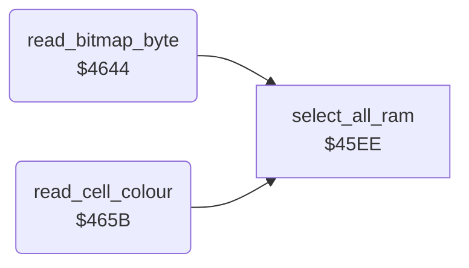

<!-- Generated by c64-docs from knowledge revision 20261025T214624.065-e5whe4 and .c64-re-tools/local/generated/src/source-map.json. Do not edit: change the knowledge, generate the source again, then run docs.ts generate. -->
# graphics/read_pixel.asm: Bitmap and Colour Reads in All RAM

Range `$4644-$4683`. Source: [graphics/read_pixel.asm](../../../../src/graphics/read_pixel.asm). Index: [the reference](../../index.md).

## Routines

| Routine | Address | Reached from | Summary |
|---|---|---|---|
| [`read_bitmap_byte`](read_pixel.md#read_bitmap_byte) | `$4644` | [`jmp_read_bitmap_byte`](../script/interpreter.md#jmp_read_bitmap_byte) | Reads the byte at bitmap_byte_ptr with all RAM (no ROM, no I/O) into bitmap_byte. |
| [`read_cell_colour`](read_pixel.md#read_cell_colour) | `$465B` | [`jmp_read_cell_colour`](../script/interpreter.md#jmp_read_cell_colour) | Reads a colour byte of a cell with all RAM (no ROM, no I/O) into current_colour. |

## Call graph

A solid arrow is a call, a thick arrow a table entry. Rounded nodes are in this file.

## Details

### [`read_bitmap_byte`](../../../../src/graphics/read_pixel.asm#L6) `$4644`

*routine*

Reads the byte at bitmap_byte_ptr with all RAM (no ROM, no I/O) into bitmap_byte. The code at $3619 calls it through jmp_read_bitmap_byte.

- **Jumped to from:** [`jmp_read_bitmap_byte`](../script/interpreter.md#jmp_read_bitmap_byte)
- **Entry of:** [`run_script`](../../tables.md#run_script)
- **Calls:** [`select_all_ram`](../script/opcodes.md#select_all_ram)
- **Jumps to:** [`select_roms_io`](../script/opcodes.md#select_roms_io)
- **Reads:** [`source_byte_ptr`](../../memory-map.md#source_byte_ptr), [`plot_vector`](../../memory-map.md#plot_vector)
- **Writes:** [`plot_vector`](../../memory-map.md#plot_vector), [`source_byte`](../../memory-map.md#source_byte)

### [`read_cell_colour`](../../../../src/graphics/read_pixel.asm#L17) `$465B`

*routine*

Reads a colour byte of a cell with all RAM (no ROM, no I/O) into current_colour. Input X: pixel value; 3 reads through cell_colour_ptr, else through cell_screen_ptr. The caller takes the nybble.

- **Jumped to from:** [`jmp_read_cell_colour`](../script/interpreter.md#jmp_read_cell_colour)
- **Entry of:** [`run_script`](../../tables.md#run_script)
- **Calls:** [`select_all_ram`](../script/opcodes.md#select_all_ram)
- **Jumps to:** [`select_roms_io`](../script/opcodes.md#select_roms_io)
- **Reads:** [`source_screen_ptr`](../../memory-map.md#source_screen_ptr), [`plot_vector`](../../memory-map.md#plot_vector), [`source_colour_ptr`](../../memory-map.md#source_colour_ptr)
- **Writes:** [`plot_vector`](../../memory-map.md#plot_vector), [`current_colour`](../../memory-map.md#current_colour)

| Label | Address | Comment |
|---|---|---|
| [`read_cell_colour_ram`](../../../../src/graphics/read_pixel.asm#L29) | `$4673` |  |
| [`read_cell_colour_store`](../../../../src/graphics/read_pixel.asm#L35) | `$467F` |  |
