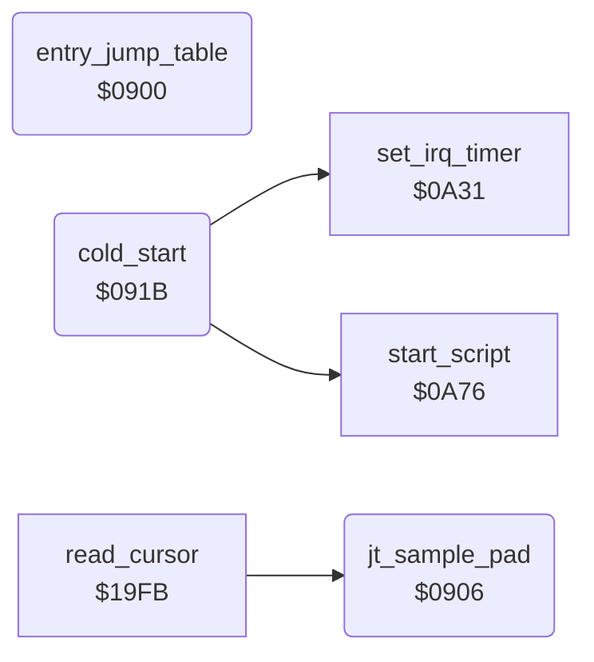

<!-- Generated by c64-docs from knowledge revision 20261025T214624.065-e5whe4 and .c64-re-tools/local/generated/src/source-map.json. Do not edit: change the knowledge, generate the source again, then run docs.ts generate. -->
# init/entry.asm: Entry JMP Table and Cold Start

Range `$0900-$0942`. Source: [init/entry.asm](../../../../src/init/entry.asm). Index: [the reference](../../index.md).

## Routines

| Routine | Address | Reached from | Summary |
|---|---|---|---|
| [`entry_jump_table`](entry.md#entry_jump_table) | `$0900` |  | JMP table at the start of the program. |
| [`jt_sample_pad`](entry.md#jt_sample_pad) | `$0906` | [`read_cursor`](../input/cursor.md#read_cursor) | JMP table entry: sample_pad. |
| [`cold_start`](entry.md#cold_start) | `$091B` |  | Cold start: stops the interrupts, sets the CIA 1 timer interrupt and the BRK and IRQ vectors, then runs the start-up script at $1e1a (through start_script). |

## Data

| Range | Type | Name | Read by | Written by |
|---|---|---|---|---|
| [`$0900`](../../../../src/init/entry.asm#L7)-`$091A` | jumps | [`entry_jump_table`](../../../../src/init/entry.asm#L6) |  |  |

## Call graph

A solid arrow is a call, a thick arrow a table entry. Rounded nodes are in this file.

## Details

### [`entry_jump_table`](../../../../src/init/entry.asm#L6) `$0900`

*routine*

JMP table at the start of the program. $0900 cold_start (the entry), $0903 $1c62, $0906 sample_pad, $0909 an RTS, $090c wait_jiffies, $090f hit_test, $0912 $1525, $0915 $18b8, $0918 $279e. The program uses only $0900 and $0906 (from read_cursor).

- **Jumps to:** [`cold_start`](entry.md#cold_start), [`wait_for_hit`](../input/hit_test.md#wait_for_hit)

### [`jt_sample_pad`](../../../../src/init/entry.asm#L11) `$0906`

*routine*

JMP table entry: sample_pad. read_cursor calls it.

- **Called from:** [`read_cursor`](../input/cursor.md#read_cursor)
- **Jumps to:** [`sample_pad`](../input/pad_smoothing.md#sample_pad), [`null_routine`](../input/buttons.md#null_routine), [`wait_jiffies`](../input/buttons.md#wait_jiffies), [`hit_test`](../input/hit_test_1c85.md#hit_test), [`get_colour_slot`](../graphics/colour_slots.md#get_colour_slot), [`plot_pixel_bits`](../graphics/pixel.md#plot_pixel_bits), [`draw_line`](../graphics/bresenham_line.md#draw_line)

| Label | Address | Comment |
|---|---|---|
| [`jt_plot_pixel_bits`](../../../../src/init/entry.asm#L18) | `$0915` |  |
| [`jt_draw_line`](../../../../src/init/entry.asm#L20) | `$0918` |  |

### [`cold_start`](../../../../src/init/entry.asm#L23) `$091B`

*routine*

Cold start: stops the interrupts, sets the CIA 1 timer interrupt and the BRK and IRQ vectors, then runs the start-up script at $1e1a (through start_script).

- **Jumped to from:** [`entry_jump_table`](entry.md#entry_jump_table)
- **Entry of:** [`entry_jump_table`](../../tables.md#entry_jump_table)
- **Calls:** [`set_irq_timer`](screen.md#set_irq_timer), [`start_script`](start.md#start_script)
- **Jumps to:** [`start_main`](start.md#start_main)
- **Writes:** [`CIACRA`](../../memory-map.md#CIACRA), [`CIAICR`](../../memory-map.md#CIAICR), [`CBINV`](../../memory-map.md#CBINV), [`CINV`](../../memory-map.md#CINV)
