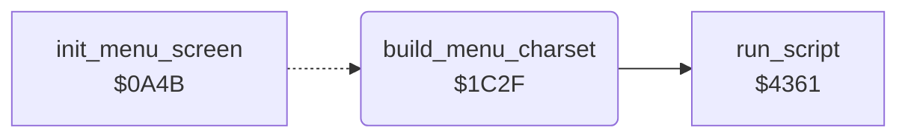

<!-- Generated by c64-docs from knowledge revision 20261024T063946.176-sfrhxb and .c64-re-tools/local/generated/src/source-map.json. Do not edit: change the knowledge, generate the source again, then run docs.ts generate. -->
# init/menu_charset.asm: Menu Character Set Setup

Range `$1C2F-$1C61`. Source: [init/menu_charset.asm](../../../../src/init/menu_charset.asm). Index: [the reference](../../index.md).

## Call graph

A solid arrow is a call, a thick arrow a table entry, a dotted arrow a jump. Rounded nodes are in this file.

## Names

### [`build_menu_charset`](../../../../src/init/menu_charset.asm#L6) `$1C2F`

*routine*

Sets the border black and blanks the screen ($d011 = $0b). With the character ROM visible, it runs menu_charset_script (charset at $5000). Then it selects screen $5c00 and charset $5000 ($d018 = $74) in VIC bank 1 ($dd00).

- **Jumped to from:** [`init_menu_screen`](screen.md#init_menu_screen) [`$0A5A`](../../../../src/init/screen.asm#L32)
- **Calls:** [`run_script`](../script/interpreter.md#run_script)
- **Reads:** [`R6510`](../../memory-map.md#R6510), [`CI2DDRA`](../../memory-map.md#CI2DDRA), [`CI2PRA`](../../memory-map.md#CI2PRA)
- **Writes:** [`EXTCOL`](../../memory-map.md#EXTCOL), [`SCROLY`](../../memory-map.md#SCROLY), [`R6510`](../../memory-map.md#R6510), [`VMCSB`](../../memory-map.md#VMCSB), [`CI2DDRA`](../../memory-map.md#CI2DDRA), [`CI2PRA`](../../memory-map.md#CI2PRA)
