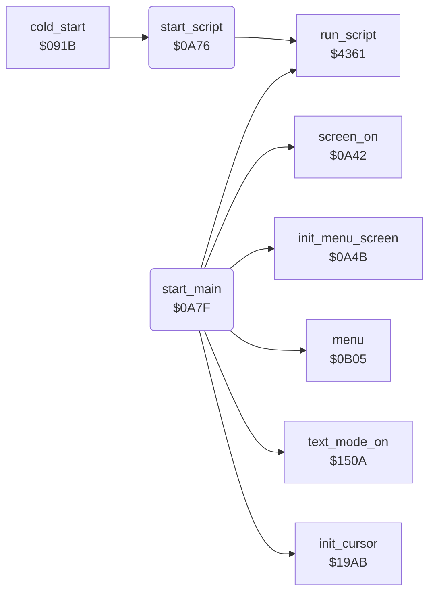

<!-- Generated by c64-docs from knowledge revision 20261025T214624.065-e5whe4 and .c64-re-tools/local/generated/src/source-map.json. Do not edit: change the knowledge, generate the source again, then run docs.ts generate. -->
# init/start.asm: Start-up

Range `$0A76-$0A9A`. Source: [init/start.asm](../../../../src/init/start.asm). Index: [the reference](../../index.md).

## Routines

| Routine | Address | Reached from | Summary |
|---|---|---|---|
| [`start_script`](start.md#start_script) | `$0A76` | [`cold_start`](entry.md#cold_start) | Runs the start-up script at $1e1a. |
| [`start_main`](start.md#start_main) | `$0A7F` | [`cold_start`](entry.md#cold_start), [`disk_protection`](../protection/disk_protection.md#disk_protection) | Start-up after the start-up script: init_menu_screen, the script at $1e5b, menu flash off, interrupts on, text mode ($150a), screen on, the cursor sprites ($19ab), then menu. |

## Data

| Range | Type | Name | Read by | Written by |
|---|---|---|---|---|
| [`$0A7E`](../../../../src/init/start.asm#L11) | bytes |  |  |  |

## Call graph

A solid arrow is a call, a thick arrow a table entry. Rounded nodes are in this file.

## Details

### [`start_script`](../../../../src/init/start.asm#L6) `$0A76`

*routine*

Runs the start-up script at $1e1a. Its op 9 jumps to the disk protection (switch PROTECTION).

- **Called from:** [`cold_start`](entry.md#cold_start)
- **Calls:** [`run_script`](../script/interpreter.md#run_script)

### [`start_main`](../../../../src/init/start.asm#L13) `$0A7F`

*routine*

Start-up after the start-up script: init_menu_screen, the script at $1e5b, menu flash off, interrupts on, text mode ($150a), screen on, the cursor sprites ($19ab), then menu.

- **Jumped to from:** [`cold_start`](entry.md#cold_start), [`disk_protection`](../protection/disk_protection.md#disk_protection)
- **Calls:** [`init_menu_screen`](screen.md#init_menu_screen), [`run_script`](../script/interpreter.md#run_script), [`text_mode_on`](../graphics/display_mode.md#text_mode_on), [`screen_on`](screen.md#screen_on), [`init_cursor`](../input/cursor.md#init_cursor), [`menu`](../menu/menu.md#menu)
- **Writes:** [`flash_enable`](../../memory-map.md#flash_enable)
