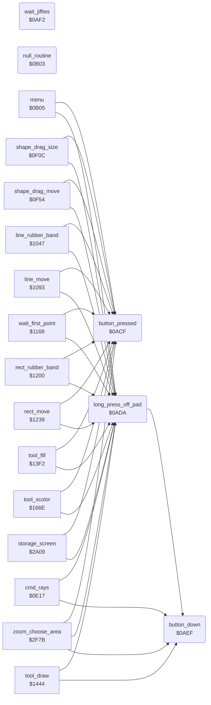

<!-- Generated by c64-docs from knowledge revision 20261025T214624.065-e5whe4 and .c64-re-tools/local/generated/src/source-map.json. Do not edit: change the knowledge, generate the source again, then run docs.ts generate. -->
# input/buttons.asm: Pad Buttons and Waits

Range `$0ACF-$0B04`. Source: [input/buttons.asm](../../../../src/input/buttons.asm). Index: [the reference](../../index.md).

## Routines

| Routine | Address | Reached from | Summary |
|---|---|---|---|
| [`button_pressed`](buttons.md#button_pressed) | `$0ACF` | [`menu`](../menu/menu.md#menu), [`shape_drag_size`](../tools/circle.md#shape_drag_size), [`shape_drag_move`](../tools/circle.md#shape_drag_move), [`line_rubber_band`](../tools/line_tool.md#line_rubber_band), [`line_move`](../tools/line_tool.md#line_move), [`wait_first_point`](../tools/line_tool.md#wait_first_point), [`rect_rubber_band`](../tools/box_frame_tool.md#rect_rubber_band), [`rect_move`](../tools/box_frame_tool.md#rect_move), [`tool_fill`](../tools/fill_tool.md#tool_fill), [`tool_xcolor`](../tools/xcolor_tool.md#tool_xcolor), [`storage_screen`](../storage/storage_screen.md#storage_screen), [`zoom_choose_area`](../zoom/zoom_choose_area.md#zoom_choose_area) and 2 more | Gives the press of a pad button since the last call (button_press_edge), and clears it. |
| [`long_press_off_pad`](buttons.md#long_press_off_pad) | `$0ADA` | [`menu`](../menu/menu.md#menu), [`cmd_rays`](../tools/rays.md#cmd_rays), [`shape_drag_size`](../tools/circle.md#shape_drag_size), [`shape_drag_move`](../tools/circle.md#shape_drag_move), [`line_rubber_band`](../tools/line_tool.md#line_rubber_band), [`line_move`](../tools/line_tool.md#line_move), [`wait_first_point`](../tools/line_tool.md#wait_first_point), [`rect_rubber_band`](../tools/box_frame_tool.md#rect_rubber_band), [`rect_move`](../tools/box_frame_tool.md#rect_move), [`tool_fill`](../tools/fill_tool.md#tool_fill), [`tool_draw`](../tools/draw_tool.md#tool_draw), [`tool_xcolor`](../tools/xcolor_tool.md#tool_xcolor) and 4 more | A is 1 when the pad is not touched for 16 samples (off_pad_count) and a button is held: the gesture that changes between the menu and the picture. |
| [`button_down`](buttons.md#button_down) | `$0AEF` | [`long_press_off_pad`](buttons.md#long_press_off_pad), [`cmd_rays`](../tools/rays.md#cmd_rays), [`tool_draw`](../tools/draw_tool.md#tool_draw), [`zoom_choose_area`](../zoom/zoom_choose_area.md#zoom_choose_area) | Gives button_held in A: 1 while a pad button is down. |
| [`wait_jiffies`](buttons.md#wait_jiffies) | `$0AF2` | [`jt_sample_pad`](../init/entry.md#jt_sample_pad) | Waits A + 1 jiffies: sets the low byte of the jiffy clock ($a2) to $ff - A and waits until it wraps to a value below 4. |
| [`null_routine`](buttons.md#null_routine) | `$0B03` | [`jt_sample_pad`](../init/entry.md#jt_sample_pad) | Only an RTS. |

## Data

| Range | Type | Name | Read by | Written by |
|---|---|---|---|---|
| [`$0B04`](../../../../src/input/buttons.asm#L49) | bytes |  |  |  |

## Call graph

A solid arrow is a call, a thick arrow a table entry. Rounded nodes are in this file.

The graph shows 30 of the 34 edges.

## Details

### [`button_pressed`](../../../../src/input/buttons.asm#L6) `$0ACF`

*routine*

Gives the press of a pad button since the last call (button_press_edge), and clears it. Z is set when there was no press.

- **Called from:** [`menu`](../menu/menu.md#menu), [`shape_drag_size`](../tools/circle.md#shape_drag_size), [`shape_drag_move`](../tools/circle.md#shape_drag_move), [`line_rubber_band`](../tools/line_tool.md#line_rubber_band), [`line_move`](../tools/line_tool.md#line_move), [`wait_first_point`](../tools/line_tool.md#wait_first_point), [`rect_rubber_band`](../tools/box_frame_tool.md#rect_rubber_band), [`rect_move`](../tools/box_frame_tool.md#rect_move), [`tool_fill`](../tools/fill_tool.md#tool_fill), [`tool_xcolor`](../tools/xcolor_tool.md#tool_xcolor), [`storage_screen`](../storage/storage_screen.md#storage_screen), [`zoom_choose_area`](../zoom/zoom_choose_area.md#zoom_choose_area) and 2 more
- **Reads:** [`button_press_edge`](../../memory-map.md#button_press_edge)
- **Writes:** [`button_press_edge`](../../memory-map.md#button_press_edge)

### [`long_press_off_pad`](../../../../src/input/buttons.asm#L15) `$0ADA`

*routine*

A is 1 when the pad is not touched for 16 samples (off_pad_count) and a button is held: the gesture that changes between the menu and the picture.

- **Called from:** [`menu`](../menu/menu.md#menu), [`cmd_rays`](../tools/rays.md#cmd_rays), [`shape_drag_size`](../tools/circle.md#shape_drag_size), [`shape_drag_move`](../tools/circle.md#shape_drag_move), [`line_rubber_band`](../tools/line_tool.md#line_rubber_band), [`line_move`](../tools/line_tool.md#line_move), [`wait_first_point`](../tools/line_tool.md#wait_first_point), [`rect_rubber_band`](../tools/box_frame_tool.md#rect_rubber_band), [`rect_move`](../tools/box_frame_tool.md#rect_move), [`tool_fill`](../tools/fill_tool.md#tool_fill), [`tool_draw`](../tools/draw_tool.md#tool_draw), [`tool_xcolor`](../tools/xcolor_tool.md#tool_xcolor) and 4 more
- **Calls:** [`button_down`](buttons.md#button_down)
- **Reads:** [`off_pad_count`](../../memory-map.md#off_pad_count)
- **Writes:** [`off_pad_count`](../../memory-map.md#off_pad_count)

| Label | Address | Comment |
|---|---|---|
| [`long_press_none`](../../../../src/input/buttons.asm#L25) | `$0AEC` |  |

### [`button_down`](../../../../src/input/buttons.asm#L29) `$0AEF`

*routine*

Gives button_held in A: 1 while a pad button is down.

- **Called from:** [`long_press_off_pad`](buttons.md#long_press_off_pad), [`cmd_rays`](../tools/rays.md#cmd_rays), [`tool_draw`](../tools/draw_tool.md#tool_draw), [`zoom_choose_area`](../zoom/zoom_choose_area.md#zoom_choose_area)
- **Reads:** [`button_held`](../../memory-map.md#button_held)

### [`wait_jiffies`](../../../../src/input/buttons.asm#L33) `$0AF2`

*routine*

Waits A + 1 jiffies: sets the low byte of the jiffy clock ($a2) to $ff - A and waits until it wraps to a value below 4. Turns the interrupts on. Only the JMP table entry $090c points here.

- **Jumped to from:** [`jt_sample_pad`](../init/entry.md#jt_sample_pad)
- **Entry of:** [`entry_jump_table`](../../tables.md#entry_jump_table)
- **Reads:** [`temp_word`](../../memory-map.md#temp_word), [`TIME`](../../memory-map.md#TIME)
- **Writes:** [`temp_word`](../../memory-map.md#temp_word), [`TIME`](../../memory-map.md#TIME)

| Label | Address | Comment |
|---|---|---|
| [`wait_jiffies_loop`](../../../../src/input/buttons.asm#L41) | `$0AFC` |  |

### [`null_routine`](../../../../src/input/buttons.asm#L47) `$0B03`

*routine*

Only an RTS. The JMP table entry $0909 points here.

- **Jumped to from:** [`jt_sample_pad`](../init/entry.md#jt_sample_pad)
- **Entry of:** [`entry_jump_table`](../../tables.md#entry_jump_table)
