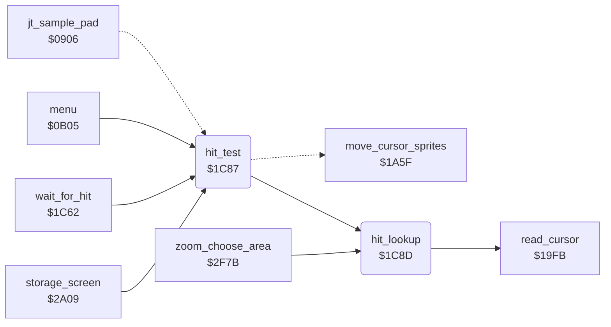

<!-- Generated by c64-docs from knowledge revision 20261024T063946.176-sfrhxb and .c64-re-tools/local/generated/src/source-map.json. Do not edit: change the knowledge, generate the source again, then run docs.ts generate. -->
# input/hit_test_1c85.asm

Range `$1C85-$1CF6`. Source: [input/hit_test_1c85.asm](../../../../src/input/hit_test_1c85.asm). Index: [the reference](../../index.md).

## Call graph

A solid arrow is a call, a thick arrow a table entry, a dotted arrow a jump. Rounded nodes are in this file.

## Names

### [`wait_for_hit_exit`](../../../../src/input/hit_test_1c85.asm#L5) `$1C85`

*label*

- **Jumped to from:** [`wait_for_hit`](hit_test.md#wait_for_hit) [`$1C7E`](../../../../src/input/hit_test.asm#L25)

### [`hit_test`](../../../../src/input/hit_test_1c85.asm#L10) `$1C87`

*routine*

Finds the cell under the cursor (hit_lookup), then moves the cursor sprites (move_cursor_sprites). hit_code gets the code of the cell, or 0.

- **Called from:** [`menu`](../menu/menu.md#menu) [`$0B88`](../../../../src/menu/menu.asm#L70), [`wait_for_hit`](hit_test.md#wait_for_hit) [`$1C62`](../../../../src/input/hit_test.asm#L8), [`storage_screen`](../storage/storage_screen.md#storage_screen) [`$2B0E`](../../../../src/storage/storage_screen.asm#L146)
- **Jumped to from:** [`jt_sample_pad`](../init/entry.md#jt_sample_pad) [`$090F`](../../../../src/init/entry.asm#L16)
- **Entry of:** [`entry_jump_table`](../../tables.md#entry_jump_table)
- **Calls:** [`hit_lookup`](hit_test_1c85.md#hit_lookup)
- **Jumps to:** [`move_cursor_sprites`](cursor.md#move_cursor_sprites)

### [`hit_lookup`](../../../../src/input/hit_test_1c85.asm#L14) `$1C8D`

*routine*

Reads the cursor (read_cursor) and looks for the cell that holds cursor_x, cursor_y in the table at hit_table_ptr: count, then 5 bytes for each cell (Y max, Y min, X end, X min, code). hit_code gets the code of the first cell that matches, or 0. No table (hit_table_ptr = 0) gives 0.

- **Called from:** [`hit_test`](hit_test_1c85.md#hit_test) [`$1C87`](../../../../src/input/hit_test_1c85.asm#L11), [`zoom_choose_area`](../zoom/zoom_choose_area.md#zoom_choose_area) [`$3072`](../../../../src/zoom/zoom_choose_area.asm#L143)
- **Calls:** [`read_cursor`](cursor.md#read_cursor)
- **Reads:** [`hit_table_ptr`](../../memory-map.md#hit_table_ptr), [`hit_table_ptr+1`](../../memory-map.md#hit_table_ptr), [`hit_cell_ptr`](../../memory-map.md#hit_cell_ptr), [`hit_cell_ptr+1`](../../memory-map.md#hit_cell_ptr), [`cursor_y`](../../memory-map.md#cursor_y), [`hit_cells_left`](../../memory-map.md#hit_cells_left), [`cursor_x`](../../memory-map.md#cursor_x)
- **Writes:** [`hit_code`](../../memory-map.md#hit_code), [`hit_cell_ptr`](../../memory-map.md#hit_cell_ptr), [`hit_cell_ptr+1`](../../memory-map.md#hit_cell_ptr), [`hit_cells_left`](../../memory-map.md#hit_cells_left), [`hit_lookup_tag`](../../memory-map.md#hit_lookup_tag)

### [`hit_lookup_start`](../../../../src/input/hit_test_1c85.asm#L23) `$1C9A`

*label*

- **Jumped to from:** [`hit_lookup`](hit_test_1c85.md#hit_lookup) [`$1C95`](../../../../src/input/hit_test_1c85.asm#L19)

### [`hit_lookup_first_cell`](../../../../src/input/hit_test_1c85.asm#L37) `$1CB1`

*label*

- **Jumped to from:** [`hit_lookup`](hit_test_1c85.md#hit_lookup) [`$1CAD`](../../../../src/input/hit_test_1c85.asm#L34)

### [`hit_lookup_cell`](../../../../src/input/hit_test_1c85.asm#L42) `$1CBA`

*label*

- **Jumped to from:** [`hit_lookup`](hit_test_1c85.md#hit_lookup) [`$1CD4`](../../../../src/input/hit_test_1c85.asm#L60)

### [`hit_lookup_next`](../../../../src/input/hit_test_1c85.asm#L48) `$1CC4`

*label*

- **Jumped to from:** [`hit_lookup`](hit_test_1c85.md#hit_lookup) [`$1CDF`](../../../../src/input/hit_test_1c85.asm#L66), [`hit_lookup`](hit_test_1c85.md#hit_lookup) [`$1CE7`](../../../../src/input/hit_test_1c85.asm#L71), [`hit_lookup`](hit_test_1c85.md#hit_lookup) [`$1CEE`](../../../../src/input/hit_test_1c85.asm#L75)

### [`hit_lookup_advance`](../../../../src/input/hit_test_1c85.asm#L52) `$1CC9`

*label*

- **Jumped to from:** [`hit_lookup`](hit_test_1c85.md#hit_lookup) [`$1CC6`](../../../../src/input/hit_test_1c85.asm#L50)

### [`hit_lookup_store_ptr`](../../../../src/input/hit_test_1c85.asm#L58) `$1CD2`

*label*

- **Jumped to from:** [`hit_lookup`](hit_test_1c85.md#hit_lookup) [`$1CCE`](../../../../src/input/hit_test_1c85.asm#L56)

### [`hit_lookup_check_y_min`](../../../../src/input/hit_test_1c85.asm#L61) `$1CD7`

*label*

- **Jumped to from:** [`hit_lookup`](hit_test_1c85.md#hit_lookup) [`$1CC0`](../../../../src/input/hit_test_1c85.asm#L46), [`hit_lookup`](hit_test_1c85.md#hit_lookup) [`$1CC2`](../../../../src/input/hit_test_1c85.asm#L47)

### [`hit_lookup_check_x`](../../../../src/input/hit_test_1c85.asm#L67) `$1CE2`

*label*

- **Jumped to from:** [`hit_lookup`](hit_test_1c85.md#hit_lookup) [`$1CDD`](../../../../src/input/hit_test_1c85.asm#L65)

### [`hit_lookup_found`](../../../../src/input/hit_test_1c85.asm#L76) `$1CF1`

*label*

- **Jumped to from:** [`hit_lookup`](hit_test_1c85.md#hit_lookup) [`$1CEC`](../../../../src/input/hit_test_1c85.asm#L74)
