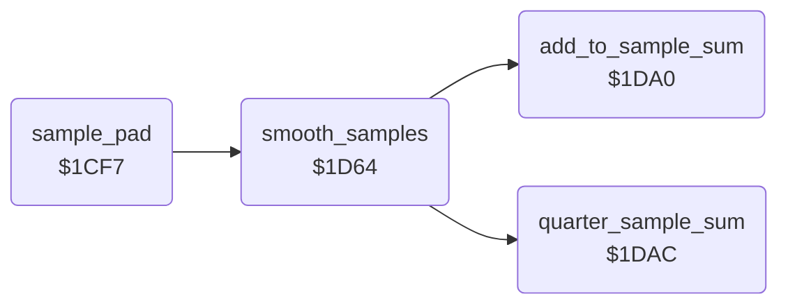

<!-- Generated by c64-docs from knowledge revision 20261025T214624.065-e5whe4 and .c64-re-tools/local/generated/src/source-map.json. Do not edit: change the knowledge, generate the source again, then run docs.ts generate. -->
# input/pad_smoothing.asm: Pad Sample Smoothing

Range `$1CF7-$1DC2`. Source: [input/pad_smoothing.asm](../../../../src/input/pad_smoothing.asm). Index: [the reference](../../index.md).

## Routines

| Routine | Address | Reached from | Summary |
|---|---|---|---|
| [`sample_pad`](pad_smoothing.md#sample_pad) | `$1CF7` | [`jt_sample_pad`](../init/entry.md#jt_sample_pad) | Smooths the 5 pad samples of each axis (smooth_samples) into cursor_x and cursor_y, in pad units. |
| [`smooth_samples`](pad_smoothing.md#smooth_samples) | `$1D64` | [`sample_pad`](pad_smoothing.md#sample_pad) | Smooths the 5 samples in smooth_buffer. |
| [`add_to_sample_sum`](pad_smoothing.md#add_to_sample_sum) | `$1DA0` | [`smooth_samples`](pad_smoothing.md#smooth_samples) | Adds A to sample_sum (16 bits). |
| [`quarter_sample_sum`](pad_smoothing.md#quarter_sample_sum) | `$1DAC` | [`smooth_samples`](pad_smoothing.md#smooth_samples) | Divides sample_sum by 4. |

## Call graph

A solid arrow is a call, a thick arrow a table entry. Rounded nodes are in this file.

## Details

### [`sample_pad`](../../../../src/input/pad_smoothing.asm#L6) `$1CF7`

*routine*

Smooths the 5 pad samples of each axis (smooth_samples) into cursor_x and cursor_y, in pad units. When a result differs from the raw value (pad_x_raw, pad_y_raw) by 5 or more, pad_spread gets the difference and cursor_x = cursor_y = 1. When both results are below 5, both become 0. Sets pad_read_enable. Jump table entry $0906.

- **Jumped to from:** [`jt_sample_pad`](../init/entry.md#jt_sample_pad)
- **Entry of:** [`entry_jump_table`](../../tables.md#entry_jump_table)
- **Calls:** [`smooth_samples`](pad_smoothing.md#smooth_samples)
- **Reads:** [`pad_x_samples`](../../memory-map.md#pad_x_samples), [`smooth_buffer`](../../memory-map.md#smooth_buffer), [`pad_x_raw`](../../memory-map.md#pad_x_raw), [`pad_y_samples`](../../memory-map.md#pad_y_samples), [`pad_y_raw`](../../memory-map.md#pad_y_raw), [`pad_spread`](../../memory-map.md#pad_spread), [`cursor_x`](../../memory-map.md#cursor_x), [`cursor_y`](../../memory-map.md#cursor_y)
- **Writes:** [`pad_read_enable`](../../memory-map.md#pad_read_enable), [`smooth_buffer`](../../memory-map.md#smooth_buffer), [`cursor_x`](../../memory-map.md#cursor_x), [`cursor_y`](../../memory-map.md#cursor_y), [`pad_spread`](../../memory-map.md#pad_spread)

| Label | Address | Comment |
|---|---|---|
| [`sample_pad_copy_x`](../../../../src/input/pad_smoothing.asm#L10) | `$1CFD` |  |
| [`sample_pad_check_x`](../../../../src/input/pad_smoothing.asm#L26) | `$1D18` |  |
| [`sample_pad_y`](../../../../src/input/pad_smoothing.asm#L30) | `$1D1F` |  |
| [`sample_pad_copy_y`](../../../../src/input/pad_smoothing.asm#L32) | `$1D21` |  |
| [`sample_pad_check_y`](../../../../src/input/pad_smoothing.asm#L48) | `$1D3C` |  |
| [`sample_pad_store_spread`](../../../../src/input/pad_smoothing.asm#L52) | `$1D42` |  |
| [`sample_pad_check_low`](../../../../src/input/pad_smoothing.asm#L60) | `$1D51` |  |
| [`sample_pad_done`](../../../../src/input/pad_smoothing.asm#L70) | `$1D63` |  |

### [`smooth_samples`](../../../../src/input/pad_smoothing.asm#L73) `$1D64`

*routine*

Smooths the 5 samples in smooth_buffer. Each step puts (s[i] + 2 * s[i+1] + s[i+2]) / 4 into s[i]: 3 steps, then 1 step. The result in s[0] is the sum of the samples with the weights 1, 4, 6, 4, 1, divided by 16. It does not sort.

- **Called from:** [`sample_pad`](pad_smoothing.md#sample_pad)
- **Calls:** [`add_to_sample_sum`](pad_smoothing.md#add_to_sample_sum), [`quarter_sample_sum`](pad_smoothing.md#quarter_sample_sum)
- **Reads:** [`smooth_limit`](../../memory-map.md#smooth_limit), [`smooth_buffer`](../../memory-map.md#smooth_buffer), [`sample_sum`](../../memory-map.md#sample_sum)
- **Writes:** [`smooth_limit`](../../memory-map.md#smooth_limit), [`sample_sum`](../../memory-map.md#sample_sum), [`sample_sum_hi`](../../memory-map.md#sample_sum_hi), [`smooth_buffer`](../../memory-map.md#smooth_buffer)

| Label | Address | Comment |
|---|---|---|
| [`sort_samples_pass`](../../../../src/input/pad_smoothing.asm#L76) | `$1D68` |  |
| [`sort_samples_step`](../../../../src/input/pad_smoothing.asm#L84) | `$1D74` |  |

### [`add_to_sample_sum`](../../../../src/input/pad_smoothing.asm#L108) `$1DA0`

*routine*

Adds A to sample_sum (16 bits).

- **Called from:** [`smooth_samples`](pad_smoothing.md#smooth_samples)
- **Reads:** [`sample_sum`](../../memory-map.md#sample_sum), [`sample_sum_hi`](../../memory-map.md#sample_sum_hi)
- **Writes:** [`sample_sum`](../../memory-map.md#sample_sum), [`sample_sum_hi`](../../memory-map.md#sample_sum_hi)

### [`quarter_sample_sum`](../../../../src/input/pad_smoothing.asm#L117) `$1DAC`

*routine*

Divides sample_sum by 4.

- **Called from:** [`smooth_samples`](pad_smoothing.md#smooth_samples)
- **Reads:** [`sample_sum_hi`](../../memory-map.md#sample_sum_hi), [`sample_sum`](../../memory-map.md#sample_sum)
- **Writes:** [`sample_sum_hi`](../../memory-map.md#sample_sum_hi), [`sample_sum`](../../memory-map.md#sample_sum)
