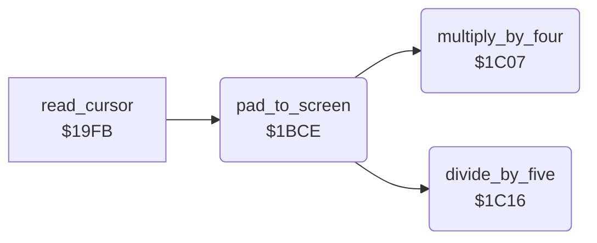

<!-- Generated by c64-docs from knowledge revision 20261024T063946.176-sfrhxb and .c64-re-tools/local/generated/src/source-map.json. Do not edit: change the knowledge, generate the source again, then run docs.ts generate. -->
# input/pad_to_screen.asm: Pad Units to Screen Units

Range `$1BCE-$1C2E`. Source: [input/pad_to_screen.asm](../../../../src/input/pad_to_screen.asm). Index: [the reference](../../index.md).

## Call graph

A solid arrow is a call, a thick arrow a table entry, a dotted arrow a jump. Rounded nodes are in this file.

## Names

### [`pad_to_screen`](../../../../src/input/pad_to_screen.asm#L6) `$1BCE`

*routine*

Converts pad units to screen units: X = (pad X - 20) * 4 / 5 (0-$9f), Y = pad Y - 20 (0-$c7). Values out of range become the limit. Input and output: X, Y.

- **Called from:** [`read_cursor`](cursor.md#read_cursor) [`$1A30`](../../../../src/input/cursor.asm#L88)
- **Calls:** [`multiply_by_four`](pad_to_screen.md#multiply_by_four), [`divide_by_five`](pad_to_screen.md#divide_by_five)

### [`pad_to_screen_x_max`](../../../../src/input/pad_to_screen.asm#L16) `$1BDB`

*label*

- **Jumped to from:** [`pad_to_screen`](pad_to_screen.md#pad_to_screen) [`$1BD4`](../../../../src/input/pad_to_screen.asm#L12)

### [`pad_to_screen_scale_x`](../../../../src/input/pad_to_screen.asm#L22) `$1BE4`

*label*

- **Jumped to from:** [`pad_to_screen`](pad_to_screen.md#pad_to_screen) [`$1BDD`](../../../../src/input/pad_to_screen.asm#L18)

### [`pad_to_screen_y`](../../../../src/input/pad_to_screen.asm#L26) `$1BEB`

*label*

- **Jumped to from:** [`pad_to_screen`](pad_to_screen.md#pad_to_screen) [`$1BD8`](../../../../src/input/pad_to_screen.asm#L15), [`pad_to_screen`](pad_to_screen.md#pad_to_screen) [`$1BE1`](../../../../src/input/pad_to_screen.asm#L21)

### [`pad_to_screen_y_max`](../../../../src/input/pad_to_screen.asm#L38) `$1BFA`

*label*

- **Jumped to from:** [`pad_to_screen`](pad_to_screen.md#pad_to_screen) [`$1BF3`](../../../../src/input/pad_to_screen.asm#L34)

### [`pad_to_screen_y_ok`](../../../../src/input/pad_to_screen.asm#L44) `$1C03`

*label*

- **Jumped to from:** [`pad_to_screen`](pad_to_screen.md#pad_to_screen) [`$1BFC`](../../../../src/input/pad_to_screen.asm#L40)

### [`pad_to_screen_done`](../../../../src/input/pad_to_screen.asm#L46) `$1C04`

*label*

- **Jumped to from:** [`pad_to_screen`](pad_to_screen.md#pad_to_screen) [`$1BF7`](../../../../src/input/pad_to_screen.asm#L37), [`pad_to_screen`](pad_to_screen.md#pad_to_screen) [`$1C00`](../../../../src/input/pad_to_screen.asm#L43)

### [`multiply_by_four`](../../../../src/input/pad_to_screen.asm#L51) `$1C07`

*routine*

Puts A * 4 in temp_word/temp_word_hi (16 bits).

- **Called from:** [`pad_to_screen`](pad_to_screen.md#pad_to_screen) [`$1BE4`](../../../../src/input/pad_to_screen.asm#L23)
- **Reads:** [`temp_word`](../../memory-map.md#temp_word), [`temp_word_hi`](../../memory-map.md#temp_word_hi)
- **Writes:** [`temp_word`](../../memory-map.md#temp_word), [`temp_word_hi`](../../memory-map.md#temp_word_hi)

### [`divide_by_five`](../../../../src/input/pad_to_screen.asm#L61) `$1C16`

*routine*

Divides the 16-bit value in temp_word/temp_word_hi by 5 (temp_word_hi must be below 5). Returns A = the quotient (8 bits); temp_word_hi keeps the remainder.

- **Called from:** [`pad_to_screen`](pad_to_screen.md#pad_to_screen) [`$1BE7`](../../../../src/input/pad_to_screen.asm#L24)
- **Reads:** [`temp_word`](../../memory-map.md#temp_word), [`temp_word_hi`](../../memory-map.md#temp_word_hi), [`temp_byte_2`](../../memory-map.md#temp_byte_2)
- **Writes:** [`temp_byte_2`](../../memory-map.md#temp_byte_2), [`temp_word`](../../memory-map.md#temp_word), [`temp_word_hi`](../../memory-map.md#temp_word_hi)

### [`divide_by_five_loop`](../../../../src/input/pad_to_screen.asm#L64) `$1C1A`

*label*

- **Jumped to from:** [`divide_by_five`](pad_to_screen.md#divide_by_five) [`$1C2A`](../../../../src/input/pad_to_screen.asm#L75)

### [`divide_by_five_bit`](../../../../src/input/pad_to_screen.asm#L73) `$1C28`

*label*

- **Jumped to from:** [`divide_by_five`](pad_to_screen.md#divide_by_five) [`$1C23`](../../../../src/input/pad_to_screen.asm#L70)
