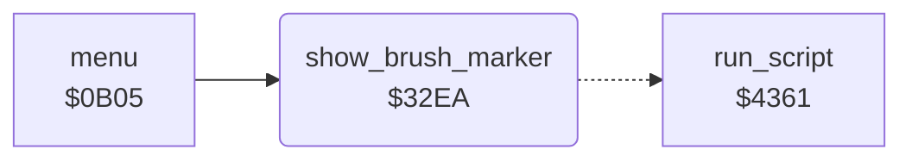

<!-- Generated by c64-docs from knowledge revision 20261024T063946.176-sfrhxb and .c64-re-tools/local/generated/src/source-map.json. Do not edit: change the knowledge, generate the source again, then run docs.ts generate. -->
# menu/brush_marker.asm: Brush marker in the menu

Range `$32EA-$32FB`. Source: [menu/brush_marker.asm](../../../../src/menu/brush_marker.asm). Index: [the reference](../../index.md).

## Call graph

A solid arrow is a call, a thick arrow a table entry, a dotted arrow a jump. Rounded nodes are in this file.

## Names

### [`show_brush_marker`](../../../../src/menu/brush_marker.asm#L6) `$32EA`

*routine*

Marks the current brush in the menu: runs brush_marker_script with the value brush_marker_columns[current_brush / 2] as its argument.

- **Called from:** [`menu`](menu.md#menu) [`$0B63`](../../../../src/menu/menu.asm#L49)
- **Jumps to:** [`run_script`](../script/interpreter.md#run_script)
- **Reads:** [`brush_index`](../../memory-map.md#brush_index), [`brush_marker_columns`](brush_marker_data.md#brush_marker_columns)
- **Writes:** [`script_arg_stack+1`](../../memory-map.md#script_arg_stack)
