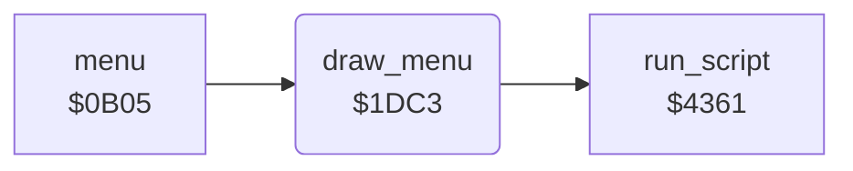

<!-- Generated by c64-docs from knowledge revision 20261025T214624.065-e5whe4 and .c64-re-tools/local/generated/src/source-map.json. Do not edit: change the knowledge, generate the source again, then run docs.ts generate. -->
# menu/draw_menu.asm: Draw the Menu

Range `$1DC3-$1DCA`. Source: [menu/draw_menu.asm](../../../../src/menu/draw_menu.asm). Index: [the reference](../../index.md).

## Routines

| Routine | Address | Reached from | Summary |
|---|---|---|---|
| [`draw_menu`](draw_menu.md#draw_menu) | `$1DC3` | [`menu`](menu.md#menu) | Draws the menu screen with the script at $3ee7. |

## Call graph

A solid arrow is a call, a thick arrow a table entry. Rounded nodes are in this file.

## Details

### [`draw_menu`](../../../../src/menu/draw_menu.asm#L6) `$1DC3`

*routine*

Draws the menu screen with the script at $3ee7.

- **Called from:** [`menu`](menu.md#menu)
- **Calls:** [`run_script`](../script/interpreter.md#run_script)
