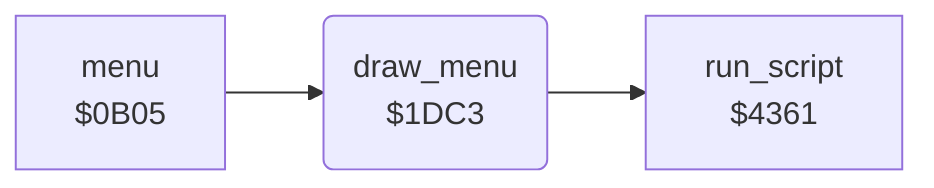

<!-- Generated by c64-docs from knowledge revision 20261024T063946.176-sfrhxb and .c64-re-tools/local/generated/src/source-map.json. Do not edit: change the knowledge, generate the source again, then run docs.ts generate. -->
# menu/draw_menu.asm: Draw the Menu

Range `$1DC3-$1DCA`. Source: [menu/draw_menu.asm](../../../../src/menu/draw_menu.asm). Index: [the reference](../../index.md).

## Call graph

A solid arrow is a call, a thick arrow a table entry, a dotted arrow a jump. Rounded nodes are in this file.

## Names

### [`draw_menu`](../../../../src/menu/draw_menu.asm#L6) `$1DC3`

*routine*

Draws the menu screen with the script at $3ee7.

- **Called from:** [`menu`](menu.md#menu) [`$0B53`](../../../../src/menu/menu.asm#L40)
- **Calls:** [`run_script`](../script/interpreter.md#run_script)
