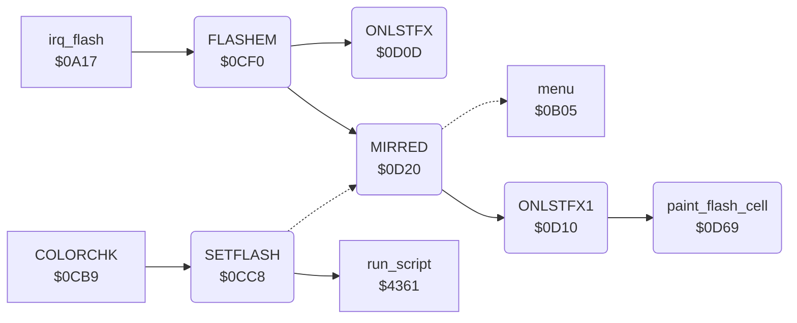

<!-- Generated by c64-docs from knowledge revision 20261024T063946.176-sfrhxb and .c64-re-tools/local/generated/src/source-map.json. Do not edit: change the knowledge, generate the source again, then run docs.ts generate. -->
# menu/flash.asm: Menu Flash

Range `$0CC8-$0D73`. Source: [menu/flash.asm](../../../../src/menu/flash.asm). Index: [the reference](../../index.md).

## Call graph

A solid arrow is a call, a thick arrow a table entry, a dotted arrow a jump. Rounded nodes are in this file.

## Names

### [`SETFLASH`](../../../../src/menu/flash.asm#L6) `$0CC8`

*routine*

SETFLASH (name from the symbol table leftover): A AND $1f is the chosen command (chosen_command). A command with a menu cell in flash_cell_table (1-$0a): erase_mode off, pad_read_enable = 0, the script at $4305, current_command = chosen_command, flash_enable on. A command without a cell goes to setflash_no_cell.

- **Called from:** [`COLORCHK`](menu.md#COLORCHK) [`$0CC2`](../../../../src/menu/menu.asm#L251)
- **Calls:** [`run_script`](../script/interpreter.md#run_script)
- **Jumps to:** [`setflash_no_cell`](flash.md#setflash_no_cell)
- **Reads:** [`flash_cell_table`](../data/menu_tables.md#flash_cell_table), [`flash_cell_table_hi`](../data/menu_tables.md#flash_cell_table_hi), [`chosen_command`](../../memory-map.md#chosen_command)
- **Writes:** [`chosen_command`](../../memory-map.md#chosen_command), [`erase_mode`](../../memory-map.md#erase_mode), [`pad_read_enable`](../../memory-map.md#pad_read_enable), [`current_command`](../../memory-map.md#current_command), [`flash_enable`](../../memory-map.md#flash_enable)

### [`FLASHEM`](../../../../src/menu/flash.asm#L26) `$0CF0`

*label*

FLASHEM (name from the symbol table leftover): changes flash_colour between 0 and 2, then paints the flash cells (DOFLASH). irq_flash calls it each 20 interrupts.

- **Called from:** [`irq_flash`](../irq/irq.md#irq_flash) [`$0A1C`](../../../../src/irq/irq.asm#L141)
- **Calls:** [`ONLSTFX`](flash.md#ONLSTFX), [`MIRRED`](flash.md#MIRRED)
- **Jumps to:** [`FLSHERA`](flash.md#FLSHERA)
- **Reads:** [`flash_colour`](../../memory-map.md#flash_colour)
- **Writes:** [`flash_colour`](../../memory-map.md#flash_colour)

### [`FLSHTOBL`](../../../../src/menu/flash.asm#L33) `$0CFF`

*label*

- **Jumped to from:** [`FLASHEM`](flash.md#FLASHEM) [`$0CF5`](../../../../src/menu/flash.asm#L29)

### [`DOFLASH`](../../../../src/menu/flash.asm#L37) `$0D04`

*label*

DOFLASH: paints the cell of current_command, the Mirror cell and the Erase cell.

- **Jumped to from:** [`FLASHEM`](flash.md#FLASHEM) [`$0CFC`](../../../../src/menu/flash.asm#L32)

### [`ONLSTFX`](../../../../src/menu/flash.asm#L42) `$0D0D`

*label*

ONLSTFX: paints the menu cell of current_command with flash_colour.

- **Called from:** [`FLASHEM`](flash.md#FLASHEM) [`$0D04`](../../../../src/menu/flash.asm#L38)
- **Reads:** [`current_command`](../../memory-map.md#current_command)

### [`ONLSTFX1`](../../../../src/menu/flash.asm#L45) `$0D10`

*label*

ONLSTFX1: paints the menu cell of the index in A (flash_cell_table) with flash_colour.

- **Called from:** [`MIRRED`](flash.md#MIRRED) [`$0D45`](../../../../src/menu/flash.asm#L78)
- **Jumped to from:** [`MIRRED`](flash.md#MIRRED) [`$0D27`](../../../../src/menu/flash.asm#L59), [`MIRRED`](flash.md#MIRRED) [`$0D36`](../../../../src/menu/flash.asm#L68)
- **Calls:** [`paint_flash_cell`](flash.md#paint_flash_cell)
- **Reads:** [`flash_cell_table`](../data/menu_tables.md#flash_cell_table), [`flash_cell_table_hi`](../data/menu_tables.md#flash_cell_table_hi)
- **Writes:** [`work_ptr`](../../memory-map.md#work_ptr), [`work_ptr+1`](../../memory-map.md#work_ptr)

### [`MIRRED`](../../../../src/menu/flash.asm#L55) `$0D20`

*label*

MIRRED: paints the Mirror cell (index $13) with flash_colour when mirror_mode is on, else with colour 0.

- **Called from:** [`FLASHEM`](flash.md#FLASHEM) [`$0D07`](../../../../src/menu/flash.asm#L39)
- **Calls:** [`ONLSTFX1`](flash.md#ONLSTFX1)
- **Jumps to:** [`ONLSTFX1`](flash.md#ONLSTFX1), [`run_command`](menu.md#run_command)
- **Reads:** [`mirror_mode`](../../memory-map.md#mirror_mode), [`erase_mode`](../../memory-map.md#erase_mode), [`flash_colour`](../../memory-map.md#flash_colour), [`chosen_command`](../../memory-map.md#chosen_command)
- **Writes:** [`flash_colour`](../../memory-map.md#flash_colour), [`erase_mode`](../../memory-map.md#erase_mode)

### [`SETFLDNZ`](../../../../src/menu/flash.asm#L60) `$0D2A`

*label*

- **Jumped to from:** [`MIRRED`](flash.md#MIRRED) [`$0D23`](../../../../src/menu/flash.asm#L57)

### [`FLSHERA`](../../../../src/menu/flash.asm#L64) `$0D2F`

*label*

FLSHERA: paints the Erase cell (index $12) with flash_colour when erase_mode is on, else with colour 0.

- **Jumped to from:** [`FLASHEM`](flash.md#FLASHEM) [`$0D0A`](../../../../src/menu/flash.asm#L40)

### [`flash_erase_off`](../../../../src/menu/flash.asm#L69) `$0D39`

*label*

- **Jumped to from:** [`MIRRED`](flash.md#MIRRED) [`$0D32`](../../../../src/menu/flash.asm#L66)

### [`flash_cell_off`](../../../../src/menu/flash.asm#L72) `$0D3B`

*label*

Paints the cell of the index in X with colour 0, and keeps flash_colour.

- **Jumped to from:** [`MIRRED`](flash.md#MIRRED) [`$0D2C`](../../../../src/menu/flash.asm#L62)

### [`setflash_no_cell`](../../../../src/menu/flash.asm#L83) `$0D4D`

*label*

A command without a flash cell. Erase ($11) when erase_mode is not 1: erase_mode = 1, return. Else it removes the return address of the caller and runs the command at once (run_command).

- **Jumped to from:** [`SETFLASH`](flash.md#SETFLASH) [`$0CD5`](../../../../src/menu/flash.asm#L13)

### [`setflash_run_now`](../../../../src/menu/flash.asm#L93) `$0D61`

*label*

- **Jumped to from:** [`MIRRED`](flash.md#MIRRED) [`$0D52`](../../../../src/menu/flash.asm#L86), [`MIRRED`](flash.md#MIRRED) [`$0D59`](../../../../src/menu/flash.asm#L89)

### [`paint_flash_cell`](../../../../src/menu/flash.asm#L99) `$0D69`

*routine*

Writes flash_colour to the 6 bytes of colour RAM at menu_ptr: one menu cell.

- **Called from:** [`ONLSTFX1`](flash.md#ONLSTFX1) [`$0D1C`](../../../../src/menu/flash.asm#L52)
- **Reads:** [`flash_colour`](../../memory-map.md#flash_colour), [`work_ptr`](../../memory-map.md#work_ptr)

### [`paint_flash_loop`](../../../../src/menu/flash.asm#L102) `$0D6E`

*label*

- **Jumped to from:** [`paint_flash_cell`](flash.md#paint_flash_cell) [`$0D71`](../../../../src/menu/flash.asm#L105)
