<!-- Generated by c64-docs from knowledge revision 20261025T214624.065-e5whe4 and .c64-re-tools/local/generated/src/source-map.json. Do not edit: change the knowledge, generate the source again, then run docs.ts generate. -->
# menu/menu.asm: Main Menu and Command Dispatch

Range `$0B05-$0CC7`. Source: [menu/menu.asm](../../../../src/menu/menu.asm). Index: [the reference](../../index.md).

## Routines

| Routine | Address | Reached from | Summary |
|---|---|---|---|
| [`menu`](menu.md#menu) | `$0B05` | [`start_main`](../init/start.md#start_main) | The main menu: draws it, then waits for a choice. |
| [`menu_redraw`](menu.md#menu_redraw) | `$0B4A` | [`$14A7`](../../../../src/tools/tool_exit.asm#L15) | Shows the menu again after a command: the cursor sprites ($19ab), text mode ($150a), menu_irq_on, the menu screen script ($1dc3), hit_table_ptr = menu_hit_table, border = current_colour. |
| [`menu_refresh`](menu.md#menu_refresh) | `$0B63` | [`tool_oops`](../tools/mirror_oops_tool.md#tool_oops) | Shows the selected brush ($32ea) and the selected colour: the script at $25e8 for a plain colour (current_colour = mix_colour), else the script at $25f2. |
| [`run_command`](menu.md#run_command) | `$0BBB` | [`MIRRED`](flash.md#MIRRED) | Runs the command in A (1-$11): erase_mode off, screen off. |
| [`cmd_none`](menu.md#cmd_none) | `$0C21` | [`menu`](menu.md#menu) | Command 0 of command_table: back to menu_refresh. |
| [`cmd_erase`](menu.md#cmd_erase) | `$0C24` | [`menu`](menu.md#menu) | Command $11 (Erase) of command_table: wait_button_up, the script at $1e7c ($14e8), screen on, then $1665 (menu_irq_on, screen on, menu_refresh). |
| [`cmd_storage`](menu.md#cmd_storage) | `$0C30` | [`menu`](menu.md#menu) | Command $0f (Storage): screen on, the storage screen ($2a09), then menu_redraw. |
| [`cmd_zoom`](menu.md#cmd_zoom) | `$0C39` | [`menu`](menu.md#menu) | Command $0c (Zoom): mirror off and full cursor limits ($1650), the zoom ($2f7b). |
| [`select_colour`](menu.md#select_colour) | `$0C86` | [`cmd_zoom`](menu.md#cmd_zoom), [`COLORCHK`](menu.md#COLORCHK) | Selects the colour of the item code in X ($40-$5f). |
| [`wait_button_up`](menu.md#wait_button_up) | `$0CA8` | [`menu`](menu.md#menu), [`storage_screen`](../storage/storage_screen.md#storage_screen), [`zoom_choose_area`](../zoom/zoom_choose_area.md#zoom_choose_area), [`copy_tool`](../tools/copy.md#copy_tool), [`swap_tool`](../tools/swap.md#swap_tool) | Waits until no pad button is down, then clears button_press_edge. |
| [`COLORCHK`](menu.md#COLORCHK) | `$0CB9` | [`zoom_choose_area`](../zoom/zoom_choose_area.md#zoom_choose_area) | COLORCHK (name from the symbol table leftover): not reached. |

## Data

| Range | Type | Name | Read by | Written by |
|---|---|---|---|---|
| [`$0CB6`](../../../../src/menu/menu.asm#L239)-`$0CB8` | bytes |  |  |  |

## Call graph

A solid arrow is a call, a thick arrow a table entry. Rounded nodes are in this file.

The graph shows 30 of the 44 edges.

```mermaid
flowchart LR
  n0a3c["screen_off<br/>$0A3C"]
  n0a7f["start_main<br/>$0A7F"]
  n0a9b["menu_irq_on<br/>$0A9B"]
  n0ab6["menu_irq_off<br/>$0AB6"]
  n0acf["button_pressed<br/>$0ACF"]
  n0ada["long_press_off_pad<br/>$0ADA"]
  n0b05("menu<br/>$0B05")
  n0c21("cmd_none<br/>$0C21")
  n0c24("cmd_erase<br/>$0C24")
  n0c30("cmd_storage<br/>$0C30")
  n0c39("cmd_zoom<br/>$0C39")
  n0c86("select_colour<br/>$0C86")
  n0ca8("wait_button_up<br/>$0CA8")
  n0cb9("COLORCHK<br/>$0CB9")
  n0de2["cmd_lines<br/>$0DE2"]
  n0e17["cmd_rays<br/>$0E17"]
  n0ea2["cmd_disc<br/>$0EA2"]
  n0ee1["cmd_circle<br/>$0EE1"]
  n1025["tool_line<br/>$1025"]
  n1192["tool_box<br/>$1192"]
  n11c9["tool_frame<br/>$11C9"]
  n13f2["tool_fill<br/>$13F2"]
  n1444["tool_draw<br/>$1444"]
  n150a["text_mode_on<br/>$150A"]
  n162d["tool_mirror<br/>$162D"]
  n165e["tool_oops<br/>$165E"]
  n166e["tool_xcolor<br/>$166E"]
  n19ab["init_cursor<br/>$19AB"]
  n1c87["hit_test<br/>$1C87"]
  n1dc3["draw_menu<br/>$1DC3"]
  n32ea["show_brush_marker<br/>$32EA"]
  n340e["copy_tool<br/>$340E"]
  n36a8["swap_tool<br/>$36A8"]
  n0a7f --> n0b05
  n0b05 --> n0a3c
  n0b05 --> n0a9b
  n0b05 --> n0ab6
  n0b05 --> n0acf
  n0b05 --> n0ada
  n0b05 ==> n0c21
  n0b05 ==> n0c24
  n0b05 ==> n0c30
  n0b05 ==> n0c39
  n0b05 --> n0ca8
  n0b05 ==> n0de2
  n0b05 ==> n0e17
  n0b05 ==> n0ea2
  n0b05 ==> n0ee1
  n0b05 ==> n1025
  n0b05 ==> n1192
  n0b05 ==> n11c9
  n0b05 ==> n13f2
  n0b05 ==> n1444
  n0b05 --> n150a
  n0b05 ==> n162d
  n0b05 ==> n165e
  n0b05 ==> n166e
  n0b05 --> n19ab
  n0b05 --> n1c87
  n0b05 --> n1dc3
  n0b05 --> n32ea
  n0b05 ==> n340e
  n0b05 ==> n36a8
```

## Details

### [`menu`](../../../../src/menu/menu.asm#L6) `$0B05`

*routine*

The main menu: draws it, then waits for a choice. A press on an item runs it. No touch and a long press shows the picture with the current tool.

- **Called from:** [`start_main`](../init/start.md#start_main)
- **Calls:** [`init_cursor`](../input/cursor.md#init_cursor), [`text_mode_on`](../graphics/display_mode.md#text_mode_on), [`menu_irq_on`](../irq/menu_irq.md#menu_irq_on), [`draw_menu`](draw_menu.md#draw_menu), [`show_brush_marker`](brush_marker.md#show_brush_marker), [`run_script`](../script/interpreter.md#run_script), [`wait_button_up`](menu.md#wait_button_up), [`hit_test`](../input/hit_test_1c85.md#hit_test), [`long_press_off_pad`](../input/buttons.md#long_press_off_pad), [`button_pressed`](../input/buttons.md#button_pressed), [`screen_off`](../init/screen.md#screen_off), [`menu_irq_off`](../irq/menu_irq.md#menu_irq_off)
- **Jumps to:** [`select_colour_item`](menu.md#select_colour_item), [`select_brush`](menu.md#select_brush), [`NEWTOG`](menu.md#NEWTOG), `$DBE8`
- **Reads:** [`current_colour`](../../memory-map.md#current_colour), [`mix_colour`](../../memory-map.md#mix_colour), [`hit_code`](../../memory-map.md#hit_code), [`cursor_x`](../../memory-map.md#cursor_x), [`current_command`](../../memory-map.md#current_command), [`last_command`](../../memory-map.md#last_command), [`command_table`](../data/menu_tables.md#command_table), [`command_table_hi`](../data/menu_tables.md#command_table_hi), [`brush_index`](../../memory-map.md#brush_index), [`brush_cursor_scripts_hi`](../script/cursor_scripts.md#brush_cursor_scripts_hi), [`brush_cursor_scripts`](../script/cursor_scripts.md#brush_cursor_scripts), [`work_ptr`](../../memory-map.md#work_ptr)
- **Writes:** [`line_fill_corners`](../../memory-map.md#line_fill_corners), [`erase_mode`](../../memory-map.md#erase_mode), [`last_command`](../../memory-map.md#last_command), [`current_command`](../../memory-map.md#current_command), [`max_y`](../../memory-map.md#max_y), [`max_x`](../../memory-map.md#max_x), [`cell_cache_addr`](../../memory-map.md#cell_cache_addr), [`current_colour`](../../memory-map.md#current_colour), [`mix_colour`](../../memory-map.md#mix_colour), [`dither_colours`](../../memory-map.md#dither_colours), [`dither_colours_1`](../../memory-map.md#dither_colours_1), [`dither_colours_2`](../../memory-map.md#dither_colours_2) and 11 more

| Label | Address | Comment |
|---|---|---|
| [`menu_colour_mixed`](../../../../src/menu/menu.asm#L56) | `$0B73` |  |
| [`menu_colour_show`](../../../../src/menu/menu.asm#L59) | `$0B77` |  |
| [`menu_loop`](../../../../src/menu/menu.asm#L67) | `$0B85` | Main menu loop: wait until the buttons are up, then hit test the cursor. |
| [`menu_hit_loop`](../../../../src/menu/menu.asm#L69) | `$0B88` |  |
| [`menu_to_picture`](../../../../src/menu/menu.asm#L79) | `$0B9A` | No touch and a long press: go to the picture with the current tool (current_command). |
| [`menu_item_hit`](../../../../src/menu/menu.asm#L83) | `$0BA0` | A press on a menu item: codes $40-$5f select a colour, codes $80-$8e a brush, the other codes a command (NEWTOG). |
| [`menu_check_brush`](../../../../src/menu/menu.asm#L91) | `$0BAF` |  |
| [`menu_check_command`](../../../../src/menu/menu.asm#L96) | `$0BB7` |  |
| [`run_copy_plain`](../../../../src/menu/menu.asm#L118) | `$0BDD` |  |
| [`run_check_last`](../../../../src/menu/menu.asm#L121) | `$0BE2` |  |
| [`run_set_command`](../../../../src/menu/menu.asm#L128) | `$0BF0` |  |
| [`run_store_command`](../../../../src/menu/menu.asm#L130) | `$0BF1` |  |
| [`run_jump`](../../../../src/menu/menu.asm#L150) | `$0C1E` |  |

### [`menu_redraw`](../../../../src/menu/menu.asm#L36) `$0B4A`

*label*

Shows the menu again after a command: the cursor sprites ($19ab), text mode ($150a), menu_irq_on, the menu screen script ($1dc3), hit_table_ptr = menu_hit_table, border = current_colour.

- **Jumped to from:** [`cmd_storage`](menu.md#cmd_storage), [`cmd_zoom`](menu.md#cmd_zoom), [`$14A7`](../../../../src/tools/tool_exit.asm#L15)

### [`menu_refresh`](../../../../src/menu/menu.asm#L48) `$0B63`

*label*

Shows the selected brush ($32ea) and the selected colour: the script at $25e8 for a plain colour (current_colour = mix_colour), else the script at $25f2. Then the script at $2e9f, cursor_sprite_mask = $cf, and menu_loop.

- **Jumped to from:** [`cmd_zoom`](menu.md#cmd_zoom), [`tool_oops`](../tools/mirror_oops_tool.md#tool_oops)

### [`run_command`](../../../../src/menu/menu.asm#L100) `$0BBB`

*label*

Runs the command in A (1-$11): erase_mode off, screen off. Except for Oops ($10), and when last_command is not Erase, it runs the script at $1e93 (words $8000 and $6000, then a call of the script at $1ef1). Copy ($0b) after Swap ($0e) sets copy_mode = 2, else 0. Then last_command = A, menu_ptr = the routine from command_table, menu_irq_off, wait_button_up. For the commands 0-6 it runs the script at $1b37 and the script of the brush from the table at $1bbe. Then JMP (menu_ptr).

- **Jumped to from:** [`menu`](menu.md#menu), [`MIRRED`](flash.md#MIRRED)

### [`cmd_none`](../../../../src/menu/menu.asm#L153) `$0C21`

*routine*

Command 0 of command_table: back to menu_refresh.

- **Entry of:** [`command_table`](../../tables.md#command_table)

### [`cmd_erase`](../../../../src/menu/menu.asm#L157) `$0C24`

*routine*

Command $11 (Erase) of command_table: wait_button_up, the script at $1e7c ($14e8), screen on, then $1665 (menu_irq_on, screen on, menu_refresh). SETFLASH runs it only when erase_mode is already 1.

- **Entry of:** [`command_table`](../../tables.md#command_table)

### [`cmd_storage`](../../../../src/menu/menu.asm#L163) `$0C30`

*routine*

Command $0f (Storage): screen on, the storage screen ($2a09), then menu_redraw.

- **Entry of:** [`command_table`](../../tables.md#command_table)
- **Calls:** [`screen_on`](../init/screen.md#screen_on), [`storage_screen`](../storage/storage_screen.md#storage_screen)
- **Jumps to:** [`menu_redraw`](menu.md#menu_redraw)

### [`cmd_zoom`](../../../../src/menu/menu.asm#L168) `$0C39`

*routine*

Command $0c (Zoom): mirror off and full cursor limits ($1650), the zoom ($2f7b). Then mirror on again ($1642) when mirror_choice is set, and menu_redraw.

- **Entry of:** [`command_table`](../../tables.md#command_table)
- **Calls:** [`mirror_mode_off`](../tools/mirror_oops_tool.md#mirror_mode_off), [`zoom_choose_area`](../zoom/zoom_choose_area.md#zoom_choose_area), [`mirror_mode_on`](../tools/mirror_oops_tool.md#mirror_mode_on), [`select_colour`](menu.md#select_colour)
- **Jumps to:** [`menu_redraw`](menu.md#menu_redraw), [`menu_refresh`](menu.md#menu_refresh)
- **Reads:** [`mirror_choice`](../../memory-map.md#mirror_choice), [`brush_index`](../../memory-map.md#brush_index), [`brush_table`](../data/menu_tables.md#brush_table), [`brush_table_hi`](../data/menu_tables.md#brush_table_hi)
- **Writes:** [`mirror_mode`](../../memory-map.md#mirror_mode), [`brush_index`](../../memory-map.md#brush_index), [`line_fill_corners`](../../memory-map.md#line_fill_corners), [`brush_ptr`](../../memory-map.md#brush_ptr), [`RNDX`](../../memory-map.md#RNDX)

| Label | Address | Comment |
|---|---|---|
| [`zoom_done`](../../../../src/menu/menu.asm#L175) | `$0C4A` |  |
| [`select_brush`](../../../../src/menu/menu.asm#L178) | `$0C4D` | A brush item ($80-$8e in X): brush_index = X AND $7f (0, 2, ... $0e), brush_ptr = the address from brush_table. brush_plot_flag = 1, but 0 for the brush indexes 0, 2 and $0a. Then menu_refresh. |
| [`brush_test_2`](../../../../src/menu/menu.asm#L190) | `$0C63` |  |
| [`brush_test_10`](../../../../src/menu/menu.asm#L195) | `$0C6B` |  |
| [`brush_set_ptr`](../../../../src/menu/menu.asm#L200) | `$0C73` |  |
| [`select_colour_item`](../../../../src/menu/menu.asm#L207) | `$0C80` | A colour item ($40-$5f in X): select_colour, then menu_refresh. |

### [`select_colour`](../../../../src/menu/menu.asm#L211) `$0C86`

*routine*

Selects the colour of the item code in X ($40-$5f). Colour = X AND $0f: border, current_colour and the 4 bytes of colour_pattern. For a dithered item (bit 4 set) colour_pattern+1 and +2 get mix_colour. For a plain item mix_colour = current_colour.

- **Called from:** [`cmd_zoom`](menu.md#cmd_zoom), [`COLORCHK`](menu.md#COLORCHK)
- **Jumps to:** [`colour_set_plain`](menu.md#colour_set_plain)
- **Reads:** [`mix_colour`](../../memory-map.md#mix_colour)
- **Writes:** [`EXTCOL`](../../memory-map.md#EXTCOL), [`current_colour`](../../memory-map.md#current_colour), [`dither_colours`](../../memory-map.md#dither_colours), [`dither_colours_3`](../../memory-map.md#dither_colours_3), [`dither_colours_2`](../../memory-map.md#dither_colours_2), [`dither_colours_1`](../../memory-map.md#dither_colours_1)

### [`wait_button_up`](../../../../src/menu/menu.asm#L228) `$0CA8`

*routine*

Waits until no pad button is down, then clears button_press_edge.

- **Called from:** [`menu`](menu.md#menu), [`storage_screen`](../storage/storage_screen.md#storage_screen), [`zoom_choose_area`](../zoom/zoom_choose_area.md#zoom_choose_area), [`copy_tool`](../tools/copy.md#copy_tool), [`swap_tool`](../tools/swap.md#swap_tool)
- **Reads:** [`button_held`](../../memory-map.md#button_held), [`current_colour`](../../memory-map.md#current_colour)
- **Writes:** [`button_press_edge`](../../memory-map.md#button_press_edge), [`mix_colour`](../../memory-map.md#mix_colour)

| Label | Address | Comment |
|---|---|---|
| [`colour_set_plain`](../../../../src/menu/menu.asm#L234) | `$0CB1` |  |

### [`COLORCHK`](../../../../src/menu/menu.asm#L241) `$0CB9`

*label*

COLORCHK (name from the symbol table leftover): not reached. For an item code in A of $40 or more, it selects that colour with select_colour.

- **Called from:** [`zoom_choose_area`](../zoom/zoom_choose_area.md#zoom_choose_area)
- **Calls:** [`select_colour`](menu.md#select_colour), [`SETFLASH`](flash.md#SETFLASH)
- **Jumps to:** [`menu_hit_loop`](menu.md#menu_hit_loop)

| Label | Address | Comment |
|---|---|---|
| [`NOTCOLOR`](../../../../src/menu/menu.asm#L247) | `$0CC1` |  |
| [`NEWTOG`](../../../../src/menu/menu.asm#L250) | `$0CC2` | NEWTOG (name from the symbol table leftover): a command item. SETFLASH, then back to the hit test (menu_hit_loop). |
