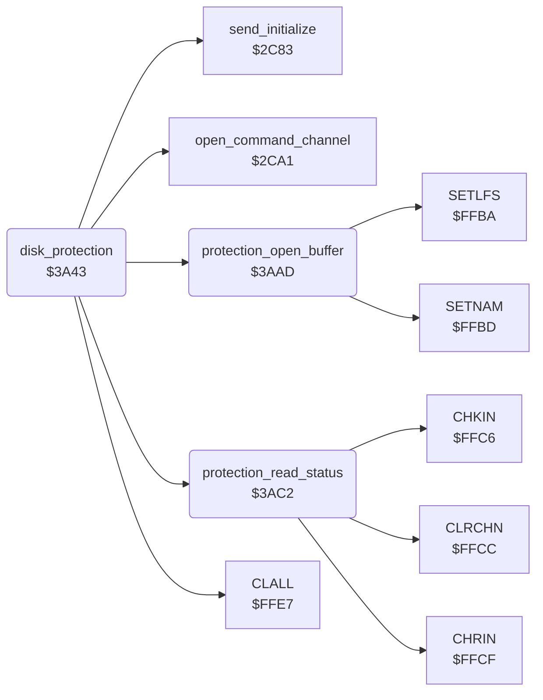

<!-- Generated by c64-docs from knowledge revision 20261025T214624.065-e5whe4 and .c64-re-tools/local/generated/src/source-map.json. Do not edit: change the knowledge, generate the source again, then run docs.ts generate. -->
# protection/disk_protection.asm: Disk protection

Range `$3A43-$3ADE`. Source: [protection/disk_protection.asm](../../../../src/protection/disk_protection.asm). Index: [the reference](../../index.md).

## Routines

| Routine | Address | Reached from | Summary |
|---|---|---|---|
| [`disk_protection`](disk_protection.md#disk_protection) | `$3A43` |  | Disk protection (switch PROTECTION), reached from op 9 of startup_script. |
| [`protection_open_buffer`](disk_protection.md#protection_open_buffer) | `$3AAD` | [`disk_protection`](disk_protection.md#disk_protection) | Opens file 5 on device 8 with secondary address 5 and the name # (a buffer in the drive). |
| [`protection_read_status`](disk_protection.md#protection_read_status) | `$3AC2` | [`disk_protection`](disk_protection.md#disk_protection) | Reads the drive status from channel 15 up to the CR. |

## Data

| Range | Type | Name | Read by | Written by |
|---|---|---|---|---|
| [`$3A96`](../../../../src/protection/disk_protection.asm#L61)-`$3AAC` | petscii | [`protection_commands`](../../../../src/protection/disk_protection.asm#L60) |  |  |

## Call graph

A solid arrow is a call, a thick arrow a table entry. Rounded nodes are in this file.

## Details

### [`disk_protection`](../../../../src/protection/disk_protection.asm#L6) `$3A43`

*routine*

Disk protection (switch PROTECTION), reached from op 9 of startup_script. A RAM test at $8413: when the byte does not keep $01 and $00, protection_failed. Then for track 1 sectors 1 and 2: opens the buffer channel 5, sends a U1 command on channel 15 and reads the first digit of the drive status (protection_result). TBC put NOPs over the checks of the results. Then CLALL, the command I (initialize) to the drive, a new stack and start_main.

- **Calls:** [`protection_open_buffer`](disk_protection.md#protection_open_buffer), [`open_command_channel`](../storage/storage_screen.md#open_command_channel), [`protection_read_status`](disk_protection.md#protection_read_status), [`CLALL`](../../memory-map.md#CLALL), [`send_initialize`](../storage/storage_screen.md#send_initialize)
- **Jumps to:** [`start_main`](../init/start.md#start_main), [`run_script`](../script/interpreter.md#run_script)
- **Reads:** `$8413`
- **Writes:** `$8413`

| Label | Address | Comment |
|---|---|---|
| [`protection_failed`](../../../../src/protection/disk_protection.asm#L54) | `$3A8F` | Protection failed: the script at $1e71 does SEI and writes 0 to 16000 bytes from $0900. The program erases itself. |

### [`protection_commands`](../../../../src/protection/disk_protection.asm#L60) `$3A96-$3AAC`

*data*

Protection: the name # of the buffer channel, and the two U1 commands that read track 1 sectors 1 and 2 into it.

### [`protection_open_buffer`](../../../../src/protection/disk_protection.asm#L89) `$3AAD`

*routine*

Opens file 5 on device 8 with secondary address 5 and the name # (a buffer in the drive).

- **Called from:** [`disk_protection`](disk_protection.md#disk_protection)
- **Calls:** [`SETNAM`](../../memory-map.md#SETNAM), [`SETLFS`](../../memory-map.md#SETLFS)
- **Jumps to:** [`OPEN`](../../memory-map.md#OPEN)

### [`protection_read_status`](../../../../src/protection/disk_protection.asm#L110) `$3AC2`

*routine*

Reads the drive status from channel 15 up to the CR. Gives the first digit of the error number (and 15) in A and in protection_result.

- **Called from:** [`disk_protection`](disk_protection.md#disk_protection)
- **Calls:** [`CLRCHN`](../../memory-map.md#CLRCHN), [`CHKIN`](../../memory-map.md#CHKIN), [`CHRIN`](../../memory-map.md#CHRIN)
- **Writes:** [`protection_result`](../../memory-map.md#protection_result)

| Label | Address | Comment |
|---|---|---|
| [`protection_skip_status`](../../../../src/protection/disk_protection.asm#L128) | `$3AD3` |  |
