<!-- Generated by c64-docs from knowledge revision 20261024T063946.176-sfrhxb and .c64-re-tools/local/generated/src/source-map.json. Do not edit: change the knowledge, generate the source again, then run docs.ts generate. -->
# script/interpreter.asm: Script Interpreter

Range `$4361-$43C4`. Source: [script/interpreter.asm](../../../../src/script/interpreter.asm). Index: [the reference](../../index.md).

## Call graph

A solid arrow is a call, a thick arrow a table entry, a dotted arrow a jump. Rounded nodes are in this file.

The graph shows 38 of the 85 edges: the calls only.

```mermaid
flowchart LR
  n0a76["start_script<br/>$0A76"]
  n0a7f["start_main<br/>$0A7F"]
  n0b05["menu<br/>$0B05"]
  n0cc8["SETFLASH<br/>$0CC8"]
  n0dd0["start_tool<br/>$0DD0"]
  n14aa["run_tool_start_script<br/>$14AA"]
  n165e["tool_oops<br/>$165E"]
  n19ab["init_cursor<br/>$19AB"]
  n1c2f["build_menu_charset<br/>$1C2F"]
  n1dc3["draw_menu<br/>$1DC3"]
  n2a09["storage_screen<br/>$2A09"]
  n2c8c["format_disk<br/>$2C8C"]
  n2cce["enter_picture_name<br/>$2CCE"]
  n2cda["enter_text<br/>$2CDA"]
  n2d2d["check_drive_status<br/>$2D2D"]
  n2f7b["zoom_choose_area<br/>$2F7B"]
  n340e["copy_tool<br/>$340E"]
  n3619["read_source_pixel<br/>$3619"]
  n3696["swap_pictures<br/>$3696"]
  n3adf["drive_status<br/>$3ADF"]
  n4361("run_script<br/>$4361")
  n4364("jmp_read_bitmap_byte<br/>$4364")
  n4367("jmp_read_cell_colour<br/>$4367")
  n4399("script_get_operand<br/>$4399")
  n439d("script_read_byte<br/>$439D")
  n43a8("script_pop_arg<br/>$43A8")
  n43b1("script_dispatch<br/>$43B1")
  n43c5["script_op_set_src<br/>$43C5"]
  n43d0["script_op_set_dest<br/>$43D0"]
  n43db["script_op_put_bytes<br/>$43DB"]
  n4422["script_op_copy_ram<br/>$4422"]
  n4431["script_op_copy<br/>$4431"]
  n4439["script_op_swap_ram<br/>$4439"]
  n4455["script_op_loop<br/>$4455"]
  n44ce["script_op_call<br/>$44CE"]
  n44e9["script_op_call_code<br/>$44E9"]
  n44fe["script_op_skip_dest<br/>$44FE"]
  n4506["script_op_fill<br/>$4506"]
  n4518["script_op_set_fill<br/>$4518"]
  n451e["script_op_push_bytes<br/>$451E"]
  n4537["script_op_arg_raise<br/>$4537"]
  n45fe["script_op_jump_if<br/>$45FE"]
  n0a76 --> n4361
  n0a7f --> n4361
  n0b05 --> n4361
  n0cc8 --> n4361
  n0dd0 --> n4361
  n14aa --> n4361
  n165e --> n4361
  n19ab --> n4361
  n1c2f --> n4361
  n1dc3 --> n4361
  n2a09 --> n4361
  n2c8c --> n4361
  n2cce --> n4361
  n2cda --> n4361
  n2d2d --> n4361
  n2f7b --> n4361
  n340e --> n4367
  n3619 --> n4364
  n3696 --> n4361
  n3adf --> n4361
  n4367 --> n439d
  n4367 --> n43b1
  n43c5 --> n4399
  n43d0 --> n4399
  n43db --> n4399
  n43db --> n43a8
  n4422 --> n4399
  n4431 --> n4399
  n4439 --> n4399
  n4455 --> n4399
  n44ce --> n4399
  n44e9 --> n4399
  n44fe --> n4399
  n4506 --> n4399
  n4518 --> n4399
  n451e --> n439d
  n4537 --> n439d
  n45fe --> n4399
```

## Data

| Range | Type | Name | Read by | Written by |
|---|---|---|---|---|
| [`$4361`](../../../../src/script/interpreter.asm#L7)-`$4369` | jumps | [`run_script`](../../../../src/script/interpreter.asm#L6) |  |  |

## Names

### [`run_script`](../../../../src/script/interpreter.asm#L6) `$4361`

*routine*

Script interpreter: A/Y is the address of a script. Each opcode byte selects a routine in script_ops. Opcode $ff ends the script, or returns from a script call. An opcode with bit 7 set takes its operands from the argument stack in place of the script.

- **Called from:** [`start_script`](../init/start.md#start_script) [`$0A7A`](../../../../src/init/start.asm#L9), [`start_main`](../init/start.md#start_main) [`$0A86`](../../../../src/init/start.asm#L17), [`menu`](../menu/menu.md#menu) [`$0B77`](../../../../src/menu/menu.asm#L60), [`menu`](../menu/menu.md#menu) [`$0B7E`](../../../../src/menu/menu.asm#L63), [`menu`](../menu/menu.md#menu) [`$0BED`](../../../../src/menu/menu.asm#L127), [`menu`](../menu/menu.md#menu) [`$0C0E`](../../../../src/menu/menu.asm#L144), [`menu`](../menu/menu.md#menu) [`$0C1B`](../../../../src/menu/menu.asm#L149), [`SETFLASH`](../menu/flash.md#SETFLASH) [`$0CE2`](../../../../src/menu/flash.asm#L19), [`start_tool`](../tools/tool_start.md#start_tool) [`$0DD0`](../../../../src/tools/tool_start.asm#L7), [`$14A4`](../../../../src/tools/tool_exit.asm#L14), [`run_tool_start_script`](../tools/tool_exit.md#run_tool_start_script) [`$14AE`](../../../../src/tools/tool_exit.asm#L20), [`tool_oops`](../tools/mirror_oops_tool.md#tool_oops) [`$1662`](../../../../src/tools/mirror_oops_tool.asm#L39), [`init_cursor`](../input/cursor.md#init_cursor) [`$19C7`](../../../../src/input/cursor.asm#L19), [`init_cursor`](../input/cursor.md#init_cursor) [`$19CE`](../../../../src/input/cursor.asm#L22), [`build_menu_charset`](../init/menu_charset.md#build_menu_charset) [`$1C45`](../../../../src/init/menu_charset.asm#L18), [`draw_menu`](../menu/draw_menu.md#draw_menu) [`$1DC7`](../../../../src/menu/draw_menu.asm#L9), [`storage_screen`](../storage/storage_screen.md#storage_screen) [`$2A15`](../../../../src/storage/storage_screen.asm#L13), [`storage_screen`](../storage/storage_screen.md#storage_screen) [`$2AC3`](../../../../src/storage/storage_screen.asm#L99), [`storage_screen`](../storage/storage_screen.md#storage_screen) [`$2AD8`](../../../../src/storage/storage_screen.asm#L113), [`storage_screen`](../storage/storage_screen.md#storage_screen) [`$2AE2`](../../../../src/storage/storage_screen.asm#L119), [`storage_screen`](../storage/storage_screen.md#storage_screen) [`$2AF4`](../../../../src/storage/storage_screen.asm#L129), [`storage_screen`](../storage/storage_screen.md#storage_screen) [`$2B02`](../../../../src/storage/storage_screen.asm#L137), [`storage_screen`](../storage/storage_screen.md#storage_screen) [`$2B1D`](../../../../src/storage/storage_screen.asm#L152), [`storage_screen`](../storage/storage_screen.md#storage_screen) [`$2B71`](../../../../src/storage/storage_screen.asm#L198), [`storage_screen`](../storage/storage_screen.md#storage_screen) [`$2B86`](../../../../src/storage/storage_screen.asm#L207), [`storage_screen`](../storage/storage_screen.md#storage_screen) [`$2B97`](../../../../src/storage/storage_screen.asm#L214), [`storage_screen`](../storage/storage_screen.md#storage_screen) [`$2BAE`](../../../../src/storage/storage_screen.asm#L227), [`storage_screen`](../storage/storage_screen.md#storage_screen) [`$2BBA`](../../../../src/storage/storage_screen.asm#L234), [`storage_screen`](../storage/storage_screen.md#storage_screen) [`$2BC6`](../../../../src/storage/storage_screen.asm#L241), [`storage_screen`](../storage/storage_screen.md#storage_screen) [`$2BD0`](../../../../src/storage/storage_screen.asm#L247), [`storage_screen`](../storage/storage_screen.md#storage_screen) [`$2BDE`](../../../../src/storage/storage_screen.asm#L254), [`storage_screen`](../storage/storage_screen.md#storage_screen) [`$2BF5`](../../../../src/storage/storage_screen.asm#L266), [`storage_screen`](../storage/storage_screen.md#storage_screen) [`$2C14`](../../../../src/storage/storage_screen.asm#L287), [`storage_screen`](../storage/storage_screen.md#storage_screen) [`$2C37`](../../../../src/storage/storage_screen.asm#L311), [`storage_screen`](../storage/storage_screen.md#storage_screen) [`$2C48`](../../../../src/storage/storage_screen.asm#L321), [`storage_screen`](../storage/storage_screen.md#storage_screen) [`$2C57`](../../../../src/storage/storage_screen.asm#L327), [`format_disk`](../storage/storage_screen.md#format_disk) [`$2C90`](../../../../src/storage/storage_screen.asm#L359), [`enter_picture_name`](../storage/storage_screen.md#enter_picture_name) [`$2CD2`](../../../../src/storage/storage_screen.asm#L403), [`enter_text`](../storage/storage_screen.md#enter_text) [`$2CF1`](../../../../src/storage/storage_screen.asm#L420), [`enter_text`](../storage/storage_screen.md#enter_text) [`$2D14`](../../../../src/storage/storage_screen.asm#L436) and 8 more
- **Jumped to from:** [`set_slot_position`](../storage/storage_screen.md#set_slot_position) [`$2CCB`](../../../../src/storage/storage_screen.asm#L398), [`put_directory_byte`](../storage/storage_screen.md#put_directory_byte) [`$2D57`](../../../../src/storage/storage_screen.asm#L484), [`show_brush_marker`](../menu/brush_marker.md#show_brush_marker) [`$32F9`](../../../../src/menu/brush_marker.asm#L14), [`disk_protection`](../protection/disk_protection.md#disk_protection) [`$3A93`](../../../../src/protection/disk_protection.asm#L58)
- **Jumps to:** [`run_script_start`](interpreter.md#run_script_start)

### [`jmp_read_bitmap_byte`](../../../../src/script/interpreter.asm#L9) `$4364`

*routine*

Jump table entry: read_bitmap_byte.

- **Called from:** [`read_source_pixel`](../tools/copy_3619.md#read_source_pixel) [`$3687`](../../../../src/tools/copy_3619.asm#L64)
- **Jumps to:** [`read_bitmap_byte`](../graphics/read_pixel.md#read_bitmap_byte)

### [`jmp_read_cell_colour`](../../../../src/script/interpreter.asm#L12) `$4367`

*routine*

Jump table entry: read_cell_colour.

- **Called from:** [`copy_tool`](../tools/copy.md#copy_tool) [`$355B`](../../../../src/tools/copy.asm#L178)
- **Calls:** [`script_read_byte`](interpreter.md#script_read_byte), [`script_dispatch`](interpreter.md#script_dispatch)
- **Jumps to:** [`read_cell_colour`](../graphics/read_pixel.md#read_cell_colour)
- **Reads:** [`script_return_index`](../../memory-map.md#script_return_index), [`script_return_stack`](../../memory-map.md#script_return_stack)
- **Writes:** [`script_ptr`](../../memory-map.md#script_ptr), [`FAC1+2`](../../memory-map.md#FAC1), [`script_loop_index`](../../memory-map.md#script_loop_index), [`script_return_index`](../../memory-map.md#script_return_index), [`script_arg_index`](../../memory-map.md#script_arg_index)

### [`run_script_start`](../../../../src/script/interpreter.asm#L16) `$436A`

*label*

Saves A/Y in script_ptr and clears the loop stack, the return stack and the argument stack.

- **Jumped to from:** [`run_script`](interpreter.md#run_script) [`$4361`](../../../../src/script/interpreter.asm#L7)
- **Entry of:** [`run_script`](../../tables.md#run_script)

### [`script_next_op`](../../../../src/script/interpreter.asm#L24) `$4376`

*label*

Reads the next opcode. $ff: end or return. Else run the opcode routine.

- **Jumped to from:** [`jmp_read_cell_colour`](interpreter.md#jmp_read_cell_colour) [`$4380`](../../../../src/script/interpreter.asm#L29), [`jmp_read_cell_colour`](interpreter.md#jmp_read_cell_colour) [`$4395`](../../../../src/script/interpreter.asm#L41)

### [`script_end_or_return`](../../../../src/script/interpreter.asm#L31) `$4383`

*label*

Opcode $ff: return to the calling script when script_return_stack has an entry, else end.

- **Jumped to from:** [`jmp_read_cell_colour`](interpreter.md#jmp_read_cell_colour) [`$437B`](../../../../src/script/interpreter.asm#L27)

### [`script_done`](../../../../src/script/interpreter.asm#L42) `$4398`

*label*

- **Jumped to from:** [`jmp_read_cell_colour`](interpreter.md#jmp_read_cell_colour) [`$4385`](../../../../src/script/interpreter.asm#L33)

### [`script_get_operand`](../../../../src/script/interpreter.asm#L45) `$4399`

*routine*

Gets one operand in A: pops it from script_arg_stack when script_stack_mode is not 0, else reads the next script byte.

- **Called from:** [`script_op_set_src`](opcodes.md#script_op_set_src) [`$43C5`](../../../../src/script/opcodes.asm#L7), [`script_op_set_src`](opcodes.md#script_op_set_src) [`$43CA`](../../../../src/script/opcodes.asm#L9), [`script_op_set_dest`](opcodes.md#script_op_set_dest) [`$43D0`](../../../../src/script/opcodes.asm#L14), [`script_op_set_dest`](opcodes.md#script_op_set_dest) [`$43D5`](../../../../src/script/opcodes.asm#L16), [`script_op_put_bytes`](opcodes.md#script_op_put_bytes) [`$43DB`](../../../../src/script/opcodes.asm#L21), [`script_op_copy_ram`](opcodes.md#script_op_copy_ram) [`$4422`](../../../../src/script/opcodes.asm#L74), [`script_op_copy`](opcodes.md#script_op_copy) [`$4431`](../../../../src/script/opcodes.asm#L83), [`script_op_swap_ram`](opcodes.md#script_op_swap_ram) [`$4439`](../../../../src/script/opcodes.asm#L91), [`script_op_loop`](opcodes.md#script_op_loop) [`$44B0`](../../../../src/script/opcodes.asm#L167), [`script_op_call`](opcodes.md#script_op_call) [`$44CE`](../../../../src/script/opcodes.asm#L195), [`script_op_call`](opcodes.md#script_op_call) [`$44D2`](../../../../src/script/opcodes.asm#L197), [`script_op_call_code`](opcodes.md#script_op_call_code) [`$44E9`](../../../../src/script/opcodes.asm#L210), [`script_op_call_code`](opcodes.md#script_op_call_code) [`$44EE`](../../../../src/script/opcodes.asm#L212), [`script_op_skip_dest`](opcodes.md#script_op_skip_dest) [`$44FE`](../../../../src/script/opcodes.asm#L223), [`script_op_fill`](opcodes.md#script_op_fill) [`$4506`](../../../../src/script/opcodes.asm#L228), [`script_op_set_fill`](opcodes.md#script_op_set_fill) [`$4518`](../../../../src/script/opcodes.asm#L241), [`script_op_jump_if`](opcodes.md#script_op_jump_if) [`$45FE`](../../../../src/script/opcodes.asm#L404), [`script_op_jump_if`](opcodes.md#script_op_jump_if) [`$4602`](../../../../src/script/opcodes.asm#L406)
- **Jumps to:** [`script_pop_arg`](interpreter.md#script_pop_arg)
- **Reads:** [`script_stack_mode`](../../memory-map.md#script_stack_mode)

### [`script_read_byte`](../../../../src/script/interpreter.asm#L49) `$439D`

*routine*

Reads the byte at script_ptr in A and increments script_ptr. Y = 0.

- **Called from:** [`jmp_read_cell_colour`](interpreter.md#jmp_read_cell_colour) [`$4376`](../../../../src/script/interpreter.asm#L25), [`script_op_push_bytes`](opcodes.md#script_op_push_bytes) [`$4522`](../../../../src/script/opcodes.asm#L248), [`script_op_push_bytes`](opcodes.md#script_op_push_bytes) [`$452B`](../../../../src/script/opcodes.asm#L254), [`script_op_arg_raise`](opcodes.md#script_op_arg_raise) [`$4537`](../../../../src/script/opcodes.asm#L262)
- **Reads:** [`script_ptr`](../../memory-map.md#script_ptr), [`FAC1+2`](../../memory-map.md#FAC1)
- **Writes:** [`script_ptr`](../../memory-map.md#script_ptr), [`FAC1+2`](../../memory-map.md#FAC1)

### [`script_read_byte_done`](../../../../src/script/interpreter.asm#L55) `$43A7`

*label*

- **Jumped to from:** [`script_read_byte`](interpreter.md#script_read_byte) [`$43A3`](../../../../src/script/interpreter.asm#L53)

### [`script_pop_arg`](../../../../src/script/interpreter.asm#L58) `$43A8`

*routine*

Pops the top byte of script_arg_stack in A. Y = the new script_arg_index.

- **Called from:** [`script_op_put_bytes`](opcodes.md#script_op_put_bytes) [`$4410`](../../../../src/script/opcodes.asm#L61)
- **Jumped to from:** [`script_get_operand`](interpreter.md#script_get_operand) [`$439B`](../../../../src/script/interpreter.asm#L47)
- **Reads:** [`script_arg_index`](../../memory-map.md#script_arg_index), [`script_arg_stack`](../../memory-map.md#script_arg_stack)
- **Writes:** [`script_arg_index`](../../memory-map.md#script_arg_index)

### [`script_dispatch`](../../../../src/script/interpreter.asm#L65) `$43B1`

*routine*

Runs the routine of opcode A: bit 7 goes to script_stack_mode, bits 0-6 select the entry of script_ops. The opcode routine returns to the interpreter loop with RTS.

- **Called from:** [`jmp_read_cell_colour`](interpreter.md#jmp_read_cell_colour) [`$437D`](../../../../src/script/interpreter.asm#L28)
- **Reads:** [`script_ops`](opcode_table.md#script_ops), [`script_ops+1`](opcode_table.md#script_ops), [`temp_word`](../../memory-map.md#temp_word)
- **Writes:** [`script_stack_mode`](../../memory-map.md#script_stack_mode), [`temp_word`](../../memory-map.md#temp_word), [`temp_word_hi`](../../memory-map.md#temp_word_hi)

### [`script_jump_temp`](../../../../src/script/interpreter.asm#L75) `$43C2`

*label*

Jumps to the address in temp_word. Op 9 also comes here.

- **Jumped to from:** [`script_op_call_code`](opcodes.md#script_op_call_code) [`$44F3`](../../../../src/script/opcodes.asm#L214)
