<!-- Generated by c64-docs from knowledge revision 20261025T214624.065-e5whe4 and .c64-re-tools/local/generated/src/source-map.json. Do not edit: change the knowledge, generate the source again, then run docs.ts generate. -->
# script/opcodes.asm: Script Opcode Routines

Range `$43C5-$4643`. Source: [script/opcodes.asm](../../../../src/script/opcodes.asm). Index: [the reference](../../index.md).

## Routines

| Routine | Address | Reached from | Summary |
|---|---|---|---|
| [`script_op_set_src`](opcodes.md#script_op_set_src) | `$43C5` | [`script_dispatch`](interpreter.md#script_dispatch) | Op 0 (lo, hi): sets script_src_ptr. |
| [`script_op_set_dest`](opcodes.md#script_op_set_dest) | `$43D0` | [`script_dispatch`](interpreter.md#script_dispatch) | Op 1 (lo, hi): sets script_dest_ptr. |
| [`script_op_put_bytes`](opcodes.md#script_op_put_bytes) | `$43DB` | [`script_dispatch`](interpreter.md#script_dispatch) | Op 2 (n, n bytes): copies the n bytes that follow in the script to script_dest_ptr and adds n to script_dest_ptr. |
| [`script_op_copy_ram`](opcodes.md#script_op_copy_ram) | `$4422` | [`script_dispatch`](interpreter.md#script_dispatch) | Op 37 (n): copies n bytes from script_src_ptr to script_dest_ptr with all RAM (no ROM, no I/O) and adds n to both pointers. |
| [`script_op_copy`](opcodes.md#script_op_copy) | `$4431` | [`script_dispatch`](interpreter.md#script_dispatch) | Op 3 (n): copies n bytes from script_src_ptr to script_dest_ptr and adds n to both pointers. |
| [`script_copy_bytes`](opcodes.md#script_copy_bytes) | `$4435` | [`script_op_copy_ram`](opcodes.md#script_op_copy_ram) | Copies Y bytes (A = Y = count, 0 = 256) from script_src_ptr to script_dest_ptr and adds the count to both pointers. |
| [`script_op_swap_ram`](opcodes.md#script_op_swap_ram) | `$4439` | [`script_dispatch`](interpreter.md#script_dispatch) | Op 4 (n): swaps n bytes between script_src_ptr and script_dest_ptr with all RAM (no ROM, no I/O) and adds n to both pointers. |
| [`script_op_loop`](opcodes.md#script_op_loop) | `$4455` | [`script_dispatch`](interpreter.md#script_dispatch) | Op 5 (count, lo, hi): loop. |
| [`script_op_sei`](opcodes.md#script_op_sei) | `$44CA` | [`script_dispatch`](interpreter.md#script_dispatch) | Op 6: SEI (disables the interrupts). |
| [`script_op_cli`](opcodes.md#script_op_cli) | `$44CC` | [`script_dispatch`](interpreter.md#script_dispatch) | Op 7: CLI (enables the interrupts). |
| [`script_op_call`](opcodes.md#script_op_call) | `$44CE` | [`script_dispatch`](interpreter.md#script_dispatch) | Op 8 (lo, hi): calls the script at the address. |
| [`script_op_call_code`](opcodes.md#script_op_call_code) | `$44E9` | [`script_dispatch`](interpreter.md#script_dispatch) | Op 9 (lo, hi): jumps to the machine code at the address. |
| [`script_op_skip_src`](opcodes.md#script_op_skip_src) | `$44F6` | [`script_dispatch`](interpreter.md#script_dispatch) | Op 10 (n): adds n (0 = 256) to script_src_ptr. |
| [`script_op_skip_dest`](opcodes.md#script_op_skip_dest) | `$44FE` | [`script_dispatch`](interpreter.md#script_dispatch) | Op 11 (n): adds n (0 = 256) to script_dest_ptr. |
| [`script_op_fill`](opcodes.md#script_op_fill) | `$4506` | [`script_dispatch`](interpreter.md#script_dispatch) | Op 12 (n): writes script_fill_byte to n bytes at script_dest_ptr and adds n to script_dest_ptr. |
| [`script_op_set_fill`](opcodes.md#script_op_set_fill) | `$4518` | [`script_dispatch`](interpreter.md#script_dispatch) | Op 13 (byte): sets script_fill_byte. |
| [`script_op_push_bytes`](opcodes.md#script_op_push_bytes) | `$451E` | [`script_dispatch`](interpreter.md#script_dispatch) | Op 14 (n, n bytes): pushes the n bytes that follow in the script on script_arg_stack. |
| [`script_op_arg_raise`](opcodes.md#script_op_arg_raise) | `$4537` | [`script_dispatch`](interpreter.md#script_dispatch) | Op 15 (n): adds n to script_arg_index. |
| [`script_op_arg_clear`](opcodes.md#script_op_arg_clear) | `$4540` | [`script_dispatch`](interpreter.md#script_dispatch) | Op 16: empties script_arg_stack. |
| [`script_op_arg_drop`](opcodes.md#script_op_arg_drop) | `$4545` | [`script_dispatch`](interpreter.md#script_dispatch) | Op 17 (n): removes n bytes from script_arg_stack. |
| [`script_op_nop`](opcodes.md#script_op_nop) | `$4552` | [`script_dispatch`](interpreter.md#script_dispatch) | Op 18: does nothing. |
| [`script_op_set_colours`](opcodes.md#script_op_set_colours) | `$4553` | [`script_dispatch`](interpreter.md#script_dispatch) | Op 19 (a, b, c): writes a to current_colour and count_pixels_1, b to count_pixels_2 and c to count_pixels_3. |
| [`script_op_plot_line_step`](opcodes.md#script_op_plot_line_step) | `$4565` | [`script_dispatch`](interpreter.md#script_dispatch) | Op 20: calls $0915 (X = shape_x0, Y = shape_y0) and $0918 of the jump table at $0900, then adds script_step_x to shape_x0 and script_step_y to shape_y0. |
| [`script_op_set_x0`](opcodes.md#script_op_set_x0) | `$457E` | [`script_dispatch`](interpreter.md#script_dispatch) | Op 21 (x): sets shape_x0. |
| [`script_op_set_y0`](opcodes.md#script_op_set_y0) | `$4584` | [`script_dispatch`](interpreter.md#script_dispatch) | Op 22 (y): sets shape_y0. |
| [`script_op_set_step_x`](opcodes.md#script_op_set_step_x) | `$458A` | [`script_dispatch`](interpreter.md#script_dispatch) | Op 23 (dx): sets script_step_x. |
| [`script_op_set_step_y`](opcodes.md#script_op_set_step_y) | `$4590` | [`script_dispatch`](interpreter.md#script_dispatch) | Op 24 (dy): sets script_step_y. |
| [`script_op_set_end_jump`](opcodes.md#script_op_set_end_jump) | `$4596` | [`script_dispatch`](interpreter.md#script_dispatch) | Op 25 (x, y): sets shape_x1 and shape_y1, then jumps to $091b. |
| [`script_op_line_step`](opcodes.md#script_op_line_step) | `$45A3` | [`script_dispatch`](interpreter.md#script_dispatch) | Op 26 (a): calls $0918 with A = a, X = shape_x0, Y = shape_y0, then adds script_step_x to shape_x0 and script_step_y to shape_y0. |
| [`script_op_push_src`](opcodes.md#script_op_push_src) | `$45AD` | [`script_dispatch`](interpreter.md#script_dispatch) | Op 27: pushes script_src_ptr on script_arg_stack (lo on top), for a later op with bit 7. |
| [`script_op_push_dest`](opcodes.md#script_op_push_dest) | `$45BB` | [`script_dispatch`](interpreter.md#script_dispatch) | Op 28: pushes script_dest_ptr on script_arg_stack (lo on top), for a later op with bit 7. |
| [`script_op_push_x0`](opcodes.md#script_op_push_x0) | `$45CA` | [`script_dispatch`](interpreter.md#script_dispatch) | Op 29: pushes shape_x0 on script_arg_stack. |
| [`script_op_push_y0`](opcodes.md#script_op_push_y0) | `$45D2` | [`script_dispatch`](interpreter.md#script_dispatch) | Op 30: pushes shape_y0 on script_arg_stack. |
| [`script_op_read_src_byte`](opcodes.md#script_op_read_src_byte) | `$45DA` | [`script_dispatch`](interpreter.md#script_dispatch) | Op 31: reads the byte at script_src_ptr into pixel_value and adds 1 to script_src_ptr. |
| [`script_op_add_y0`](opcodes.md#script_op_add_y0) | `$45E5` | [`script_dispatch`](interpreter.md#script_dispatch) | Op 32 (n): adds n to shape_y0. |
| [`select_all_ram`](opcodes.md#select_all_ram) | `$45EE` | [`script_dispatch`](interpreter.md#script_dispatch), [`script_op_copy_ram`](opcodes.md#script_op_copy_ram), [`script_op_swap_ram`](opcodes.md#script_op_swap_ram), [`read_bitmap_byte`](../graphics/read_pixel.md#read_bitmap_byte), [`read_cell_colour`](../graphics/read_pixel.md#read_cell_colour) | Op 33, and a subroutine: SEI, then $01 bits 0-1 = 0 (all RAM: no BASIC, no KERNAL, no I/O). |
| [`select_roms_io`](opcodes.md#select_roms_io) | `$45F6` | [`script_dispatch`](interpreter.md#script_dispatch), [`script_op_swap_ram`](opcodes.md#script_op_swap_ram), [`read_bitmap_byte`](../graphics/read_pixel.md#read_bitmap_byte), [`read_cell_colour`](../graphics/read_pixel.md#read_cell_colour) | Op 34, and a subroutine: $01 bits 0-1 = 1 (BASIC, KERNAL and I/O on), then CLI. |
| [`script_op_jump_if`](opcodes.md#script_op_jump_if) | `$45FE` | [`script_dispatch`](interpreter.md#script_dispatch) | Op 35 (lo, hi): jumps to the script at the address when script_condition is not 0. |
| [`script_op_dest_back`](opcodes.md#script_op_dest_back) | `$4614` | [`script_dispatch`](interpreter.md#script_dispatch) | Op 36 (n): subtracts n from script_dest_ptr. |
| [`script_arg_reserve_2`](opcodes.md#script_arg_reserve_2) | `$4625` | [`script_op_push_dest`](opcodes.md#script_op_push_dest) | Adds 2 to script_arg_index. |
| [`script_arg_reserve_1`](opcodes.md#script_arg_reserve_1) | `$4627` |  | Adds 1 to script_arg_index. |
| [`script_add_src`](opcodes.md#script_add_src) | `$462C` | [`script_op_put_bytes`](opcodes.md#script_op_put_bytes) | Adds A to script_src_ptr. |
| [`script_add_dest`](opcodes.md#script_add_dest) | `$4638` |  | Adds A to script_dest_ptr. |

## Call graph

A solid arrow is a call, a thick arrow a table entry. Rounded nodes are in this file.

The graph shows 30 of the 62 edges.

```mermaid
flowchart LR
  n43b1["script_dispatch<br/>$43B1"]
  n43c5("script_op_set_src<br/>$43C5")
  n43d0("script_op_set_dest<br/>$43D0")
  n43db("script_op_put_bytes<br/>$43DB")
  n4422("script_op_copy_ram<br/>$4422")
  n4431("script_op_copy<br/>$4431")
  n4435("script_copy_bytes<br/>$4435")
  n4439("script_op_swap_ram<br/>$4439")
  n4455("script_op_loop<br/>$4455")
  n44ca("script_op_sei<br/>$44CA")
  n44cc("script_op_cli<br/>$44CC")
  n44ce("script_op_call<br/>$44CE")
  n44e9("script_op_call_code<br/>$44E9")
  n44f6("script_op_skip_src<br/>$44F6")
  n44fe("script_op_skip_dest<br/>$44FE")
  n4506("script_op_fill<br/>$4506")
  n4518("script_op_set_fill<br/>$4518")
  n451e("script_op_push_bytes<br/>$451E")
  n4537("script_op_arg_raise<br/>$4537")
  n4540("script_op_arg_clear<br/>$4540")
  n4545("script_op_arg_drop<br/>$4545")
  n4552("script_op_nop<br/>$4552")
  n4553("script_op_set_colours<br/>$4553")
  n4565("script_op_plot_line_step<br/>$4565")
  n457e("script_op_set_x0<br/>$457E")
  n4584("script_op_set_y0<br/>$4584")
  n458a("script_op_set_step_x<br/>$458A")
  n4590("script_op_set_step_y<br/>$4590")
  n4596("script_op_set_end_jump<br/>$4596")
  n45a3("script_op_line_step<br/>$45A3")
  n45ad("script_op_push_src<br/>$45AD")
  n45bb("script_op_push_dest<br/>$45BB")
  n45ca("script_op_push_x0<br/>$45CA")
  n45d2("script_op_push_y0<br/>$45D2")
  n45da("script_op_read_src_byte<br/>$45DA")
  n45e5("script_op_add_y0<br/>$45E5")
  n45ee("select_all_ram<br/>$45EE")
  n45f6("select_roms_io<br/>$45F6")
  n45fe("script_op_jump_if<br/>$45FE")
  n4614("script_op_dest_back<br/>$4614")
  n4625("script_arg_reserve_2<br/>$4625")
  n4627("script_arg_reserve_1<br/>$4627")
  n462c("script_add_src<br/>$462C")
  n4638("script_add_dest<br/>$4638")
  n43b1 ==> n43c5
  n43b1 ==> n43d0
  n43b1 ==> n43db
  n43b1 ==> n4422
  n43b1 ==> n4431
  n43b1 ==> n4439
  n43b1 ==> n4455
  n43b1 ==> n44ca
  n43b1 ==> n44cc
  n43b1 ==> n44ce
  n43b1 ==> n44e9
  n43b1 ==> n44f6
  n43b1 ==> n44fe
  n43b1 ==> n4506
  n43b1 ==> n4518
  n43b1 ==> n451e
  n43b1 ==> n4537
  n43b1 ==> n4540
  n43b1 ==> n4545
  n43b1 ==> n4552
  n43b1 ==> n4553
  n43b1 ==> n4565
  n43b1 ==> n457e
  n43b1 ==> n4584
  n43b1 ==> n458a
  n43b1 ==> n4590
  n43b1 ==> n4596
  n43b1 ==> n45a3
  n43b1 ==> n45ad
  n43b1 ==> n45bb
```

## Details

### [`script_op_set_src`](../../../../src/script/opcodes.asm#L6) `$43C5`

*routine*

Op 0 (lo, hi): sets script_src_ptr.

- **Entry of:** [`script_ops`](../../tables.md#script_ops)
- **Calls:** [`script_get_operand`](interpreter.md#script_get_operand)
- **Writes:** [`script_src_ptr`](../../memory-map.md#script_src_ptr), [`FAC1`](../../memory-map.md#FAC1)

### [`script_op_set_dest`](../../../../src/script/opcodes.asm#L13) `$43D0`

*routine*

Op 1 (lo, hi): sets script_dest_ptr.

- **Entry of:** [`script_ops`](../../tables.md#script_ops)
- **Calls:** [`script_get_operand`](interpreter.md#script_get_operand)
- **Writes:** [`script_dest_ptr`](../../memory-map.md#script_dest_ptr)

### [`script_op_put_bytes`](../../../../src/script/opcodes.asm#L20) `$43DB`

*routine*

Op 2 (n, n bytes): copies the n bytes that follow in the script to script_dest_ptr and adds n to script_dest_ptr. script_src_ptr is then the end of the bytes. With bit 7: n and the bytes come from script_arg_stack.

- **Entry of:** [`script_ops`](../../tables.md#script_ops)
- **Calls:** [`script_get_operand`](interpreter.md#script_get_operand), [`script_add_src`](opcodes.md#script_add_src), [`script_pop_arg`](interpreter.md#script_pop_arg)
- **Jumps to:** [`script_add_dest`](opcodes.md#script_add_dest)
- **Reads:** [`script_stack_mode`](../../memory-map.md#script_stack_mode), [`script_ptr`](../../memory-map.md#script_ptr), [`FAC1`](../../memory-map.md#FAC1), [`script_src_ptr`](../../memory-map.md#script_src_ptr), [`script_dest_ptr`](../../memory-map.md#script_dest_ptr), [`temp_word`](../../memory-map.md#temp_word)
- **Writes:** [`script_src_ptr`](../../memory-map.md#script_src_ptr), [`FAC1`](../../memory-map.md#FAC1), [`script_ptr`](../../memory-map.md#script_ptr), [`temp_word`](../../memory-map.md#temp_word)

| Label | Address | Comment |
|---|---|---|
| [`script_copy_loop`](../../../../src/script/opcodes.asm#L38) | `$43F7` | Copies Y bytes from script_src_ptr to script_dest_ptr, last byte first. |
| [`script_advance_both`](../../../../src/script/opcodes.asm#L45) | `$43FF` | Adds the count on the stack (0 = 256) to script_src_ptr and script_dest_ptr. |
| [`script_put_from_stack`](../../../../src/script/opcodes.asm#L52) | `$4408` | Op 2 with bit 7: pops n bytes to script_dest_ptr, first pop first, and adds n to script_dest_ptr. |
| [`script_put_stack_loop`](../../../../src/script/opcodes.asm#L58) | `$440E` |  |

### [`script_op_copy_ram`](../../../../src/script/opcodes.asm#L73) `$4422`

*routine*

Op 37 (n): copies n bytes from script_src_ptr to script_dest_ptr with all RAM (no ROM, no I/O) and adds n to both pointers.

- **Entry of:** [`script_ops`](../../tables.md#script_ops)
- **Calls:** [`script_get_operand`](interpreter.md#script_get_operand), [`select_all_ram`](opcodes.md#select_all_ram), [`script_copy_bytes`](opcodes.md#script_copy_bytes)
- **Jumps to:** [`select_roms_io`](opcodes.md#select_roms_io)

### [`script_op_copy`](../../../../src/script/opcodes.asm#L82) `$4431`

*routine*

Op 3 (n): copies n bytes from script_src_ptr to script_dest_ptr and adds n to both pointers.

- **Entry of:** [`script_ops`](../../tables.md#script_ops)
- **Calls:** [`script_get_operand`](interpreter.md#script_get_operand)

### [`script_copy_bytes`](../../../../src/script/opcodes.asm#L86) `$4435`

*routine*

Copies Y bytes (A = Y = count, 0 = 256) from script_src_ptr to script_dest_ptr and adds the count to both pointers.

- **Called from:** [`script_op_copy_ram`](opcodes.md#script_op_copy_ram)
- **Jumps to:** [`script_copy_loop`](opcodes.md#script_copy_loop)

### [`script_op_swap_ram`](../../../../src/script/opcodes.asm#L90) `$4439`

*routine*

Op 4 (n): swaps n bytes between script_src_ptr and script_dest_ptr with all RAM (no ROM, no I/O) and adds n to both pointers.

- **Entry of:** [`script_ops`](../../tables.md#script_ops)
- **Calls:** [`script_get_operand`](interpreter.md#script_get_operand), [`select_all_ram`](opcodes.md#select_all_ram), [`select_roms_io`](opcodes.md#select_roms_io)
- **Jumps to:** [`script_advance_both`](opcodes.md#script_advance_both)
- **Reads:** [`script_dest_ptr`](../../memory-map.md#script_dest_ptr), [`script_src_ptr`](../../memory-map.md#script_src_ptr)

| Label | Address | Comment |
|---|---|---|
| [`script_swap_loop`](../../../../src/script/opcodes.asm#L95) | `$4441` |  |

### [`script_op_loop`](../../../../src/script/opcodes.asm#L108) `$4455`

*routine*

Op 5 (count, lo, hi): loop. The first time, it pushes an entry on script_loop_stack and jumps to the address. Each next time, it decrements the count and jumps again until the count is 0. Then it pops the entry and continues after the operands. Thus the code between the address and the op runs count + 1 times. With bit 7: the count comes from script_arg_stack. With a full loop stack, it continues after the operands.

- **Entry of:** [`script_ops`](../../tables.md#script_ops)
- **Calls:** [`script_get_operand`](interpreter.md#script_get_operand)
- **Reads:** [`script_loop_index`](../../memory-map.md#script_loop_index), [`script_loop_stack`](../../memory-map.md#script_loop_stack), [`FAC1`](../../memory-map.md#FAC1), [`script_ptr`](../../memory-map.md#script_ptr), [`script_stack_mode`](../../memory-map.md#script_stack_mode)
- **Writes:** [`script_loop_stack`](../../memory-map.md#script_loop_stack), [`FAC1`](../../memory-map.md#FAC1), [`script_ptr`](../../memory-map.md#script_ptr), [`script_loop_index`](../../memory-map.md#script_loop_index)

| Label | Address | Comment |
|---|---|---|
| [`script_loop_pop`](../../../../src/script/opcodes.asm#L128) | `$447B` |  |
| [`script_loop_skip`](../../../../src/script/opcodes.asm#L134) | `$4480` | Skips the operands: 3 bytes, or 2 bytes with bit 7. |
| [`script_loop_skip_done`](../../../../src/script/opcodes.asm#L143) | `$448F` |  |
| [`script_loop_new`](../../../../src/script/opcodes.asm#L145) | `$4490` |  |
| [`script_loop_push`](../../../../src/script/opcodes.asm#L148) | `$4492` | Pushes address lo, address hi, count, script_ptr lo and hi, then jumps to the address. |
| [`script_pull_ptr`](../../../../src/script/opcodes.asm#L178) | `$44C3` | Pulls the new script_ptr (hi, then lo) from the CPU stack. |

### [`script_op_sei`](../../../../src/script/opcodes.asm#L185) `$44CA`

*routine*

Op 6: SEI (disables the interrupts).

- **Entry of:** [`script_ops`](../../tables.md#script_ops)

### [`script_op_cli`](../../../../src/script/opcodes.asm#L190) `$44CC`

*routine*

Op 7: CLI (enables the interrupts).

- **Entry of:** [`script_ops`](../../tables.md#script_ops)

### [`script_op_call`](../../../../src/script/opcodes.asm#L194) `$44CE`

*routine*

Op 8 (lo, hi): calls the script at the address. It pushes script_ptr on script_return_stack; opcode $ff of the called script returns.

- **Entry of:** [`script_ops`](../../tables.md#script_ops)
- **Calls:** [`script_get_operand`](interpreter.md#script_get_operand)
- **Jumps to:** [`script_pull_ptr`](opcodes.md#script_pull_ptr)
- **Reads:** [`script_return_index`](../../memory-map.md#script_return_index), [`script_ptr`](../../memory-map.md#script_ptr), [`FAC1`](../../memory-map.md#FAC1)
- **Writes:** [`script_return_stack`](../../memory-map.md#script_return_stack), [`script_return_index`](../../memory-map.md#script_return_index)

### [`script_op_call_code`](../../../../src/script/opcodes.asm#L209) `$44E9`

*routine*

Op 9 (lo, hi): jumps to the machine code at the address. The RTS of that code returns to the interpreter loop.

- **Entry of:** [`script_ops`](../../tables.md#script_ops)
- **Calls:** [`script_get_operand`](interpreter.md#script_get_operand)
- **Jumps to:** [`script_jump_temp`](interpreter.md#script_jump_temp)
- **Writes:** [`temp_word`](../../memory-map.md#temp_word), [`temp_word_hi`](../../memory-map.md#temp_word_hi)

### [`script_op_skip_src`](../../../../src/script/opcodes.asm#L216) `$44F6`

*routine*

Op 10 (n): adds n (0 = 256) to script_src_ptr.

- **Entry of:** [`script_ops`](../../tables.md#script_ops)

### [`script_op_skip_dest`](../../../../src/script/opcodes.asm#L222) `$44FE`

*routine*

Op 11 (n): adds n (0 = 256) to script_dest_ptr.

- **Entry of:** [`script_ops`](../../tables.md#script_ops)
- **Calls:** [`script_get_operand`](interpreter.md#script_get_operand)
- **Jumps to:** [`script_add_dest`](opcodes.md#script_add_dest)

### [`script_op_fill`](../../../../src/script/opcodes.asm#L227) `$4506`

*routine*

Op 12 (n): writes script_fill_byte to n bytes at script_dest_ptr and adds n to script_dest_ptr.

- **Entry of:** [`script_ops`](../../tables.md#script_ops)
- **Calls:** [`script_get_operand`](interpreter.md#script_get_operand)
- **Jumps to:** [`script_add_dest`](opcodes.md#script_add_dest)
- **Reads:** [`script_fill_byte`](../../memory-map.md#script_fill_byte), [`script_dest_ptr`](../../memory-map.md#script_dest_ptr)

| Label | Address | Comment |
|---|---|---|
| [`script_fill_loop`](../../../../src/script/opcodes.asm#L232) | `$450D` |  |

### [`script_op_set_fill`](../../../../src/script/opcodes.asm#L240) `$4518`

*routine*

Op 13 (byte): sets script_fill_byte.

- **Entry of:** [`script_ops`](../../tables.md#script_ops)
- **Calls:** [`script_get_operand`](interpreter.md#script_get_operand)
- **Writes:** [`script_fill_byte`](../../memory-map.md#script_fill_byte)

### [`script_op_push_bytes`](../../../../src/script/opcodes.asm#L245) `$451E`

*routine*

Op 14 (n, n bytes): pushes the n bytes that follow in the script on script_arg_stack. The first byte is on top, so the next pops give the bytes in script order. The operands always come from the script.

- **Entry of:** [`script_ops`](../../tables.md#script_ops)
- **Calls:** [`script_read_byte`](interpreter.md#script_read_byte)
- **Reads:** [`script_arg_index`](../../memory-map.md#script_arg_index), [`temp_word`](../../memory-map.md#temp_word)
- **Writes:** [`temp_word`](../../memory-map.md#temp_word), [`script_arg_index`](../../memory-map.md#script_arg_index), [`script_arg_stack`](../../memory-map.md#script_arg_stack)

| Label | Address | Comment |
|---|---|---|
| [`script_push_loop`](../../../../src/script/opcodes.asm#L253) | `$452B` |  |

### [`script_op_arg_raise`](../../../../src/script/opcodes.asm#L261) `$4537`

*routine*

Op 15 (n): adds n to script_arg_index. The n bytes above the top become stack bytes again. The operand always comes from the script.

- **Entry of:** [`script_ops`](../../tables.md#script_ops)
- **Calls:** [`script_read_byte`](interpreter.md#script_read_byte)
- **Reads:** [`script_arg_index`](../../memory-map.md#script_arg_index)
- **Writes:** [`script_arg_index`](../../memory-map.md#script_arg_index)

### [`script_op_arg_clear`](../../../../src/script/opcodes.asm#L268) `$4540`

*routine*

Op 16: empties script_arg_stack.

- **Entry of:** [`script_ops`](../../tables.md#script_ops)
- **Writes:** [`script_arg_index`](../../memory-map.md#script_arg_index)

### [`script_op_arg_drop`](../../../../src/script/opcodes.asm#L273) `$4545`

*routine*

Op 17 (n): removes n bytes from script_arg_stack. The operand always comes from the script.

- **Entry of:** [`script_ops`](../../tables.md#script_ops)

### [`script_op_nop`](../../../../src/script/opcodes.asm#L283) `$4552`

*routine*

Op 18: does nothing.

- **Entry of:** [`script_ops`](../../tables.md#script_ops)

### [`script_op_set_colours`](../../../../src/script/opcodes.asm#L286) `$4553`

*routine*

Op 19 (a, b, c): writes a to current_colour and count_pixels_1, b to count_pixels_2 and c to count_pixels_3.

- **Entry of:** [`script_ops`](../../tables.md#script_ops)

### [`script_op_plot_line_step`](../../../../src/script/opcodes.asm#L296) `$4565`

*routine*

Op 20: calls $0915 (X = shape_x0, Y = shape_y0) and $0918 of the jump table at $0900, then adds script_step_x to shape_x0 and script_step_y to shape_y0.

- **Entry of:** [`script_ops`](../../tables.md#script_ops)

| Label | Address | Comment |
|---|---|---|
| [`script_call_0918_step`](../../../../src/script/opcodes.asm#L301) | `$456C` | Calls $0918, then adds the steps to shape_x0 and shape_y0. |

### [`script_op_set_x0`](../../../../src/script/opcodes.asm#L313) `$457E`

*routine*

Op 21 (x): sets shape_x0.

- **Entry of:** [`script_ops`](../../tables.md#script_ops)

### [`script_op_set_y0`](../../../../src/script/opcodes.asm#L318) `$4584`

*routine*

Op 22 (y): sets shape_y0.

- **Entry of:** [`script_ops`](../../tables.md#script_ops)

### [`script_op_set_step_x`](../../../../src/script/opcodes.asm#L323) `$458A`

*routine*

Op 23 (dx): sets script_step_x.

- **Entry of:** [`script_ops`](../../tables.md#script_ops)

### [`script_op_set_step_y`](../../../../src/script/opcodes.asm#L328) `$4590`

*routine*

Op 24 (dy): sets script_step_y.

- **Entry of:** [`script_ops`](../../tables.md#script_ops)

### [`script_op_set_end_jump`](../../../../src/script/opcodes.asm#L333) `$4596`

*routine*

Op 25 (x, y): sets shape_x1 and shape_y1, then jumps to $091b. In this build $091b is cold_start.
JMP $091b: in this build $091b is cold_start, the first byte after the 9 entries of entry_jump_table. No script uses op 25.

- **Entry of:** [`script_ops`](../../tables.md#script_ops)

### [`script_op_line_step`](../../../../src/script/opcodes.asm#L340) `$45A3`

*routine*

Op 26 (a): calls $0918 with A = a, X = shape_x0, Y = shape_y0, then adds script_step_x to shape_x0 and script_step_y to shape_y0.

- **Entry of:** [`script_ops`](../../tables.md#script_ops)

### [`script_op_push_src`](../../../../src/script/opcodes.asm#L346) `$45AD`

*routine*

Op 27: pushes script_src_ptr on script_arg_stack (lo on top), for a later op with bit 7.

- **Entry of:** [`script_ops`](../../tables.md#script_ops)

### [`script_op_push_dest`](../../../../src/script/opcodes.asm#L354) `$45BB`

*routine*

Op 28: pushes script_dest_ptr on script_arg_stack (lo on top), for a later op with bit 7.

- **Entry of:** [`script_ops`](../../tables.md#script_ops)
- **Calls:** [`script_arg_reserve_2`](opcodes.md#script_arg_reserve_2)
- **Reads:** [`script_dest_ptr`](../../memory-map.md#script_dest_ptr)
- **Writes:** [`script_arg_stack`](../../memory-map.md#script_arg_stack)

| Label | Address | Comment |
|---|---|---|
| [`script_push_store`](../../../../src/script/opcodes.asm#L360) | `$45C6` |  |

### [`script_op_push_x0`](../../../../src/script/opcodes.asm#L364) `$45CA`

*routine*

Op 29: pushes shape_x0 on script_arg_stack.

- **Entry of:** [`script_ops`](../../tables.md#script_ops)

### [`script_op_push_y0`](../../../../src/script/opcodes.asm#L370) `$45D2`

*routine*

Op 30: pushes shape_y0 on script_arg_stack.

- **Entry of:** [`script_ops`](../../tables.md#script_ops)

### [`script_op_read_src_byte`](../../../../src/script/opcodes.asm#L375) `$45DA`

*routine*

Op 31: reads the byte at script_src_ptr into pixel_value and adds 1 to script_src_ptr.

- **Entry of:** [`script_ops`](../../tables.md#script_ops)

### [`script_op_add_y0`](../../../../src/script/opcodes.asm#L382) `$45E5`

*routine*

Op 32 (n): adds n to shape_y0.

- **Entry of:** [`script_ops`](../../tables.md#script_ops)

### [`select_all_ram`](../../../../src/script/opcodes.asm#L389) `$45EE`

*routine*

Op 33, and a subroutine: SEI, then $01 bits 0-1 = 0 (all RAM: no BASIC, no KERNAL, no I/O).

- **Called from:** [`script_op_copy_ram`](opcodes.md#script_op_copy_ram), [`script_op_swap_ram`](opcodes.md#script_op_swap_ram), [`read_bitmap_byte`](../graphics/read_pixel.md#read_bitmap_byte), [`read_cell_colour`](../graphics/read_pixel.md#read_cell_colour)
- **Entry of:** [`script_ops`](../../tables.md#script_ops)
- **Reads:** [`R6510`](../../memory-map.md#R6510)
- **Writes:** [`R6510`](../../memory-map.md#R6510)

### [`select_roms_io`](../../../../src/script/opcodes.asm#L396) `$45F6`

*routine*

Op 34, and a subroutine: $01 bits 0-1 = 1 (BASIC, KERNAL and I/O on), then CLI.

- **Called from:** [`script_op_swap_ram`](opcodes.md#script_op_swap_ram)
- **Jumped to from:** [`script_op_copy_ram`](opcodes.md#script_op_copy_ram), [`read_bitmap_byte`](../graphics/read_pixel.md#read_bitmap_byte), [`read_cell_colour`](../graphics/read_pixel.md#read_cell_colour)
- **Entry of:** [`script_ops`](../../tables.md#script_ops)
- **Reads:** [`R6510`](../../memory-map.md#R6510)
- **Writes:** [`R6510`](../../memory-map.md#R6510)

### [`script_op_jump_if`](../../../../src/script/opcodes.asm#L403) `$45FE`

*routine*

Op 35 (lo, hi): jumps to the script at the address when script_condition is not 0.

- **Entry of:** [`script_ops`](../../tables.md#script_ops)
- **Calls:** [`script_get_operand`](interpreter.md#script_get_operand)
- **Reads:** [`script_condition`](../../memory-map.md#script_condition)
- **Writes:** [`FAC1`](../../memory-map.md#FAC1), [`script_ptr`](../../memory-map.md#script_ptr)

| Label | Address | Comment |
|---|---|---|
| [`script_jump_if_not`](../../../../src/script/opcodes.asm#L415) | `$4611` |  |

### [`script_op_dest_back`](../../../../src/script/opcodes.asm#L420) `$4614`

*routine*

Op 36 (n): subtracts n from script_dest_ptr.

- **Entry of:** [`script_ops`](../../tables.md#script_ops)

| Label | Address | Comment |
|---|---|---|
| [`script_dest_back_done`](../../../../src/script/opcodes.asm#L430) | `$4624` |  |

### [`script_arg_reserve_2`](../../../../src/script/opcodes.asm#L433) `$4625`

*routine*

Adds 2 to script_arg_index. Output X = the new script_arg_index.

- **Called from:** [`script_op_push_dest`](opcodes.md#script_op_push_dest)
- **Reads:** [`script_arg_index`](../../memory-map.md#script_arg_index)
- **Writes:** [`script_arg_index`](../../memory-map.md#script_arg_index)

### [`script_arg_reserve_1`](../../../../src/script/opcodes.asm#L436) `$4627`

*routine*

Adds 1 to script_arg_index. Output X = the new script_arg_index.

- **Reads:** [`script_arg_index`](../../memory-map.md#script_arg_index)
- **Writes:** [`script_arg_index`](../../memory-map.md#script_arg_index)

### [`script_add_src`](../../../../src/script/opcodes.asm#L441) `$462C`

*routine*

Adds A to script_src_ptr. A = 0 adds 256.

- **Called from:** [`script_op_put_bytes`](opcodes.md#script_op_put_bytes)
- **Reads:** [`script_src_ptr`](../../memory-map.md#script_src_ptr), [`FAC1`](../../memory-map.md#FAC1)
- **Writes:** [`script_src_ptr`](../../memory-map.md#script_src_ptr), [`FAC1`](../../memory-map.md#FAC1)

| Label | Address | Comment |
|---|---|---|
| [`script_add_src_hi`](../../../../src/script/opcodes.asm#L447) | `$4635` |  |
| [`script_add_src_done`](../../../../src/script/opcodes.asm#L449) | `$4637` |  |

### [`script_add_dest`](../../../../src/script/opcodes.asm#L452) `$4638`

*routine*

Adds A to script_dest_ptr. A = 0 adds 256.

- **Jumped to from:** [`script_op_put_bytes`](opcodes.md#script_op_put_bytes), [`script_op_skip_dest`](opcodes.md#script_op_skip_dest), [`script_op_fill`](opcodes.md#script_op_fill)
- **Reads:** [`script_dest_ptr`](../../memory-map.md#script_dest_ptr)
- **Writes:** [`script_dest_ptr`](../../memory-map.md#script_dest_ptr)

| Label | Address | Comment |
|---|---|---|
| [`script_add_dest_hi`](../../../../src/script/opcodes.asm#L458) | `$4641` |  |
| [`script_add_dest_done`](../../../../src/script/opcodes.asm#L460) | `$4643` |  |
