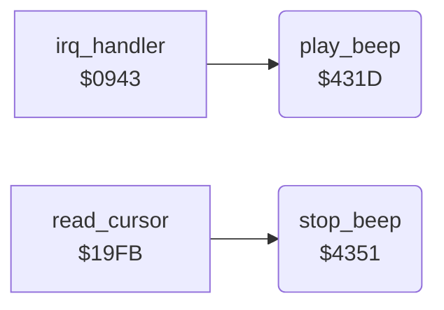

<!-- Generated by c64-docs from knowledge revision 20261025T214624.065-e5whe4 and .c64-re-tools/local/generated/src/source-map.json. Do not edit: change the knowledge, generate the source again, then run docs.ts generate. -->
# sound/beep.asm: Pad Beep

Range `$431D-$4360`. Source: [sound/beep.asm](../../../../src/sound/beep.asm). Index: [the reference](../../index.md).

## Routines

| Routine | Address | Reached from | Summary |
|---|---|---|---|
| [`play_beep`](beep.md#play_beep) | `$431D` | [`irq_handler`](../irq/irq.md#irq_handler) | Starts a short beep on SID voice 1: volume 14, pulse width $400, frequency $2ef0, attack 0, decay 3, sustain 0, release 0, triangle wave with the gate on. |
| [`stop_beep`](beep.md#stop_beep) | `$4351` | [`read_cursor`](../input/cursor.md#read_cursor) | Stops the beep: clears off_pad_beep_on, turns the gate of SID voice 1 off and sets the test bit. |

## Call graph

A solid arrow is a call, a thick arrow a table entry. Rounded nodes are in this file.

## Details

### [`play_beep`](../../../../src/sound/beep.asm#L6) `$431D`

*routine*

Starts a short beep on SID voice 1: volume 14, pulse width $400, frequency $2ef0, attack 0, decay 3, sustain 0, release 0, triangle wave with the gate on. The IRQ calls it every 33 interrupts while off_pad_beep_on is not 0.

- **Called from:** [`irq_handler`](../irq/irq.md#irq_handler)
- **Writes:** [`SIGVOL`](../../memory-map.md#SIGVOL), [`PWHI1`](../../memory-map.md#PWHI1), [`PWLO1`](../../memory-map.md#PWLO1), [`ATDCY1`](../../memory-map.md#ATDCY1), [`SUREL1`](../../memory-map.md#SUREL1), [`VCREG1`](../../memory-map.md#VCREG1), [`FRELO1`](../../memory-map.md#FRELO1), [`FREHI1`](../../memory-map.md#FREHI1)

### [`stop_beep`](../../../../src/sound/beep.asm#L29) `$4351`

*routine*

Stops the beep: clears off_pad_beep_on, turns the gate of SID voice 1 off and sets the test bit. read_cursor calls it when the pad is touched.

- **Called from:** [`read_cursor`](../input/cursor.md#read_cursor)
- **Writes:** [`off_pad_beep_on`](../../memory-map.md#off_pad_beep_on), [`VCREG1`](../../memory-map.md#VCREG1)
