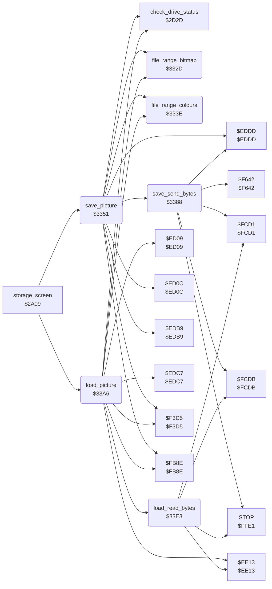

<!-- Generated by c64-docs from knowledge revision 20261025T214624.065-e5whe4 and .c64-re-tools/local/generated/src/source-map.json. Do not edit: change the knowledge, generate the source again, then run docs.ts generate. -->
# storage/picture_file.asm: Save and load of the picture file

Range `$332D-$340D`. Source: [storage/picture_file.asm](../../../../src/storage/picture_file.asm). Index: [the reference](../../index.md).

## Routines

| Routine | Address | Reached from | Summary |
|---|---|---|---|
| [`file_range_bitmap`](picture_file.md#file_range_bitmap) | `$332D` | [`save_picture`](picture_file.md#save_picture), [`load_picture`](picture_file.md#load_picture) | Sets the KERNAL start address (STAL $c1/$c2) to $6000 and the end address (EAL $ae/$af) to $7f40: the 8000 bitmap bytes. |
| [`file_range_colours`](picture_file.md#file_range_colours) | `$333E` | [`save_picture`](picture_file.md#save_picture), [`load_picture`](picture_file.md#load_picture) | Sets STAL to $c000 and EAL to $c7d1: the screen colours, the colour RAM and the background colour (2001 bytes). |
| [`save_picture`](picture_file.md#save_picture) | `$3351` | [`storage_screen`](storage_screen.md#storage_screen) | Saves the picture as a Koala file with the file name and device that are set. |
| [`save_send_bytes`](picture_file.md#save_send_bytes) | `$3388` | [`save_picture`](picture_file.md#save_picture) | Sends the bytes from $ac/$ad up to EAL with CIOUT. |
| [`load_picture`](picture_file.md#load_picture) | `$33A6` | [`storage_screen`](storage_screen.md#storage_screen) | Loads a Koala file with the file name and device that are set. |
| [`load_read_bytes`](picture_file.md#load_read_bytes) | `$33E3` | [`load_picture`](picture_file.md#load_picture) | Reads bytes with ACPTR to $ac/$ad up to EAL. |

## Call graph

A solid arrow is a call, a thick arrow a table entry. Rounded nodes are in this file.

## Details

### [`file_range_bitmap`](../../../../src/storage/picture_file.asm#L6) `$332D`

*routine*

Sets the KERNAL start address (STAL $c1/$c2) to $6000 and the end address (EAL $ae/$af) to $7f40: the 8000 bitmap bytes.

- **Called from:** [`save_picture`](picture_file.md#save_picture), [`load_picture`](picture_file.md#load_picture)
- **Writes:** [`STAL`](../../memory-map.md#STAL), [`EAL`](../../memory-map.md#EAL)

### [`file_range_colours`](../../../../src/storage/picture_file.asm#L17) `$333E`

*routine*

Sets STAL to $c000 and EAL to $c7d1: the screen colours, the colour RAM and the background colour (2001 bytes). Then copies STAL to the KERNAL pointer $ac/$ad ($fb8e).

- **Called from:** [`save_picture`](picture_file.md#save_picture), [`load_picture`](picture_file.md#load_picture)
- **Jumps to:** `$FB8E`
- **Writes:** [`STAL`](../../memory-map.md#STAL), [`EAL`](../../memory-map.md#EAL)

### [`save_picture`](../../../../src/storage/picture_file.asm#L28) `$3351`

*routine*

Saves the picture as a Koala file with the file name and device that are set. Opens the file with secondary address 1 ($f3d5) and checks the drive status ($2d2d, drive_status); on an error it jumps to $2c22. Then sends the load address $6000, the bitmap $6000-$7f3f and $c000-$c7d0, and closes the file ($f63f). The STOP key ends the save with C set.

- **Called from:** [`storage_screen`](storage_screen.md#storage_screen)
- **Calls:** [`file_range_bitmap`](picture_file.md#file_range_bitmap), `$F3D5`, [`check_drive_status`](storage_screen.md#check_drive_status), `$ED0C`, `$EDB9`, `$FB8E`, `$EDDD`, [`save_send_bytes`](picture_file.md#save_send_bytes), [`file_range_colours`](picture_file.md#file_range_colours)
- **Jumps to:** [`storage_transfer_abort`](storage_screen.md#storage_transfer_abort), `$F63F`
- **Reads:** [`FA`](../../memory-map.md#FA), [`SA`](../../memory-map.md#SA), `$00AC`, `$00AD`
- **Writes:** [`SA`](../../memory-map.md#SA)

| Label | Address | Comment |
|---|---|---|
| [`save_send_file`](../../../../src/storage/picture_file.asm#L37) | `$3363` |  |

### [`save_send_bytes`](../../../../src/storage/picture_file.asm#L53) `$3388`

*routine*

Sends the bytes from $ac/$ad up to EAL with CIOUT. The STOP key closes the file ($f642), drops the return address and returns from the caller with A = 0 and C set.
C set when $ac/$ad has reached EAL.

- **Called from:** [`save_picture`](picture_file.md#save_picture)
- **Calls:** `$FCD1`, `$EDDD`, [`STOP`](../../memory-map.md#STOP), `$F642`, `$FCDB`
- **Reads:** `$00AC`

| Label | Address | Comment |
|---|---|---|
| [`save_send_next`](../../../../src/storage/picture_file.asm#L67) | `$33A0` |  |
| [`save_send_done`](../../../../src/storage/picture_file.asm#L70) | `$33A5` |  |

### [`load_picture`](../../../../src/storage/picture_file.asm#L73) `$33A6`

*routine*

Loads a Koala file with the file name and device that are set. Opens the file with secondary address 0 ($f3d5) and checks the drive status ($2d2d, drive_status); on an error it jumps to $2c22. The file's load address is not used: the first 8000 bytes go to the bitmap $6000-$7f3f, the next 2001 bytes to $c000-$c7d0. A read timeout on the first byte gives FILE NOT FOUND ($f704).

- **Called from:** [`storage_screen`](storage_screen.md#storage_screen)
- **Calls:** [`file_range_bitmap`](picture_file.md#file_range_bitmap), `$F3D5`, [`check_drive_status`](storage_screen.md#check_drive_status), `$ED09`, `$EDC7`, `$EE13`, `$FB8E`, [`load_read_bytes`](picture_file.md#load_read_bytes), [`file_range_colours`](picture_file.md#file_range_colours)
- **Jumps to:** [`storage_transfer_abort`](storage_screen.md#storage_transfer_abort), [`load_file_not_found`](picture_file.md#load_file_not_found), `$F528`
- **Reads:** [`FA`](../../memory-map.md#FA), [`SA`](../../memory-map.md#SA), [`STATUS`](../../memory-map.md#STATUS)
- **Writes:** [`STATUS`](../../memory-map.md#STATUS), [`SA`](../../memory-map.md#SA)

| Label | Address | Comment |
|---|---|---|
| [`load_read_file`](../../../../src/storage/picture_file.asm#L84) | `$33BC` |  |

### [`load_read_bytes`](../../../../src/storage/picture_file.asm#L102) `$33E3`

*routine*

Reads bytes with ACPTR to $ac/$ad up to EAL. After a read timeout (STATUS bit 1) it reads again. The STOP key drops the return address and jumps to $f633 in the KERNAL.

- **Called from:** [`load_picture`](picture_file.md#load_picture)
- **Calls:** `$FCD1`, [`STOP`](../../memory-map.md#STOP), `$EE13`, `$FCDB`
- **Jumps to:** `$F633`, `$F704`
- **Reads:** [`STATUS`](../../memory-map.md#STATUS), `$00AC`
- **Writes:** [`STATUS`](../../memory-map.md#STATUS)

| Label | Address | Comment |
|---|---|---|
| [`load_read_byte`](../../../../src/storage/picture_file.asm#L114) | `$33F8` |  |
| [`load_read_done`](../../../../src/storage/picture_file.asm#L125) | `$340A` |  |
| [`load_file_not_found`](../../../../src/storage/picture_file.asm#L127) | `$340B` | KERNAL error FILE NOT FOUND. |
