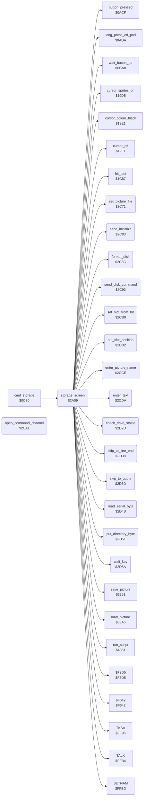

<!-- Generated by c64-docs from knowledge revision 20261025T214624.065-e5whe4 and .c64-re-tools/local/generated/src/source-map.json. Do not edit: change the knowledge, generate the source again, then run docs.ts generate. -->
# storage/storage_screen.asm: Storage Screen: Directory, Save, Get, Name and Disk Commands

Range `$2A09-$2D7A`. Source: [storage/storage_screen.asm](../../../../src/storage/storage_screen.asm). Index: [the reference](../../index.md).

## Routines

| Routine | Address | Reached from | Summary |
|---|---|---|---|
| [`storage_screen`](storage_screen.md#storage_screen) | `$2A09` | [`cmd_storage`](../menu/menu.md#cmd_storage) | The Storage screen (command $0f, also Change Disk). |
| [`storage_transfer_abort`](storage_screen.md#storage_transfer_abort) | `$2C22` | [`save_picture`](picture_file.md#save_picture), [`load_picture`](picture_file.md#load_picture) | The save and load routines jump here when the drive status is not 00 after the open: removes their return address and shows the error. |
| [`set_picture_file`](storage_screen.md#set_picture_file) | `$2C71` | [`storage_screen`](storage_screen.md#storage_screen) | Sets the file of a picture: name = the 15 bytes at script_dst (the slot field: $81 "PIC ", the letter, a space and the name), logical file 5, device 8, secondary address 0. |
| [`send_initialize`](storage_screen.md#send_initialize) | `$2C83` | [`storage_screen`](storage_screen.md#storage_screen), [`disk_protection`](../protection/disk_protection.md#disk_protection) | Sends the command "I" (init_command) to the drive on channel 15. |
| [`format_disk`](storage_screen.md#format_disk) | `$2C8C` | [`storage_screen`](storage_screen.md#storage_screen) | Shows "Formatting Disk" and sends the 18 bytes of disk_command ("N0:name,id") to the drive. |
| [`send_disk_command`](storage_screen.md#send_disk_command) | `$2C93` | [`storage_screen`](storage_screen.md#storage_screen) | Sends the 18 bytes of disk_command to the drive on channel 15. |
| [`open_command_channel`](storage_screen.md#open_command_channel) | `$2CA1` | [`send_disk_command`](storage_screen.md#send_disk_command), [`disk_protection`](../protection/disk_protection.md#disk_protection) | Opens file 15 on device 8, secondary address 15, with the name of length A at X/Y (SETNAM, SETLFS, OPEN). |
| [`set_slot_from_hit`](storage_screen.md#set_slot_from_hit) | `$2CB0` | [`storage_screen`](storage_screen.md#storage_screen) | Sets the destination to the field of the slot in hit_code. |
| [`set_slot_position`](storage_screen.md#set_slot_position) | `$2CB2` | [`storage_screen`](storage_screen.md#storage_screen) | Sets the destination (script_dst) to the field of slot A (1-16). |
| [`enter_picture_name`](storage_screen.md#enter_picture_name) | `$2CCE` | [`storage_screen`](storage_screen.md#storage_screen) | Clears the name of the slot field and gets a name of at most 8 characters. |
| [`enter_text`](storage_screen.md#enter_text) | `$2CDA` | [`storage_screen`](storage_screen.md#storage_screen) | Text entry at the destination: at most entry_max_length characters $20-$5a, DEL removes one, RETURN ends. |
| [`check_drive_status`](storage_screen.md#check_drive_status) | `$2D2D` | [`storage_screen`](storage_screen.md#storage_screen), [`save_picture`](picture_file.md#save_picture), [`load_picture`](picture_file.md#load_picture) | Reads the status of the drive on channel 15 ($3adf) into drive_message after the text "Error". |
| [`skip_to_line_end`](storage_screen.md#skip_to_line_end) | `$2D38` | [`storage_screen`](storage_screen.md#storage_screen) | Reads bytes from the serial bus up to a zero byte. |
| [`skip_to_quote`](storage_screen.md#skip_to_quote) | `$2D3D` | [`storage_screen`](storage_screen.md#storage_screen) | Reads bytes from the serial bus up to a quote. |
| [`read_serial_byte`](storage_screen.md#read_serial_byte) | `$2D4B` | [`storage_screen`](storage_screen.md#storage_screen), [`skip_to_quote`](storage_screen.md#skip_to_quote) | Reads a byte from the serial bus (ACPTR) to A. |
| [`put_directory_byte`](storage_screen.md#put_directory_byte) | `$2D51` | [`storage_screen`](storage_screen.md#storage_screen) | Writes A at the destination (script_put_fill_value) and increments the destination. |
| [`wait_key`](storage_screen.md#wait_key) | `$2D5A` | [`storage_screen`](storage_screen.md#storage_screen), [`enter_text`](storage_screen.md#enter_text) | Waits for a key: lets the IRQ scan the keyboard, waits for 10 empty GETIN results, then waits for a key and stops the keyboard scan. |

## Data

| Range | Type | Name | Read by | Written by |
|---|---|---|---|---|
| [`$2C9C`](../../../../src/storage/storage_screen.asm#L368)-`$2C9D` | dual-use |  |  |  |
| [`$2CBB`](../../../../src/storage/storage_screen.asm#L388)-`$2CBC` | dual-use | [`slot_right_column`](../../../../src/storage/storage_screen.asm#L387) |  |  |

## Call graph

A solid arrow is a call, a thick arrow a table entry. Rounded nodes are in this file.

The graph shows 30 of the 47 edges.

## Details

### [`storage_screen`](../../../../src/storage/storage_screen.asm#L6) `$2A09`

*routine*

The Storage screen (command $0f, also Change Disk). Draws the screen (script $23ac), sends "I" to the drive, reads the directory and shows each file whose name starts with $81 "PIC " in the next slot. Then it runs the Storage loop. Returns after a long press off the pad.

- **Called from:** [`cmd_storage`](../menu/menu.md#cmd_storage)
- **Calls:** [`run_script`](../script/interpreter.md#run_script), [`cursor_off`](../input/cursor.md#cursor_off), [`cursor_colour_black`](../input/cursor.md#cursor_colour_black), [`send_initialize`](storage_screen.md#send_initialize), [`check_drive_status`](storage_screen.md#check_drive_status), [`CLALL`](../../memory-map.md#CLALL), [`SETNAM`](../../memory-map.md#SETNAM), `$F3D5`, [`TALK`](../../memory-map.md#TALK), [`TKSA`](../../memory-map.md#TKSA), [`skip_to_quote`](storage_screen.md#skip_to_quote), [`read_serial_byte`](storage_screen.md#read_serial_byte) and 18 more
- **Reads:** [`FA`](../../memory-map.md#FA), [`SA`](../../memory-map.md#SA), [`FNLEN`](../../memory-map.md#FNLEN), [`FNADR`](../../memory-map.md#FNADR), [`pic_name_prefix`](storage_data.md#pic_name_prefix), [`storage_free_slot`](../../memory-map.md#storage_free_slot), [`hit_code`](../../memory-map.md#hit_code), [`storage_action`](../../memory-map.md#storage_action), [`storage_named_slot`](../../memory-map.md#storage_named_slot)
- **Writes:** [`hit_table_ptr`](../../memory-map.md#hit_table_ptr), [`storage_free_slot`](../../memory-map.md#storage_free_slot), [`SA`](../../memory-map.md#SA), [`STATUS`](../../memory-map.md#STATUS), [`script_dest_ptr`](../../memory-map.md#script_dest_ptr), [`FNLEN`](../../memory-map.md#FNLEN), [`FNADR`](../../memory-map.md#FNADR), [`storage_action`](../../memory-map.md#storage_action), [`hit_code`](../../memory-map.md#hit_code), [`NDX`](../../memory-map.md#NDX), [`entry_max_length`](../../memory-map.md#entry_max_length), [`storage_named_slot`](../../memory-map.md#storage_named_slot)

| Label | Address | Comment |
|---|---|---|
| [`storage_read_directory`](../../../../src/storage/storage_screen.asm#L22) | `$2A29` | Opens the directory: file name "$", secondary address $60, $f3d5 sends the name. storage_free_slot starts at 1. |
| [`storage_directory_talk`](../../../../src/storage/storage_screen.asm#L37) | `$2A47` | Makes the drive talk, then reads the disk name (the text between the first quotes, at most 12 characters) to row 1, column 22 of the screen. |
| [`storage_disk_name_loop`](../../../../src/storage/storage_screen.asm#L51) | `$2A64` | FNLEN is a counter here. |
| [`storage_disk_name_done`](../../../../src/storage/storage_screen.asm#L61) | `$2A77` |  |
| [`storage_next_entry`](../../../../src/storage/storage_screen.asm#L65) | `$2A7C` | Next directory line: skips to its quote, compares the first 5 bytes of the name with pic_name_prefix and puts the 15 bytes of the name in dir_entry_buffer. |
| [`storage_prefix_loop`](../../../../src/storage/storage_screen.asm#L76) | `$2A91` |  |
| [`storage_name_rest_loop`](../../../../src/storage/storage_screen.asm#L88) | `$2AAA` |  |
| [`storage_skip_entry`](../../../../src/storage/storage_screen.asm#L100) | `$2AC6` |  |
| [`storage_directory_close`](../../../../src/storage/storage_screen.asm#L105) | `$2ACE` | End of the directory or a read error: $f642 closes the serial file. KERNAL: closes the serial file. |
| [`storage_device_absent`](../../../../src/storage/storage_screen.asm#L109) | `$2AD4` | KERNAL error 5: writes "Device Not Present" to drive_message. |
| [`storage_file_not_found`](../../../../src/storage/storage_screen.asm#L116) | `$2ADE` | KERNAL error 4: shows "File not found". |
| [`storage_kernal_error`](../../../../src/storage/storage_screen.asm#L122) | `$2AE8` | A = the KERNAL error code of a failed load or save (carry set): 4 and 5 have their own texts, other codes show "error". |
| [`storage_idle`](../../../../src/storage/storage_screen.asm#L132) | `$2AFA` | No action: clears storage_action and the label sprites of the cursor. |
| [`storage_loop`](../../../../src/storage/storage_screen.asm#L139) | `$2B05` | Storage loop: a long press off the pad returns to the caller. A press on a cell runs the cell. |
| [`storage_press`](../../../../src/storage/storage_screen.asm#L145) | `$2B0E` | Hit test of the cursor; a press clears the marks and the message, then selects the action of the cell code. |
| [`storage_test_get`](../../../../src/storage/storage_screen.asm#L157) | `$2B29` |  |
| [`storage_test_name_save`](../../../../src/storage/storage_screen.asm#L161) | `$2B30` |  |
| [`storage_test_change_disk`](../../../../src/storage/storage_screen.asm#L165) | `$2B37` |  |
| [`storage_test_init_disk`](../../../../src/storage/storage_screen.asm#L169) | `$2B3E` |  |
| [`storage_slot_chosen`](../../../../src/storage/storage_screen.asm#L179) | `$2B50` | A slot: the slot number is at most storage_free_slot. Sets the destination to the slot field, then runs storage_action. |
| [`storage_test_name_action`](../../../../src/storage/storage_screen.asm#L188) | `$2B62` |  |
| [`storage_init_disk`](../../../../src/storage/storage_screen.asm#L193) | `$2B69` | Init Disk: asks "Erase Disk?"; only "Y" continues. Then gets a disk name of 1-12 characters, sends "N0:name,id" and checks the drive status. |
| [`storage_init_disk_exit`](../../../../src/storage/storage_screen.asm#L220) | `$2BA5` |  |
| [`storage_choose_save`](../../../../src/storage/storage_screen.asm#L223) | `$2BA8` | Save: storage_action = 1 and the cursor label "save". |
| [`storage_choose_get`](../../../../src/storage/storage_screen.asm#L230) | `$2BB4` | Get: storage_action = 2 and the cursor label "get". |
| [`storage_choose_name_save`](../../../../src/storage/storage_screen.asm#L237) | `$2BC0` | Name & Save: storage_action = 3 and the cursor label "name". |
| [`storage_save_slot`](../../../../src/storage/storage_screen.asm#L244) | `$2BCC` | Saves the picture to the slot. A slot that has a file: sends "S0:" and the old name first. |
| [`storage_scratch_and_save`](../../../../src/storage/storage_screen.asm#L255) | `$2BE1` |  |
| [`storage_save_new_slot`](../../../../src/storage/storage_screen.asm#L261) | `$2BEC` | The first empty slot: clears the name (not after Name & Save) and adds the slot. |
| [`storage_add_slot`](../../../../src/storage/storage_screen.asm#L267) | `$2BF8` |  |
| [`storage_write_file`](../../../../src/storage/storage_screen.asm#L270) | `$2BFB` | Sets the file name from the slot field and saves the picture ($3351). |
| [`storage_get_slot`](../../../../src/storage/storage_screen.asm#L277) | `$2C06` | Gets the picture of the slot. The first empty slot does nothing. |
| [`storage_read_file`](../../../../src/storage/storage_screen.asm#L284) | `$2C10` | Shows "Getting Picture", sets the file name from the slot field and loads the picture ($33a6). |
| [`storage_check_result`](../../../../src/storage/storage_screen.asm#L298) | `$2C27` |  |
| [`storage_show_error`](../../../../src/storage/storage_screen.asm#L302) | `$2C2C` | Shows drive_message on the message line. |
| [`storage_clear_message`](../../../../src/storage/storage_screen.asm#L307) | `$2C33` |  |
| [`storage_message_done`](../../../../src/storage/storage_screen.asm#L310) | `$2C37` |  |
| [`storage_name_save_slot`](../../../../src/storage/storage_screen.asm#L314) | `$2C3D` | Name & Save to the slot: gets a name of 1-8 characters, then saves. A slot that has a file: sends "S0:" and the old name first. |
| [`storage_name_new_slot`](../../../../src/storage/storage_screen.asm#L329) | `$2C5D` |  |
| [`storage_name_cancel`](../../../../src/storage/storage_screen.asm#L336) | `$2C6E` |  |

### [`storage_transfer_abort`](../../../../src/storage/storage_screen.asm#L294) `$2C22`

*label*

The save and load routines jump here when the drive status is not 00 after the open: removes their return address and shows the error.

- **Jumped to from:** [`save_picture`](picture_file.md#save_picture), [`load_picture`](picture_file.md#load_picture)

### [`set_picture_file`](../../../../src/storage/storage_screen.asm#L340) `$2C71`

*routine*

Sets the file of a picture: name = the 15 bytes at script_dst (the slot field: $81 "PIC ", the letter, a space and the name), logical file 5, device 8, secondary address 0.
15 characters: the name in the slot field.

- **Called from:** [`storage_screen`](storage_screen.md#storage_screen)
- **Calls:** [`SETNAM`](../../memory-map.md#SETNAM)
- **Jumps to:** [`SETLFS`](../../memory-map.md#SETLFS)
- **Reads:** [`script_dest_ptr`](../../memory-map.md#script_dest_ptr)

### [`send_initialize`](../../../../src/storage/storage_screen.asm#L350) `$2C83`

*routine*

Sends the command "I" (init_command) to the drive on channel 15. Also used by the disk protection ($3a85).

- **Called from:** [`storage_screen`](storage_screen.md#storage_screen), [`disk_protection`](../protection/disk_protection.md#disk_protection)
- **Jumps to:** [`send_command_close`](storage_screen.md#send_command_close)

### [`format_disk`](../../../../src/storage/storage_screen.asm#L356) `$2C8C`

*routine*

Shows "Formatting Disk" and sends the 18 bytes of disk_command ("N0:name,id") to the drive.

- **Called from:** [`storage_screen`](storage_screen.md#storage_screen)
- **Calls:** [`run_script`](../script/interpreter.md#run_script)

### [`send_disk_command`](../../../../src/storage/storage_screen.asm#L361) `$2C93`

*routine*

Sends the 18 bytes of disk_command to the drive on channel 15.

- **Called from:** [`storage_screen`](storage_screen.md#storage_screen)
- **Calls:** [`open_command_channel`](storage_screen.md#open_command_channel)
- **Jumps to:** [`CLOSE`](../../memory-map.md#CLOSE)

| Label | Address | Comment |
|---|---|---|
| [`send_command_close`](../../../../src/storage/storage_screen.asm#L366) | `$2C99` | Opens the command channel with the name in A/X/Y, then closes file 15. |

### [`open_command_channel`](../../../../src/storage/storage_screen.asm#L371) `$2CA1`

*routine*

Opens file 15 on device 8, secondary address 15, with the name of length A at X/Y (SETNAM, SETLFS, OPEN). Also used by the disk protection ($3a62, $3a78).

- **Called from:** [`send_disk_command`](storage_screen.md#send_disk_command), [`disk_protection`](../protection/disk_protection.md#disk_protection)
- **Calls:** [`SETNAM`](../../memory-map.md#SETNAM), [`SETLFS`](../../memory-map.md#SETLFS)
- **Jumps to:** [`OPEN`](../../memory-map.md#OPEN)

### [`set_slot_from_hit`](../../../../src/storage/storage_screen.asm#L379) `$2CB0`

*routine*

Sets the destination to the field of the slot in hit_code.

- **Called from:** [`storage_screen`](storage_screen.md#storage_screen)
- **Reads:** [`hit_code`](../../memory-map.md#hit_code)

### [`set_slot_position`](../../../../src/storage/storage_screen.asm#L382) `$2CB2`

*routine*

Sets the destination (script_dst) to the field of slot A (1-16). Slots 1-8 are the left column, 9-16 the right column. Changes script_condition.
Slots 1-8: script_condition = slot (not zero) means the left column.

- **Called from:** [`storage_screen`](storage_screen.md#storage_screen)
- **Jumps to:** [`run_script`](../script/interpreter.md#run_script)
- **Writes:** [`script_condition`](../../memory-map.md#script_condition), [`script_arg_stack`](../../memory-map.md#script_arg_stack)

| Label | Address | Comment |
|---|---|---|
| [`slot_right_column`](../../../../src/storage/storage_screen.asm#L387) | `$2CBB` |  |
| [`slot_run_position`](../../../../src/storage/storage_screen.asm#L394) | `$2CC4` |  |

### [`enter_picture_name`](../../../../src/storage/storage_screen.asm#L400) `$2CCE`

*routine*

Clears the name of the slot field and gets a name of at most 8 characters. Carry set: no characters.

- **Called from:** [`storage_screen`](storage_screen.md#storage_screen)
- **Calls:** [`run_script`](../script/interpreter.md#run_script)
- **Writes:** [`entry_max_length`](../../memory-map.md#entry_max_length)

### [`enter_text`](../../../../src/storage/storage_screen.asm#L407) `$2CDA`

*routine*

Text entry at the destination: at most entry_max_length characters $20-$5a, DEL removes one, RETURN ends. Carry set: no characters. The script code draws the characters and the caret.

- **Called from:** [`storage_screen`](storage_screen.md#storage_screen)
- **Calls:** [`wait_key`](storage_screen.md#wait_key), [`run_script`](../script/interpreter.md#run_script)
- **Reads:** [`entry_length`](../../memory-map.md#entry_length), [`entry_max_length`](../../memory-map.md#entry_max_length)
- **Writes:** [`entry_length`](../../memory-map.md#entry_length), [`NDX`](../../memory-map.md#NDX), [`script_fill_byte`](../../memory-map.md#script_fill_byte)

| Label | Address | Comment |
|---|---|---|
| [`enter_text_loop`](../../../../src/storage/storage_screen.asm#L411) | `$2CE1` |  |
| [`enter_text_test_return`](../../../../src/storage/storage_screen.asm#L423) | `$2CFA` | RETURN. |
| [`enter_text_done`](../../../../src/storage/storage_screen.asm#L439) | `$2D1D` |  |
| [`enter_text_empty`](../../../../src/storage/storage_screen.asm#L447) | `$2D2B` |  |

### [`check_drive_status`](../../../../src/storage/storage_screen.asm#L452) `$2D2D`

*routine*

Reads the status of the drive on channel 15 ($3adf) into drive_message after the text "Error". Carry clear: status 00.

- **Called from:** [`storage_screen`](storage_screen.md#storage_screen), [`save_picture`](picture_file.md#save_picture), [`load_picture`](picture_file.md#load_picture)
- **Calls:** [`run_script`](../script/interpreter.md#run_script)
- **Jumps to:** [`drive_status`](drive_status.md#drive_status)

### [`skip_to_line_end`](../../../../src/storage/storage_screen.asm#L459) `$2D38`

*routine*

Reads bytes from the serial bus up to a zero byte. Z clear: the read ended with a status.

- **Called from:** [`storage_screen`](storage_screen.md#storage_screen)
- **Jumps to:** [`skip_until_byte`](storage_screen.md#skip_until_byte)

### [`skip_to_quote`](../../../../src/storage/storage_screen.asm#L463) `$2D3D`

*routine*

Reads bytes from the serial bus up to a quote. Z clear: the read ended with a status.

- **Called from:** [`storage_screen`](storage_screen.md#storage_screen)
- **Calls:** [`read_serial_byte`](storage_screen.md#read_serial_byte)
- **Reads:** [`temp_word`](../../memory-map.md#temp_word)
- **Writes:** [`temp_word`](../../memory-map.md#temp_word)

| Label | Address | Comment |
|---|---|---|
| [`skip_until_byte`](../../../../src/storage/storage_screen.asm#L465) | `$2D3F` |  |
| [`skip_until_loop`](../../../../src/storage/storage_screen.asm#L467) | `$2D41` |  |
| [`skip_until_exit`](../../../../src/storage/storage_screen.asm#L472) | `$2D4A` |  |

### [`read_serial_byte`](../../../../src/storage/storage_screen.asm#L475) `$2D4B`

*routine*

Reads a byte from the serial bus (ACPTR) to A. Y = STATUS, Z set when STATUS is 0.

- **Called from:** [`storage_screen`](storage_screen.md#storage_screen), [`skip_to_quote`](storage_screen.md#skip_to_quote)
- **Calls:** [`ACPTR`](../../memory-map.md#ACPTR)
- **Reads:** [`STATUS`](../../memory-map.md#STATUS)

### [`put_directory_byte`](../../../../src/storage/storage_screen.asm#L480) `$2D51`

*routine*

Writes A at the destination (script_put_fill_value) and increments the destination.

- **Called from:** [`storage_screen`](storage_screen.md#storage_screen)
- **Jumps to:** [`run_script`](../script/interpreter.md#run_script)
- **Writes:** [`script_fill_byte`](../../memory-map.md#script_fill_byte)

### [`wait_key`](../../../../src/storage/storage_screen.asm#L486) `$2D5A`

*routine*

Waits for a key: lets the IRQ scan the keyboard, waits for 10 empty GETIN results, then waits for a key and stops the keyboard scan. Returns the key in A.
The IRQ calls SCNKEY while keyboard_scan_enable is not zero.

- **Called from:** [`storage_screen`](storage_screen.md#storage_screen), [`enter_text`](storage_screen.md#enter_text)
- **Calls:** [`GETIN`](../../memory-map.md#GETIN)
- **Reads:** [`key_flush_count`](../../memory-map.md#key_flush_count)
- **Writes:** [`scan_keys_enable`](../../memory-map.md#scan_keys_enable), [`key_flush_count`](../../memory-map.md#key_flush_count)

| Label | Address | Comment |
|---|---|---|
| [`wait_key_flush`](../../../../src/storage/storage_screen.asm#L490) | `$2D61` |  |
| [`wait_key_press`](../../../../src/storage/storage_screen.asm#L496) | `$2D6D` |  |
