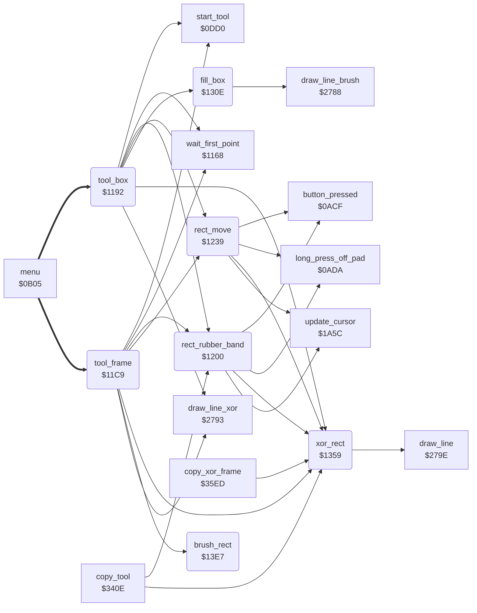

<!-- Generated by c64-docs from knowledge revision 20261025T214624.065-e5whe4 and .c64-re-tools/local/generated/src/source-map.json. Do not edit: change the knowledge, generate the source again, then run docs.ts generate. -->
# tools/box_frame_tool.asm: Box and Frame tools

Range `$1192-$13F1`. Source: [tools/box_frame_tool.asm](../../../../src/tools/box_frame_tool.asm). Index: [the reference](../../index.md).

## Routines

| Routine | Address | Reached from | Summary |
|---|---|---|---|
| [`tool_box`](box_frame_tool.md#tool_box) | `$1192` | [`menu`](../menu/menu.md#menu) | Box command (code 7). |
| [`tool_frame`](box_frame_tool.md#tool_frame) | `$11C9` | [`menu`](../menu/menu.md#menu) | Frame command (code 4). |
| [`rect_rubber_band`](box_frame_tool.md#rect_rubber_band) | `$1200` | [`tool_box`](box_frame_tool.md#tool_box), [`tool_frame`](box_frame_tool.md#tool_frame), [`copy_tool`](copy.md#copy_tool) | Moves the corner (shape_x1, shape_y1) with the cursor and shows the rectangle with XOR (xor_rect) until a new button press. |
| [`rect_move`](box_frame_tool.md#rect_move) | `$1239` | [`tool_box`](box_frame_tool.md#tool_box), [`tool_frame`](box_frame_tool.md#tool_frame) | Moves the rectangle with the cursor until a new button press. |
| [`fill_box`](box_frame_tool.md#fill_box) | `$130E` | [`tool_box`](box_frame_tool.md#tool_box) | Fills the rectangle with the corners (shape_x0, shape_y0) and (shape_x1, shape_y1) in current_colour: draws one horizontal line ($2788) for each row, with the one-pixel brush at $1868. |
| [`xor_rect`](box_frame_tool.md#xor_rect) | `$1359` | [`tool_box`](box_frame_tool.md#tool_box), [`tool_frame`](box_frame_tool.md#tool_frame), [`rect_rubber_band`](box_frame_tool.md#rect_rubber_band), [`rect_move`](box_frame_tool.md#rect_move), [`copy_tool`](copy.md#copy_tool), [`copy_xor_frame`](copy.md#copy_xor_frame) | Draws the rectangle with the corners (shape_x0, shape_y0) and (shape_x1, shape_y1) with XOR: plot_vector = $18c2, then draw_rect. |
| [`brush_rect`](box_frame_tool.md#brush_rect) | `$13E7` | [`tool_frame`](box_frame_tool.md#tool_frame) | Draws the rectangle with the corners (shape_x0, shape_y0) and (shape_x1, shape_y1) with the brush: plot_vector = plot_brush, then draw_rect. |

## Call graph

A solid arrow is a call, a thick arrow a table entry. Rounded nodes are in this file.

## Details

### [`tool_box`](../../../../src/tools/box_frame_tool.asm#L6) `$1192`

*routine*

Box command (code 7). Shows the label BOX. The first press sets a corner, the second press sets the other corner. Then the box moves with the cursor until the third press. Then fill_box fills the box in current_colour.

- **Entry of:** [`command_table`](../../tables.md#command_table)
- **Calls:** [`start_tool`](tool_start.md#start_tool), [`wait_first_point`](line_tool.md#wait_first_point), [`draw_line_xor`](../graphics/bresenham_line.md#draw_line_xor), [`xor_rect`](box_frame_tool.md#xor_rect), [`rect_rubber_band`](box_frame_tool.md#rect_rubber_band), [`rect_move`](box_frame_tool.md#rect_move), [`fill_box`](box_frame_tool.md#fill_box)
- **Reads:** [`current_colour`](../../memory-map.md#current_colour), [`background_colour`](../../memory-map.md#background_colour), [`shape_x0`](../../memory-map.md#shape_x0), [`shape_y0`](../../memory-map.md#shape_y0), [`saved_colour`](../../memory-map.md#saved_colour)
- **Writes:** [`saved_colour`](../../memory-map.md#saved_colour), [`current_colour`](../../memory-map.md#current_colour), [`point_x0`](../../memory-map.md#point_x0), [`point_x1`](../../memory-map.md#point_x1), [`point_y0`](../../memory-map.md#point_y0), [`point_y1`](../../memory-map.md#point_y1)

| Label | Address | Comment |
|---|---|---|
| [`tool_box_loop`](../../../../src/tools/box_frame_tool.asm#L10) | `$1199` |  |

### [`tool_frame`](../../../../src/tools/box_frame_tool.asm#L32) `$11C9`

*routine*

Frame command (code 4). Shows the label FRAME. The first press sets a corner, the second press sets the other corner. Then the frame moves with the cursor until the third press. Then brush_rect draws the frame with the brush in current_colour.

- **Entry of:** [`command_table`](../../tables.md#command_table)
- **Calls:** [`start_tool`](tool_start.md#start_tool), [`wait_first_point`](line_tool.md#wait_first_point), [`draw_line_xor`](../graphics/bresenham_line.md#draw_line_xor), [`xor_rect`](box_frame_tool.md#xor_rect), [`rect_rubber_band`](box_frame_tool.md#rect_rubber_band), [`rect_move`](box_frame_tool.md#rect_move), [`brush_rect`](box_frame_tool.md#brush_rect)
- **Reads:** [`current_colour`](../../memory-map.md#current_colour), [`background_colour`](../../memory-map.md#background_colour), [`shape_x0`](../../memory-map.md#shape_x0), [`shape_y0`](../../memory-map.md#shape_y0), [`saved_colour`](../../memory-map.md#saved_colour)
- **Writes:** [`saved_colour`](../../memory-map.md#saved_colour), [`current_colour`](../../memory-map.md#current_colour), [`point_x0`](../../memory-map.md#point_x0), [`point_x1`](../../memory-map.md#point_x1), [`point_y0`](../../memory-map.md#point_y0), [`point_y1`](../../memory-map.md#point_y1)

| Label | Address | Comment |
|---|---|---|
| [`tool_frame_loop`](../../../../src/tools/box_frame_tool.asm#L36) | `$11D0` |  |

### [`rect_rubber_band`](../../../../src/tools/box_frame_tool.asm#L58) `$1200`

*routine*

Moves the corner (shape_x1, shape_y1) with the cursor and shows the rectangle with XOR (xor_rect) until a new button press. Then erases the rectangle. A long press off the pad erases it, restores current_colour from saved_colour and goes to tool_exit. Box, Frame and Copy use it.

- **Called from:** [`tool_box`](box_frame_tool.md#tool_box), [`tool_frame`](box_frame_tool.md#tool_frame), [`copy_tool`](copy.md#copy_tool)
- **Calls:** [`update_cursor`](../input/cursor.md#update_cursor), [`long_press_off_pad`](../input/buttons.md#long_press_off_pad), [`xor_rect`](box_frame_tool.md#xor_rect), [`button_pressed`](../input/buttons.md#button_pressed)
- **Jumps to:** [`tool_exit`](tool_exit.md#tool_exit)
- **Reads:** [`saved_colour`](../../memory-map.md#saved_colour), [`cursor_x`](../../memory-map.md#cursor_x), [`cursor_y`](../../memory-map.md#cursor_y)
- **Writes:** [`current_colour`](../../memory-map.md#current_colour), [`point_y1`](../../memory-map.md#point_y1), [`point_x1`](../../memory-map.md#point_x1)

| Label | Address | Comment |
|---|---|---|
| [`rect_band_check_press`](../../../../src/tools/box_frame_tool.asm#L68) | `$1214` |  |
| [`rect_band_read`](../../../../src/tools/box_frame_tool.asm#L73) | `$121D` |  |

### [`rect_move`](../../../../src/tools/box_frame_tool.asm#L89) `$1239`

*routine*

Moves the rectangle with the cursor until a new button press. The cursor sets the corner (shape_x1, shape_y1). The corner (shape_x0, shape_y0) keeps its distance delta_x/delta_y, in the limits 0-max_x and 0-max_y. Shows the rectangle with XOR and erases it at the end. A long press off the pad goes to tool_exit.
delta_x = shape_x0 - shape_x1 (16 bits).

- **Called from:** [`tool_box`](box_frame_tool.md#tool_box), [`tool_frame`](box_frame_tool.md#tool_frame)
- **Calls:** [`update_cursor`](../input/cursor.md#update_cursor), [`long_press_off_pad`](../input/buttons.md#long_press_off_pad), [`xor_rect`](box_frame_tool.md#xor_rect), [`button_pressed`](../input/buttons.md#button_pressed)
- **Jumps to:** [`tool_exit`](tool_exit.md#tool_exit)
- **Reads:** [`point_x1`](../../memory-map.md#point_x1), [`temp_word`](../../memory-map.md#temp_word), [`temp_word_hi`](../../memory-map.md#temp_word_hi), [`point_x0`](../../memory-map.md#point_x0), [`point_y1`](../../memory-map.md#point_y1), [`point_y0`](../../memory-map.md#point_y0), [`saved_colour`](../../memory-map.md#saved_colour), [`cursor_x`](../../memory-map.md#cursor_x), [`cursor_y`](../../memory-map.md#cursor_y), [`delta_x`](../../memory-map.md#delta_x), [`circle_left_x`](../../memory-map.md#circle_left_x), [`max_x`](../../memory-map.md#max_x) and 3 more
- **Writes:** [`temp_word`](../../memory-map.md#temp_word), [`temp_word_hi`](../../memory-map.md#temp_word_hi), [`delta_x`](../../memory-map.md#delta_x), [`circle_left_x`](../../memory-map.md#circle_left_x), [`delta_y`](../../memory-map.md#delta_y), [`circle_upper_y`](../../memory-map.md#circle_upper_y), [`current_colour`](../../memory-map.md#current_colour), [`point_y1`](../../memory-map.md#point_y1), [`point_x1`](../../memory-map.md#point_x1), [`point_x0`](../../memory-map.md#point_x0), [`point_y0`](../../memory-map.md#point_y0)

| Label | Address | Comment |
|---|---|---|
| [`rect_move_loop`](../../../../src/tools/box_frame_tool.asm#L128) | `$1281` |  |
| [`rect_move_check_press`](../../../../src/tools/box_frame_tool.asm#L139) | `$1295` |  |
| [`rect_move_read`](../../../../src/tools/box_frame_tool.asm#L144) | `$129E` |  |
| [`rect_move_moved`](../../../../src/tools/box_frame_tool.asm#L154) | `$12B1` |  |
| [`rect_move_check_x_max`](../../../../src/tools/box_frame_tool.asm#L177) | `$12D8` | High byte not 0: shape_x0 is max_x. |
| [`rect_move_clamp_x_max`](../../../../src/tools/box_frame_tool.asm#L182) | `$12E0` |  |
| [`rect_move_set_y`](../../../../src/tools/box_frame_tool.asm#L186) | `$12E4` |  |
| [`rect_move_check_y_max`](../../../../src/tools/box_frame_tool.asm#L200) | `$12FC` |  |
| [`rect_move_clamp_y_max`](../../../../src/tools/box_frame_tool.asm#L205) | `$1304` |  |
| [`rect_move_redraw`](../../../../src/tools/box_frame_tool.asm#L209) | `$1308` |  |

### [`fill_box`](../../../../src/tools/box_frame_tool.asm#L213) `$130E`

*routine*

Fills the rectangle with the corners (shape_x0, shape_y0) and (shape_x1, shape_y1) in current_colour: draws one horizontal line ($2788) for each row, with the one-pixel brush at $1868. Puts the smaller coordinates in shape_x0/shape_y0. Restores brush_ptr at the end.

- **Called from:** [`tool_box`](box_frame_tool.md#tool_box)
- **Calls:** [`draw_line_brush`](../graphics/bresenham_line.md#draw_line_brush)
- **Reads:** [`brush_ptr`](../../memory-map.md#brush_ptr), [`RNDX`](../../memory-map.md#RNDX), [`point_x0`](../../memory-map.md#point_x0), [`point_x1`](../../memory-map.md#point_x1), [`point_y0`](../../memory-map.md#point_y0), [`point_y1`](../../memory-map.md#point_y1)
- **Writes:** [`brush_ptr`](../../memory-map.md#brush_ptr), [`RNDX`](../../memory-map.md#RNDX), [`point_x1`](../../memory-map.md#point_x1), [`point_x0`](../../memory-map.md#point_x0), [`point_y1`](../../memory-map.md#point_y1), [`point_y0`](../../memory-map.md#point_y0), [`shape_x0`](../../memory-map.md#shape_x0), [`shape_x1`](../../memory-map.md#shape_x1), [`shape_y0`](../../memory-map.md#shape_y0), [`shape_y1`](../../memory-map.md#shape_y1)

| Label | Address | Comment |
|---|---|---|
| [`fill_box_order_y`](../../../../src/tools/box_frame_tool.asm#L229) | `$1328` |  |
| [`fill_box_start`](../../../../src/tools/box_frame_tool.asm#L237) | `$1334` |  |
| [`fill_box_row`](../../../../src/tools/box_frame_tool.asm#L243) | `$133E` |  |
| [`fill_box_done`](../../../../src/tools/box_frame_tool.asm#L252) | `$1350` |  |

### [`xor_rect`](../../../../src/tools/box_frame_tool.asm#L260) `$1359`

*routine*

Draws the rectangle with the corners (shape_x0, shape_y0) and (shape_x1, shape_y1) with XOR: plot_vector = $18c2, then draw_rect. A second call erases it.

- **Called from:** [`tool_box`](box_frame_tool.md#tool_box), [`tool_frame`](box_frame_tool.md#tool_frame), [`rect_rubber_band`](box_frame_tool.md#rect_rubber_band), [`rect_move`](box_frame_tool.md#rect_move), [`copy_tool`](copy.md#copy_tool), [`copy_xor_frame`](copy.md#copy_xor_frame)
- **Calls:** [`draw_line`](../graphics/bresenham_line.md#draw_line)
- **Reads:** [`point_x0`](../../memory-map.md#point_x0), [`point_x1`](../../memory-map.md#point_x1), [`point_y0`](../../memory-map.md#point_y0), [`point_y1`](../../memory-map.md#point_y1), [`shape_y1`](../../memory-map.md#shape_y1), [`shape_x0`](../../memory-map.md#shape_x0), [`shape_y0`](../../memory-map.md#shape_y0)
- **Writes:** [`plot_vector`](../../memory-map.md#plot_vector), [`shape_x0`](../../memory-map.md#shape_x0), [`shape_x1`](../../memory-map.md#shape_x1), [`shape_y0`](../../memory-map.md#shape_y0), [`shape_y1`](../../memory-map.md#shape_y1)

| Label | Address | Comment |
|---|---|---|
| [`draw_rect`](../../../../src/tools/box_frame_tool.asm#L266) | `$1361` | Draws the rectangle with the corners (shape_x0, shape_y0) and (shape_x1, shape_y1) through plot_vector ($279e). When the corners are in one column or one row, draws one line. Else draws four lines: left side, bottom, right side, top. The 2nd, 3rd and 4th line start one pixel after their corner. |
| [`draw_rect_not_column`](../../../../src/tools/box_frame_tool.asm#L278) | `$1377` |  |
| [`draw_rect_four_lines`](../../../../src/tools/box_frame_tool.asm#L290) | `$138D` |  |
| [`draw_rect_inc_x`](../../../../src/tools/box_frame_tool.asm#L309) | `$13B1` |  |
| [`draw_rect_bottom`](../../../../src/tools/box_frame_tool.asm#L311) | `$13B3` |  |
| [`draw_rect_dec_y`](../../../../src/tools/box_frame_tool.asm#L323) | `$13C9` |  |
| [`draw_rect_right`](../../../../src/tools/box_frame_tool.asm#L325) | `$13CB` |  |
| [`draw_rect_dec_x`](../../../../src/tools/box_frame_tool.asm#L337) | `$13E1` |  |
| [`draw_rect_top`](../../../../src/tools/box_frame_tool.asm#L339) | `$13E3` |  |

### [`brush_rect`](../../../../src/tools/box_frame_tool.asm#L343) `$13E7`

*routine*

Draws the rectangle with the corners (shape_x0, shape_y0) and (shape_x1, shape_y1) with the brush: plot_vector = plot_brush, then draw_rect.

- **Called from:** [`tool_frame`](box_frame_tool.md#tool_frame)
- **Jumps to:** [`draw_rect`](box_frame_tool.md#draw_rect)
- **Writes:** [`plot_vector`](../../memory-map.md#plot_vector)
