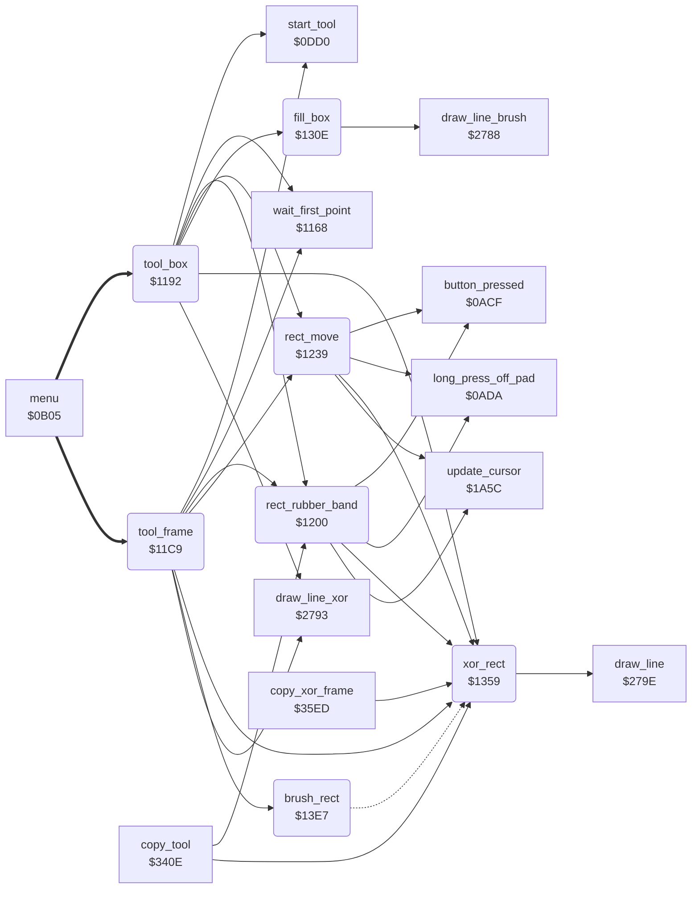

<!-- Generated by c64-docs from knowledge revision 20261024T063946.176-sfrhxb and .c64-re-tools/local/generated/src/source-map.json. Do not edit: change the knowledge, generate the source again, then run docs.ts generate. -->
# tools/box_frame_tool.asm: Box and Frame tools

Range `$1192-$13F1`. Source: [tools/box_frame_tool.asm](../../../../src/tools/box_frame_tool.asm). Index: [the reference](../../index.md).

## Call graph

A solid arrow is a call, a thick arrow a table entry, a dotted arrow a jump. Rounded nodes are in this file.

## Names

### [`tool_box`](../../../../src/tools/box_frame_tool.asm#L6) `$1192`

*routine*

Box command (code 7). Shows the label BOX. The first press sets a corner, the second press sets the other corner. Then the box moves with the cursor until the third press. Then fill_box fills the box in current_colour.

- **Entry of:** [`command_table`](../../tables.md#command_table)
- **Calls:** [`start_tool`](tool_start.md#start_tool), [`wait_first_point`](line_tool.md#wait_first_point), [`draw_line_xor`](../graphics/bresenham_line.md#draw_line_xor), [`xor_rect`](box_frame_tool.md#xor_rect), [`rect_rubber_band`](box_frame_tool.md#rect_rubber_band), [`rect_move`](box_frame_tool.md#rect_move), [`fill_box`](box_frame_tool.md#fill_box)
- **Reads:** [`current_colour`](../../memory-map.md#current_colour), [`background_colour`](../../memory-map.md#background_colour), [`shape_x0`](../../memory-map.md#shape_x0), [`shape_y0`](../../memory-map.md#shape_y0), [`saved_colour`](../../memory-map.md#saved_colour)
- **Writes:** [`saved_colour`](../../memory-map.md#saved_colour), [`current_colour`](../../memory-map.md#current_colour), [`point_x0`](../../memory-map.md#point_x0), [`point_x1`](../../memory-map.md#point_x1), [`point_y0`](../../memory-map.md#point_y0), [`point_y1`](../../memory-map.md#point_y1)

### [`tool_box_loop`](../../../../src/tools/box_frame_tool.asm#L10) `$1199`

*label*

- **Jumped to from:** [`tool_box`](box_frame_tool.md#tool_box) [`$11C6`](../../../../src/tools/box_frame_tool.asm#L30)

### [`tool_frame`](../../../../src/tools/box_frame_tool.asm#L32) `$11C9`

*routine*

Frame command (code 4). Shows the label FRAME. The first press sets a corner, the second press sets the other corner. Then the frame moves with the cursor until the third press. Then brush_rect draws the frame with the brush in current_colour.

- **Entry of:** [`command_table`](../../tables.md#command_table)
- **Calls:** [`start_tool`](tool_start.md#start_tool), [`wait_first_point`](line_tool.md#wait_first_point), [`draw_line_xor`](../graphics/bresenham_line.md#draw_line_xor), [`xor_rect`](box_frame_tool.md#xor_rect), [`rect_rubber_band`](box_frame_tool.md#rect_rubber_band), [`rect_move`](box_frame_tool.md#rect_move), [`brush_rect`](box_frame_tool.md#brush_rect)
- **Reads:** [`current_colour`](../../memory-map.md#current_colour), [`background_colour`](../../memory-map.md#background_colour), [`shape_x0`](../../memory-map.md#shape_x0), [`shape_y0`](../../memory-map.md#shape_y0), [`saved_colour`](../../memory-map.md#saved_colour)
- **Writes:** [`saved_colour`](../../memory-map.md#saved_colour), [`current_colour`](../../memory-map.md#current_colour), [`point_x0`](../../memory-map.md#point_x0), [`point_x1`](../../memory-map.md#point_x1), [`point_y0`](../../memory-map.md#point_y0), [`point_y1`](../../memory-map.md#point_y1)

### [`tool_frame_loop`](../../../../src/tools/box_frame_tool.asm#L36) `$11D0`

*label*

- **Jumped to from:** [`tool_frame`](box_frame_tool.md#tool_frame) [`$11FD`](../../../../src/tools/box_frame_tool.asm#L56)

### [`rect_rubber_band`](../../../../src/tools/box_frame_tool.asm#L58) `$1200`

*routine*

Moves the corner (shape_x1, shape_y1) with the cursor and shows the rectangle with XOR (xor_rect) until a new button press. Then erases the rectangle. A long press off the pad erases it, restores current_colour from saved_colour and goes to tool_exit. Box, Frame and Copy use it.

- **Called from:** [`tool_box`](box_frame_tool.md#tool_box) [`$11B6`](../../../../src/tools/box_frame_tool.asm#L24), [`tool_frame`](box_frame_tool.md#tool_frame) [`$11ED`](../../../../src/tools/box_frame_tool.asm#L50), [`copy_tool`](copy.md#copy_tool) [`$343C`](../../../../src/tools/copy.asm#L28)
- **Calls:** [`update_cursor`](../input/cursor.md#update_cursor), [`long_press_off_pad`](../input/buttons.md#long_press_off_pad), [`xor_rect`](box_frame_tool.md#xor_rect), [`button_pressed`](../input/buttons.md#button_pressed)
- **Jumps to:** [`tool_exit`](tool_exit.md#tool_exit)
- **Reads:** [`saved_colour`](../../memory-map.md#saved_colour), [`cursor_x`](../../memory-map.md#cursor_x), [`cursor_y`](../../memory-map.md#cursor_y)
- **Writes:** [`current_colour`](../../memory-map.md#current_colour), [`point_y1`](../../memory-map.md#point_y1), [`point_x1`](../../memory-map.md#point_x1)

### [`rect_band_check_press`](../../../../src/tools/box_frame_tool.asm#L68) `$1214`

*label*

- **Jumped to from:** [`rect_rubber_band`](box_frame_tool.md#rect_rubber_band) [`$1206`](../../../../src/tools/box_frame_tool.asm#L61)

### [`rect_band_read`](../../../../src/tools/box_frame_tool.asm#L73) `$121D`

*label*

- **Jumped to from:** [`rect_rubber_band`](box_frame_tool.md#rect_rubber_band) [`$1217`](../../../../src/tools/box_frame_tool.asm#L70)

### [`rect_move`](../../../../src/tools/box_frame_tool.asm#L89) `$1239`

*routine*

Moves the rectangle with the cursor until a new button press. The cursor sets the corner (shape_x1, shape_y1). The corner (shape_x0, shape_y0) keeps its distance delta_x/delta_y, in the limits 0-max_x and 0-max_y. Shows the rectangle with XOR and erases it at the end. A long press off the pad goes to tool_exit.
delta_x = shape_x0 - shape_x1 (16 bits).

- **Called from:** [`tool_box`](box_frame_tool.md#tool_box) [`$11BC`](../../../../src/tools/box_frame_tool.asm#L26), [`tool_frame`](box_frame_tool.md#tool_frame) [`$11F3`](../../../../src/tools/box_frame_tool.asm#L52)
- **Calls:** [`update_cursor`](../input/cursor.md#update_cursor), [`long_press_off_pad`](../input/buttons.md#long_press_off_pad), [`xor_rect`](box_frame_tool.md#xor_rect), [`button_pressed`](../input/buttons.md#button_pressed)
- **Jumps to:** [`tool_exit`](tool_exit.md#tool_exit)
- **Reads:** [`point_x1`](../../memory-map.md#point_x1), [`temp_word`](../../memory-map.md#temp_word), [`temp_word_hi`](../../memory-map.md#temp_word_hi), [`point_x0`](../../memory-map.md#point_x0), [`point_y1`](../../memory-map.md#point_y1), [`point_y0`](../../memory-map.md#point_y0), [`saved_colour`](../../memory-map.md#saved_colour), [`cursor_x`](../../memory-map.md#cursor_x), [`cursor_y`](../../memory-map.md#cursor_y), [`delta_x`](../../memory-map.md#delta_x), [`circle_left_x`](../../memory-map.md#circle_left_x), [`max_x`](../../memory-map.md#max_x), [`delta_y`](../../memory-map.md#delta_y), [`circle_upper_y`](../../memory-map.md#circle_upper_y), [`max_y`](../../memory-map.md#max_y)
- **Writes:** [`temp_word`](../../memory-map.md#temp_word), [`temp_word_hi`](../../memory-map.md#temp_word_hi), [`delta_x`](../../memory-map.md#delta_x), [`circle_left_x`](../../memory-map.md#circle_left_x), [`delta_y`](../../memory-map.md#delta_y), [`circle_upper_y`](../../memory-map.md#circle_upper_y), [`current_colour`](../../memory-map.md#current_colour), [`point_y1`](../../memory-map.md#point_y1), [`point_x1`](../../memory-map.md#point_x1), [`point_x0`](../../memory-map.md#point_x0), [`point_y0`](../../memory-map.md#point_y0)

### [`rect_move_loop`](../../../../src/tools/box_frame_tool.asm#L128) `$1281`

*label*

- **Jumped to from:** [`rect_move`](box_frame_tool.md#rect_move) [`$12A5`](../../../../src/tools/box_frame_tool.asm#L148), [`rect_move`](box_frame_tool.md#rect_move) [`$12AF`](../../../../src/tools/box_frame_tool.asm#L153), [`rect_move`](box_frame_tool.md#rect_move) [`$130B`](../../../../src/tools/box_frame_tool.asm#L211)

### [`rect_move_check_press`](../../../../src/tools/box_frame_tool.asm#L139) `$1295`

*label*

- **Jumped to from:** [`rect_move`](box_frame_tool.md#rect_move) [`$1287`](../../../../src/tools/box_frame_tool.asm#L131)

### [`rect_move_read`](../../../../src/tools/box_frame_tool.asm#L144) `$129E`

*label*

- **Jumped to from:** [`rect_move`](box_frame_tool.md#rect_move) [`$1298`](../../../../src/tools/box_frame_tool.asm#L141)

### [`rect_move_moved`](../../../../src/tools/box_frame_tool.asm#L154) `$12B1`

*label*

- **Jumped to from:** [`rect_move`](box_frame_tool.md#rect_move) [`$12A9`](../../../../src/tools/box_frame_tool.asm#L150)

### [`rect_move_check_x_max`](../../../../src/tools/box_frame_tool.asm#L177) `$12D8`

*label*

High byte not 0: shape_x0 is max_x.

- **Jumped to from:** [`rect_move`](box_frame_tool.md#rect_move) [`$12CF`](../../../../src/tools/box_frame_tool.asm#L172)

### [`rect_move_clamp_x_max`](../../../../src/tools/box_frame_tool.asm#L182) `$12E0`

*label*

- **Jumped to from:** [`rect_move`](box_frame_tool.md#rect_move) [`$12D8`](../../../../src/tools/box_frame_tool.asm#L178)

### [`rect_move_set_y`](../../../../src/tools/box_frame_tool.asm#L186) `$12E4`

*label*

- **Jumped to from:** [`rect_move`](box_frame_tool.md#rect_move) [`$12D5`](../../../../src/tools/box_frame_tool.asm#L176), [`rect_move`](box_frame_tool.md#rect_move) [`$12DE`](../../../../src/tools/box_frame_tool.asm#L181)

### [`rect_move_check_y_max`](../../../../src/tools/box_frame_tool.asm#L200) `$12FC`

*label*

- **Jumped to from:** [`rect_move`](box_frame_tool.md#rect_move) [`$12F3`](../../../../src/tools/box_frame_tool.asm#L195)

### [`rect_move_clamp_y_max`](../../../../src/tools/box_frame_tool.asm#L205) `$1304`

*label*

- **Jumped to from:** [`rect_move`](box_frame_tool.md#rect_move) [`$12FC`](../../../../src/tools/box_frame_tool.asm#L201)

### [`rect_move_redraw`](../../../../src/tools/box_frame_tool.asm#L209) `$1308`

*label*

- **Jumped to from:** [`rect_move`](box_frame_tool.md#rect_move) [`$12F9`](../../../../src/tools/box_frame_tool.asm#L199), [`rect_move`](box_frame_tool.md#rect_move) [`$1302`](../../../../src/tools/box_frame_tool.asm#L204)

### [`fill_box`](../../../../src/tools/box_frame_tool.asm#L213) `$130E`

*routine*

Fills the rectangle with the corners (shape_x0, shape_y0) and (shape_x1, shape_y1) in current_colour: draws one horizontal line ($2788) for each row, with the one-pixel brush at $1868. Puts the smaller coordinates in shape_x0/shape_y0. Restores brush_ptr at the end.

- **Called from:** [`tool_box`](box_frame_tool.md#tool_box) [`$11C3`](../../../../src/tools/box_frame_tool.asm#L29)
- **Calls:** [`draw_line_brush`](../graphics/bresenham_line.md#draw_line_brush)
- **Reads:** [`brush_ptr`](../../memory-map.md#brush_ptr), [`RNDX`](../../memory-map.md#RNDX), [`point_x0`](../../memory-map.md#point_x0), [`point_x1`](../../memory-map.md#point_x1), [`point_y0`](../../memory-map.md#point_y0), [`point_y1`](../../memory-map.md#point_y1)
- **Writes:** [`brush_ptr`](../../memory-map.md#brush_ptr), [`RNDX`](../../memory-map.md#RNDX), [`point_x1`](../../memory-map.md#point_x1), [`point_x0`](../../memory-map.md#point_x0), [`point_y1`](../../memory-map.md#point_y1), [`point_y0`](../../memory-map.md#point_y0), [`shape_x0`](../../memory-map.md#shape_x0), [`shape_x1`](../../memory-map.md#shape_x1), [`shape_y0`](../../memory-map.md#shape_y0), [`shape_y1`](../../memory-map.md#shape_y1)

### [`fill_box_order_y`](../../../../src/tools/box_frame_tool.asm#L229) `$1328`

*label*

- **Jumped to from:** [`fill_box`](box_frame_tool.md#fill_box) [`$1320`](../../../../src/tools/box_frame_tool.asm#L224)

### [`fill_box_start`](../../../../src/tools/box_frame_tool.asm#L237) `$1334`

*label*

- **Jumped to from:** [`fill_box`](box_frame_tool.md#fill_box) [`$132C`](../../../../src/tools/box_frame_tool.asm#L232)

### [`fill_box_row`](../../../../src/tools/box_frame_tool.asm#L243) `$133E`

*label*

- **Jumped to from:** [`fill_box`](box_frame_tool.md#fill_box) [`$134D`](../../../../src/tools/box_frame_tool.asm#L251)

### [`fill_box_done`](../../../../src/tools/box_frame_tool.asm#L252) `$1350`

*label*

- **Jumped to from:** [`fill_box`](box_frame_tool.md#fill_box) [`$1342`](../../../../src/tools/box_frame_tool.asm#L246)

### [`xor_rect`](../../../../src/tools/box_frame_tool.asm#L260) `$1359`

*routine*

Draws the rectangle with the corners (shape_x0, shape_y0) and (shape_x1, shape_y1) with XOR: plot_vector = $18c2, then draw_rect. A second call erases it.

- **Called from:** [`tool_box`](box_frame_tool.md#tool_box) [`$11B3`](../../../../src/tools/box_frame_tool.asm#L23), [`tool_box`](box_frame_tool.md#tool_box) [`$11B9`](../../../../src/tools/box_frame_tool.asm#L25), [`tool_frame`](box_frame_tool.md#tool_frame) [`$11EA`](../../../../src/tools/box_frame_tool.asm#L49), [`tool_frame`](box_frame_tool.md#tool_frame) [`$11F0`](../../../../src/tools/box_frame_tool.asm#L51), [`rect_rubber_band`](box_frame_tool.md#rect_rubber_band) [`$1208`](../../../../src/tools/box_frame_tool.asm#L62), [`rect_rubber_band`](box_frame_tool.md#rect_rubber_band) [`$1219`](../../../../src/tools/box_frame_tool.asm#L71), [`rect_rubber_band`](box_frame_tool.md#rect_rubber_band) [`$122A`](../../../../src/tools/box_frame_tool.asm#L81), [`rect_rubber_band`](box_frame_tool.md#rect_rubber_band) [`$1233`](../../../../src/tools/box_frame_tool.asm#L86), [`rect_move`](box_frame_tool.md#rect_move) [`$1289`](../../../../src/tools/box_frame_tool.asm#L133), [`rect_move`](box_frame_tool.md#rect_move) [`$129A`](../../../../src/tools/box_frame_tool.asm#L142), [`rect_move`](box_frame_tool.md#rect_move) [`$12B7`](../../../../src/tools/box_frame_tool.asm#L159), [`rect_move`](box_frame_tool.md#rect_move) [`$1308`](../../../../src/tools/box_frame_tool.asm#L210), [`copy_tool`](copy.md#copy_tool) [`$3439`](../../../../src/tools/copy.asm#L27), [`copy_xor_frame`](copy.md#copy_xor_frame) [`$35F3`](../../../../src/tools/copy.asm#L260)
- **Calls:** [`draw_line`](../graphics/bresenham_line.md#draw_line)
- **Reads:** [`point_x0`](../../memory-map.md#point_x0), [`point_x1`](../../memory-map.md#point_x1), [`point_y0`](../../memory-map.md#point_y0), [`point_y1`](../../memory-map.md#point_y1), [`shape_y1`](../../memory-map.md#shape_y1), [`shape_x0`](../../memory-map.md#shape_x0), [`shape_y0`](../../memory-map.md#shape_y0)
- **Writes:** [`plot_vector`](../../memory-map.md#plot_vector), [`plot_vector+1`](../../memory-map.md#plot_vector), [`shape_x0`](../../memory-map.md#shape_x0), [`shape_x1`](../../memory-map.md#shape_x1), [`shape_y0`](../../memory-map.md#shape_y0), [`shape_y1`](../../memory-map.md#shape_y1)

### [`draw_rect`](../../../../src/tools/box_frame_tool.asm#L266) `$1361`

*label*

Draws the rectangle with the corners (shape_x0, shape_y0) and (shape_x1, shape_y1) through plot_vector ($279e). When the corners are in one column or one row, draws one line. Else draws four lines: left side, bottom, right side, top. The 2nd, 3rd and 4th line start one pixel after their corner.

- **Jumped to from:** [`brush_rect`](box_frame_tool.md#brush_rect) [`$13EF`](../../../../src/tools/box_frame_tool.asm#L348)

### [`draw_rect_not_column`](../../../../src/tools/box_frame_tool.asm#L278) `$1377`

*label*

- **Jumped to from:** [`xor_rect`](box_frame_tool.md#xor_rect) [`$1365`](../../../../src/tools/box_frame_tool.asm#L269)

### [`draw_rect_four_lines`](../../../../src/tools/box_frame_tool.asm#L290) `$138D`

*label*

- **Jumped to from:** [`xor_rect`](box_frame_tool.md#xor_rect) [`$137B`](../../../../src/tools/box_frame_tool.asm#L281)

### [`draw_rect_inc_x`](../../../../src/tools/box_frame_tool.asm#L309) `$13B1`

*label*

- **Jumped to from:** [`xor_rect`](box_frame_tool.md#xor_rect) [`$13AA`](../../../../src/tools/box_frame_tool.asm#L305)

### [`draw_rect_bottom`](../../../../src/tools/box_frame_tool.asm#L311) `$13B3`

*label*

- **Jumped to from:** [`xor_rect`](box_frame_tool.md#xor_rect) [`$13AE`](../../../../src/tools/box_frame_tool.asm#L308)

### [`draw_rect_dec_y`](../../../../src/tools/box_frame_tool.asm#L323) `$13C9`

*label*

- **Jumped to from:** [`xor_rect`](box_frame_tool.md#xor_rect) [`$13C2`](../../../../src/tools/box_frame_tool.asm#L319)

### [`draw_rect_right`](../../../../src/tools/box_frame_tool.asm#L325) `$13CB`

*label*

- **Jumped to from:** [`xor_rect`](box_frame_tool.md#xor_rect) [`$13C6`](../../../../src/tools/box_frame_tool.asm#L322)

### [`draw_rect_dec_x`](../../../../src/tools/box_frame_tool.asm#L337) `$13E1`

*label*

- **Jumped to from:** [`xor_rect`](box_frame_tool.md#xor_rect) [`$13DA`](../../../../src/tools/box_frame_tool.asm#L333)

### [`draw_rect_top`](../../../../src/tools/box_frame_tool.asm#L339) `$13E3`

*label*

- **Jumped to from:** [`xor_rect`](box_frame_tool.md#xor_rect) [`$13DE`](../../../../src/tools/box_frame_tool.asm#L336)

### [`brush_rect`](../../../../src/tools/box_frame_tool.asm#L343) `$13E7`

*routine*

Draws the rectangle with the corners (shape_x0, shape_y0) and (shape_x1, shape_y1) with the brush: plot_vector = plot_brush, then draw_rect.

- **Called from:** [`tool_frame`](box_frame_tool.md#tool_frame) [`$11FA`](../../../../src/tools/box_frame_tool.asm#L55)
- **Jumps to:** [`draw_rect`](box_frame_tool.md#draw_rect)
- **Writes:** [`plot_vector`](../../memory-map.md#plot_vector), [`plot_vector+1`](../../memory-map.md#plot_vector)
