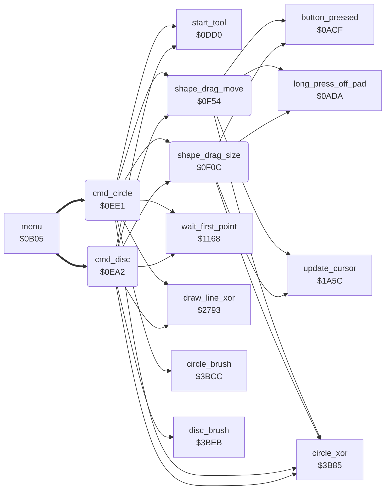

<!-- Generated by c64-docs from knowledge revision 20261025T214624.065-e5whe4 and .c64-re-tools/local/generated/src/source-map.json. Do not edit: change the knowledge, generate the source again, then run docs.ts generate. -->
# tools/circle.asm: Circle and Disc

Range `$0EA2-$1024`. Source: [tools/circle.asm](../../../../src/tools/circle.asm). Index: [the reference](../../index.md).

## Routines

| Routine | Address | Reached from | Summary |
|---|---|---|---|
| [`cmd_disc`](circle.md#cmd_disc) | `$0EA2` | [`menu`](../menu/menu.md#menu) | Command 8 (Disc): the first point comes from wait_first_point ($1168), the size from shape_drag_size and the place from shape_drag_move. |
| [`cmd_circle`](circle.md#cmd_circle) | `$0EE1` | [`menu`](../menu/menu.md#menu) | Command 5 (Circle): the first point comes from wait_first_point ($1168), the size from shape_drag_size and the place from shape_drag_move. |
| [`shape_drag_size`](circle.md#shape_drag_size) | `$0F0C` | [`cmd_disc`](circle.md#cmd_disc), [`cmd_circle`](circle.md#cmd_circle) | Sets the size of a circle: the second point (shape_x1, shape_y1) follows the cursor, and $3b85 draws the band circle again at each move (a second draw removes it). |
| [`shape_drag_move`](circle.md#shape_drag_move) | `$0F54` | [`cmd_disc`](circle.md#cmd_disc), [`cmd_circle`](circle.md#cmd_circle) | Moves a circle: keeps shape_x0 - shape_x1 in delta_x and shape_y0 - shape_y1 in delta_y. |

## Call graph

A solid arrow is a call, a thick arrow a table entry. Rounded nodes are in this file.

## Details

### [`cmd_disc`](../../../../src/tools/circle.asm#L6) `$0EA2`

*routine*

Command 8 (Disc): the first point comes from wait_first_point ($1168), the size from shape_drag_size and the place from shape_drag_move. circle_radius makes the second point the centre. Then it fills the shape in current_colour ($3beb) with brush 0 ($1868) and puts brush_ptr back.

- **Entry of:** [`command_table`](../../tables.md#command_table)
- **Calls:** [`start_tool`](tool_start.md#start_tool), [`wait_first_point`](line_tool.md#wait_first_point), [`draw_line_xor`](../graphics/bresenham_line.md#draw_line_xor), [`circle_xor`](../graphics/circle.md#circle_xor), [`shape_drag_size`](circle.md#shape_drag_size), [`shape_drag_move`](circle.md#shape_drag_move), [`disc_brush`](../graphics/circle.md#disc_brush)
- **Reads:** [`current_colour`](../../memory-map.md#current_colour), [`background_colour`](../../memory-map.md#background_colour), [`saved_colour`](../../memory-map.md#saved_colour), [`brush_ptr`](../../memory-map.md#brush_ptr), [`RNDX`](../../memory-map.md#RNDX)
- **Writes:** [`saved_colour`](../../memory-map.md#saved_colour), [`current_colour`](../../memory-map.md#current_colour), [`brush_ptr`](../../memory-map.md#brush_ptr), [`RNDX`](../../memory-map.md#RNDX)

| Label | Address | Comment |
|---|---|---|
| [`disc_next`](../../../../src/tools/circle.asm#L12) | `$0EAD` |  |

### [`cmd_circle`](../../../../src/tools/circle.asm#L38) `$0EE1`

*routine*

Command 5 (Circle): the first point comes from wait_first_point ($1168), the size from shape_drag_size and the place from shape_drag_move. circle_radius makes the second point the centre and the distance of the points the radius. Then it draws the circle in current_colour ($3bcc).

- **Entry of:** [`command_table`](../../tables.md#command_table)
- **Calls:** [`start_tool`](tool_start.md#start_tool), [`wait_first_point`](line_tool.md#wait_first_point), [`draw_line_xor`](../graphics/bresenham_line.md#draw_line_xor), [`circle_xor`](../graphics/circle.md#circle_xor), [`shape_drag_size`](circle.md#shape_drag_size), [`shape_drag_move`](circle.md#shape_drag_move), [`circle_brush`](../graphics/circle.md#circle_brush)
- **Reads:** [`current_colour`](../../memory-map.md#current_colour), [`background_colour`](../../memory-map.md#background_colour), [`saved_colour`](../../memory-map.md#saved_colour)
- **Writes:** [`saved_colour`](../../memory-map.md#saved_colour), [`current_colour`](../../memory-map.md#current_colour)

| Label | Address | Comment |
|---|---|---|
| [`circle_next`](../../../../src/tools/circle.asm#L44) | `$0EEC` |  |

### [`shape_drag_size`](../../../../src/tools/circle.asm#L58) `$0F0C`

*routine*

Sets the size of a circle: the second point (shape_x1, shape_y1) follows the cursor, and $3b85 draws the band circle again at each move (a second draw removes it). A press removes the band circle and returns. A long press with no touch removes the return address of the caller, puts current_colour back from saved_colour and goes back to the menu ($1495).

- **Called from:** [`cmd_disc`](circle.md#cmd_disc), [`cmd_circle`](circle.md#cmd_circle)
- **Calls:** [`update_cursor`](../input/cursor.md#update_cursor), [`long_press_off_pad`](../input/buttons.md#long_press_off_pad), [`circle_xor`](../graphics/circle.md#circle_xor), [`button_pressed`](../input/buttons.md#button_pressed)
- **Jumps to:** [`tool_exit`](tool_exit.md#tool_exit)
- **Reads:** [`saved_colour`](../../memory-map.md#saved_colour), [`cursor_x`](../../memory-map.md#cursor_x), [`shape_x1`](../../memory-map.md#shape_x1), [`cursor_y`](../../memory-map.md#cursor_y), [`shape_y1`](../../memory-map.md#shape_y1)
- **Writes:** [`current_colour`](../../memory-map.md#current_colour), [`shape_y1`](../../memory-map.md#shape_y1), [`shape_x1`](../../memory-map.md#shape_x1)

| Label | Address | Comment |
|---|---|---|
| [`drag_size_press`](../../../../src/tools/circle.asm#L68) | `$0F20` |  |
| [`drag_size_track`](../../../../src/tools/circle.asm#L73) | `$0F29` |  |
| [`drag_size_same_x`](../../../../src/tools/circle.asm#L84) | `$0F3F` |  |
| [`drag_size_move`](../../../../src/tools/circle.asm#L86) | `$0F41` |  |

### [`shape_drag_move`](../../../../src/tools/circle.asm#L98) `$0F54`

*routine*

Moves a circle: keeps shape_x0 - shape_x1 in delta_x and shape_y0 - shape_y1 in delta_y. Then the second point follows the cursor and the centre moves with it, in the limits 0-cursor_limit_x and 0-cursor_limit_y. $3b85 draws the band circle again at each move. A press removes the band circle and returns. A long press with no touch goes back to the menu ($1495).

- **Called from:** [`cmd_disc`](circle.md#cmd_disc), [`cmd_circle`](circle.md#cmd_circle)
- **Calls:** [`update_cursor`](../input/cursor.md#update_cursor), [`long_press_off_pad`](../input/buttons.md#long_press_off_pad), [`circle_xor`](../graphics/circle.md#circle_xor), [`button_pressed`](../input/buttons.md#button_pressed)
- **Jumps to:** [`tool_exit`](tool_exit.md#tool_exit)
- **Reads:** [`shape_x1`](../../memory-map.md#shape_x1), [`temp_word`](../../memory-map.md#temp_word), [`temp_word_hi`](../../memory-map.md#temp_word_hi), [`shape_x0`](../../memory-map.md#shape_x0), [`shape_y1`](../../memory-map.md#shape_y1), [`shape_y0`](../../memory-map.md#shape_y0), [`saved_colour`](../../memory-map.md#saved_colour), [`cursor_x`](../../memory-map.md#cursor_x), [`cursor_y`](../../memory-map.md#cursor_y), [`delta_x`](../../memory-map.md#delta_x), [`circle_left_x`](../../memory-map.md#circle_left_x), [`max_x`](../../memory-map.md#max_x) and 3 more
- **Writes:** [`temp_word`](../../memory-map.md#temp_word), [`temp_word_hi`](../../memory-map.md#temp_word_hi), [`delta_x`](../../memory-map.md#delta_x), [`circle_left_x`](../../memory-map.md#circle_left_x), [`delta_y`](../../memory-map.md#delta_y), [`circle_upper_y`](../../memory-map.md#circle_upper_y), [`current_colour`](../../memory-map.md#current_colour), [`shape_y1`](../../memory-map.md#shape_y1), [`shape_x1`](../../memory-map.md#shape_x1), [`shape_x0`](../../memory-map.md#shape_x0), [`shape_y0`](../../memory-map.md#shape_y0)

| Label | Address | Comment |
|---|---|---|
| [`drag_move_loop`](../../../../src/tools/circle.asm#L137) | `$0F9C` |  |
| [`drag_move_press`](../../../../src/tools/circle.asm#L148) | `$0FB0` |  |
| [`drag_move_track`](../../../../src/tools/circle.asm#L153) | `$0FB9` |  |
| [`drag_move_shift`](../../../../src/tools/circle.asm#L163) | `$0FCC` |  |
| [`drag_move_clamp_x`](../../../../src/tools/circle.asm#L186) | `$0FF3` |  |
| [`drag_move_set_y`](../../../../src/tools/circle.asm#L192) | `$0FFD` |  |
| [`circle_move_check_y`](../../../../src/tools/circle.asm#L206) | `$1015` |  |
| [`circle_move_redraw`](../../../../src/tools/circle.asm#L213) | `$101F` |  |
