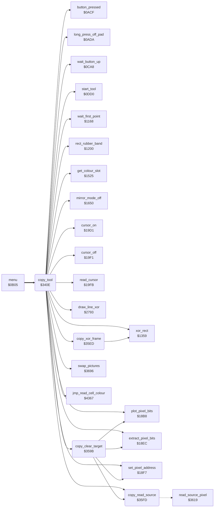

<!-- Generated by c64-docs from knowledge revision 20261024T063946.176-sfrhxb and .c64-re-tools/local/generated/src/source-map.json. Do not edit: change the knowledge, generate the source again, then run docs.ts generate. -->
# tools/copy.asm: Copy

Range `$340E-$35FF`. Source: [tools/copy.asm](../../../../src/tools/copy.asm). Index: [the reference](../../index.md).

## Call graph

A solid arrow is a call, a thick arrow a table entry, a dotted arrow a jump. Rounded nodes are in this file.

## Names

### [`copy_tool`](../../../../src/tools/copy.asm#L6) `$340E`

*routine*

Copy (command $0b, from the command table at $0d74). The user marks a rectangle. Then a frame of the same size follows the cursor, and a press copies the rectangle there; this repeats. The source is the picture copy at $8000 (copy_source 0) or the swap picture at $e000 (copy_source 2). Source pixels with bit pair 0 are not copied. No touch and a long press ends the tool ($1495).

- **Entry of:** [`command_table`](../../tables.md#command_table)
- **Calls:** [`mirror_mode_off`](mirror_oops_tool.md#mirror_mode_off), [`wait_button_up`](../menu/menu.md#wait_button_up), [`start_tool`](tool_start.md#start_tool), [`wait_first_point`](line_tool.md#wait_first_point), [`draw_line_xor`](../graphics/bresenham_line.md#draw_line_xor), [`xor_rect`](box_frame_tool.md#xor_rect), [`rect_rubber_band`](box_frame_tool.md#rect_rubber_band), [`cursor_off`](../input/cursor.md#cursor_off), [`swap_pictures`](swap.md#swap_pictures), [`copy_xor_frame`](copy.md#copy_xor_frame), [`read_cursor`](../input/cursor.md#read_cursor), [`long_press_off_pad`](../input/buttons.md#long_press_off_pad), [`button_pressed`](../input/buttons.md#button_pressed), [`cursor_on`](../input/cursor.md#cursor_on), [`copy_clear_target`](copy.md#copy_clear_target), [`copy_read_source`](copy.md#copy_read_source), [`extract_pixel_bits`](../graphics/pixel.md#extract_pixel_bits), [`jmp_read_cell_colour`](../script/interpreter.md#jmp_read_cell_colour), [`set_pixel_address`](../graphics/pixel.md#set_pixel_address), [`get_colour_slot`](../graphics/colour_slots.md#get_colour_slot), [`plot_pixel_bits`](../graphics/pixel.md#plot_pixel_bits)
- **Jumps to:** [`tool_exit`](tool_exit.md#tool_exit)
- **Reads:** [`current_colour`](../../memory-map.md#current_colour), [`background_colour`](../../memory-map.md#background_colour), [`shape_x0`](../../memory-map.md#shape_x0), [`shape_y0`](../../memory-map.md#shape_y0), [`point_x0`](../../memory-map.md#point_x0), [`point_x1`](../../memory-map.md#point_x1), [`point_y0`](../../memory-map.md#point_y0), [`point_y1`](../../memory-map.md#point_y1), [`copy_mode`](../../memory-map.md#copy_mode), [`cursor_x`](../../memory-map.md#cursor_x), [`copy_width`](../../memory-map.md#copy_width), [`cursor_y`](../../memory-map.md#cursor_y), [`copy_height`](../../memory-map.md#copy_height), [`zoom_pixel_x`](../../memory-map.md#zoom_pixel_x), [`copy_source_y0`](../../memory-map.md#copy_source_y0), [`copy_source_x0`](../../memory-map.md#copy_source_x0), [`copy_source_x`](../../memory-map.md#copy_source_x), [`copy_source_y`](../../memory-map.md#copy_source_y), [`source_row_addr`](../../memory-map.md#source_row_addr), [`source_row_addr+1`](../../memory-map.md#source_row_addr), [`source_screen_ptr`](../../memory-map.md#source_screen_ptr), [`source_x`](../../memory-map.md#source_x), [`source_screen_ptr+1`](../../memory-map.md#source_screen_ptr), [`copy_source_colour_bases`](copy_368f.md#copy_source_colour_bases), [`copy_source_colour_offsets`](copy_368f.md#copy_source_colour_offsets), [`pixel_value`](../../memory-map.md#pixel_value)
- **Writes:** [`zoom_pixel_x`](../../memory-map.md#zoom_pixel_x), [`saved_colour`](../../memory-map.md#saved_colour), [`current_colour`](../../memory-map.md#current_colour), [`point_x0`](../../memory-map.md#point_x0), [`point_x1`](../../memory-map.md#point_x1), [`point_y0`](../../memory-map.md#point_y0), [`point_y1`](../../memory-map.md#point_y1), [`copy_source_x0`](../../memory-map.md#copy_source_x0), [`copy_source_y0`](../../memory-map.md#copy_source_y0), [`copy_width`](../../memory-map.md#copy_width), [`copy_height`](../../memory-map.md#copy_height), [`cursor_y`](../../memory-map.md#cursor_y), [`copy_source_y`](../../memory-map.md#copy_source_y), [`cursor_x`](../../memory-map.md#cursor_x), [`copy_source_x`](../../memory-map.md#copy_source_x), [`pixel_value`](../../memory-map.md#pixel_value), [`source_screen_ptr`](../../memory-map.md#source_screen_ptr), [`source_screen_ptr+1`](../../memory-map.md#source_screen_ptr), [`source_colour_ptr`](../../memory-map.md#source_colour_ptr), [`source_colour_ptr+1`](../../memory-map.md#source_colour_ptr)

### [`copy_start`](../../../../src/tools/copy.asm#L10) `$3415`

*label*

- **Jumped to from:** [`copy_tool`](copy.md#copy_tool) [`$34E8`](../../../../src/tools/copy.asm#L124)

### [`copy_x_ordered`](../../../../src/tools/copy.asm#L39) `$344F`

*label*

copy_source_x0: the left edge of the source.

- **Jumped to from:** [`copy_tool`](copy.md#copy_tool) [`$3443`](../../../../src/tools/copy.asm#L31)

### [`copy_y_ordered`](../../../../src/tools/copy.asm#L51) `$3462`

*label*

- **Jumped to from:** [`copy_tool`](copy.md#copy_tool) [`$3456`](../../../../src/tools/copy.asm#L43)

### [`copy_show_frame`](../../../../src/tools/copy.asm#L68) `$3485`

*label*

- **Jumped to from:** [`copy_tool`](copy.md#copy_tool) [`$3480`](../../../../src/tools/copy.asm#L65), [`copy_tool`](copy.md#copy_tool) [`$34CC`](../../../../src/tools/copy.asm#L108), [`copy_tool`](copy.md#copy_tool) [`$34D3`](../../../../src/tools/copy.asm#L113), [`copy_tool`](copy.md#copy_tool) [`$3598`](../../../../src/tools/copy.asm#L211)

### [`copy_wait`](../../../../src/tools/copy.asm#L71) `$3488`

*label*

Waits for the target: a touch moves the frame, a press copies, no touch and a long press ends the tool.

- **Jumped to from:** [`copy_tool`](copy.md#copy_tool) [`$3497`](../../../../src/tools/copy.asm#L78)

### [`copy_place`](../../../../src/tools/copy.asm#L81) `$349F`

*label*

- **Jumped to from:** [`copy_tool`](copy.md#copy_tool) [`$3493`](../../../../src/tools/copy.asm#L76)

### [`copy_move_frame`](../../../../src/tools/copy.asm#L85) `$34A5`

*label*

The frame starts at the cursor point. Its end is the start plus copy_width and copy_height, at most $9f and $c7.

- **Jumped to from:** [`copy_tool`](copy.md#copy_tool) [`$349C`](../../../../src/tools/copy.asm#L80)

### [`copy_clip_right`](../../../../src/tools/copy.asm#L95) `$34B8`

*label*

- **Jumped to from:** [`copy_tool`](copy.md#copy_tool) [`$34AD`](../../../../src/tools/copy.asm#L90), [`copy_tool`](copy.md#copy_tool) [`$34B1`](../../../../src/tools/copy.asm#L92)

### [`copy_frame_y`](../../../../src/tools/copy.asm#L99) `$34BC`

*label*

- **Jumped to from:** [`copy_tool`](copy.md#copy_tool) [`$34B5`](../../../../src/tools/copy.asm#L94)

### [`copy_clip_bottom`](../../../../src/tools/copy.asm#L109) `$34CF`

*label*

- **Jumped to from:** [`copy_tool`](copy.md#copy_tool) [`$34C4`](../../../../src/tools/copy.asm#L104), [`copy_tool`](copy.md#copy_tool) [`$34C8`](../../../../src/tools/copy.asm#L106)

### [`copy_end`](../../../../src/tools/copy.asm#L115) `$34D6`

*label*

End of Copy: removes the frame and sets current_colour again. After a copy from the swap picture, it swaps the pictures back and starts the copy again.

- **Jumped to from:** [`copy_tool`](copy.md#copy_tool) [`$348E`](../../../../src/tools/copy.asm#L74)

### [`copy_exit`](../../../../src/tools/copy.asm#L125) `$34EB`

*label*

- **Jumped to from:** [`copy_tool`](copy.md#copy_tool) [`$34E0`](../../../../src/tools/copy.asm#L120)

### [`copy_pixels`](../../../../src/tools/copy.asm#L128) `$34EE`

*label*

Copies the rectangle: first copy_clear_target, then for each pixel of the target (point_x0-point_x1, point_y0-point_y1) the pixel of the source (copy_source_x, copy_source_y) with its colour.

- **Jumped to from:** [`copy_tool`](copy.md#copy_tool) [`$34A2`](../../../../src/tools/copy.asm#L83)

### [`copy_row`](../../../../src/tools/copy.asm#L134) `$34FB`

*label*

- **Jumped to from:** [`copy_tool`](copy.md#copy_tool) [`$3595`](../../../../src/tools/copy.asm#L209)

### [`copy_pixel`](../../../../src/tools/copy.asm#L139) `$3505`

*label*

- **Jumped to from:** [`copy_tool`](copy.md#copy_tool) [`$3587`](../../../../src/tools/copy.asm#L202)

### [`copy_colour_ptrs`](../../../../src/tools/copy.asm#L169) `$3546`

*label*

Adds the base of the source colours: $d000/$d400 or $d800/$dc00.

- **Jumped to from:** [`copy_tool`](copy.md#copy_tool) [`$3541`](../../../../src/tools/copy.asm#L167)

### [`copy_low_nybble`](../../../../src/tools/copy.asm#L187) `$356B`

*label*

- **Jumped to from:** [`copy_tool`](copy.md#copy_tool) [`$3562`](../../../../src/tools/copy.asm#L181)

### [`copy_plot`](../../../../src/tools/copy.asm#L189) `$356D`

*label*

- **Jumped to from:** [`copy_tool`](copy.md#copy_tool) [`$3568`](../../../../src/tools/copy.asm#L186)

### [`copy_next_pixel`](../../../../src/tools/copy.asm#L196) `$357C`

*label*

- **Jumped to from:** [`copy_tool`](copy.md#copy_tool) [`$3513`](../../../../src/tools/copy.asm#L145)

### [`copy_next_row`](../../../../src/tools/copy.asm#L203) `$358A`

*label*

- **Jumped to from:** [`copy_tool`](copy.md#copy_tool) [`$3582`](../../../../src/tools/copy.asm#L200)

### [`copy_done`](../../../../src/tools/copy.asm#L210) `$3598`

*label*

- **Jumped to from:** [`copy_tool`](copy.md#copy_tool) [`$3590`](../../../../src/tools/copy.asm#L207)

### [`copy_clear_target`](../../../../src/tools/copy.asm#L213) `$359B`

*routine*

For each pixel of the target rectangle whose source pixel is not bit pair 0, writes bit pair 0 to the target pixel.

- **Called from:** [`copy_tool`](copy.md#copy_tool) [`$34EE`](../../../../src/tools/copy.asm#L129)
- **Calls:** [`copy_read_source`](copy.md#copy_read_source), [`extract_pixel_bits`](../graphics/pixel.md#extract_pixel_bits), [`set_pixel_address`](../graphics/pixel.md#set_pixel_address), [`plot_pixel_bits`](../graphics/pixel.md#plot_pixel_bits)
- **Reads:** [`point_y0`](../../memory-map.md#point_y0), [`copy_source_y0`](../../memory-map.md#copy_source_y0), [`point_x0`](../../memory-map.md#point_x0), [`copy_source_x0`](../../memory-map.md#copy_source_x0), [`copy_source_x`](../../memory-map.md#copy_source_x), [`copy_source_y`](../../memory-map.md#copy_source_y), [`cursor_x`](../../memory-map.md#cursor_x), [`cursor_y`](../../memory-map.md#cursor_y), [`point_x1`](../../memory-map.md#point_x1), [`point_y1`](../../memory-map.md#point_y1)
- **Writes:** [`key_flush_count+1`](../../memory-map.md#key_flush_count), [`cursor_y`](../../memory-map.md#cursor_y), [`copy_source_y`](../../memory-map.md#copy_source_y), [`cursor_x`](../../memory-map.md#cursor_x), [`copy_source_x`](../../memory-map.md#copy_source_x)

### [`copy_clear_row`](../../../../src/tools/copy.asm#L220) `$35AA`

*label*

- **Jumped to from:** [`copy_clear_target`](copy.md#copy_clear_target) [`$35E9`](../../../../src/tools/copy.asm#L251)

### [`copy_clear_pixel`](../../../../src/tools/copy.asm#L225) `$35B4`

*label*

- **Jumped to from:** [`copy_clear_target`](copy.md#copy_clear_target) [`$35DB`](../../../../src/tools/copy.asm#L244)

### [`copy_clear_next_pixel`](../../../../src/tools/copy.asm#L238) `$35D0`

*label*

- **Jumped to from:** [`copy_clear_target`](copy.md#copy_clear_target) [`$35C2`](../../../../src/tools/copy.asm#L231)

### [`copy_clear_next_row`](../../../../src/tools/copy.asm#L245) `$35DE`

*label*

- **Jumped to from:** [`copy_clear_target`](copy.md#copy_clear_target) [`$35D6`](../../../../src/tools/copy.asm#L242)

### [`copy_clear_done`](../../../../src/tools/copy.asm#L252) `$35EC`

*label*

- **Jumped to from:** [`copy_clear_target`](copy.md#copy_clear_target) [`$35E4`](../../../../src/tools/copy.asm#L249)

### [`copy_xor_frame`](../../../../src/tools/copy.asm#L255) `$35ED`

*routine*

Draws the frame point_x0/point_y0 - point_x1/point_y1 with the XOR plot ($1359): a second call removes it. Keeps cursor_x and cursor_y.

- **Called from:** [`copy_tool`](copy.md#copy_tool) [`$3485`](../../../../src/tools/copy.asm#L69), [`copy_tool`](copy.md#copy_tool) [`$3499`](../../../../src/tools/copy.asm#L79), [`copy_tool`](copy.md#copy_tool) [`$349F`](../../../../src/tools/copy.asm#L82), [`copy_tool`](copy.md#copy_tool) [`$34D6`](../../../../src/tools/copy.asm#L116)
- **Calls:** [`xor_rect`](box_frame_tool.md#xor_rect)
- **Reads:** [`cursor_x`](../../memory-map.md#cursor_x), [`cursor_y`](../../memory-map.md#cursor_y)
- **Writes:** [`cursor_y`](../../memory-map.md#cursor_y), [`cursor_x`](../../memory-map.md#cursor_x)

### [`copy_read_source`](../../../../src/tools/copy.asm#L267) `$35FD`

*routine*

Jumps to read_source_pixel.

- **Called from:** [`copy_tool`](copy.md#copy_tool) [`$350B`](../../../../src/tools/copy.asm#L142), [`copy_clear_target`](copy.md#copy_clear_target) [`$35BA`](../../../../src/tools/copy.asm#L228)
- **Jumps to:** [`read_source_pixel`](copy_3619.md#read_source_pixel)
