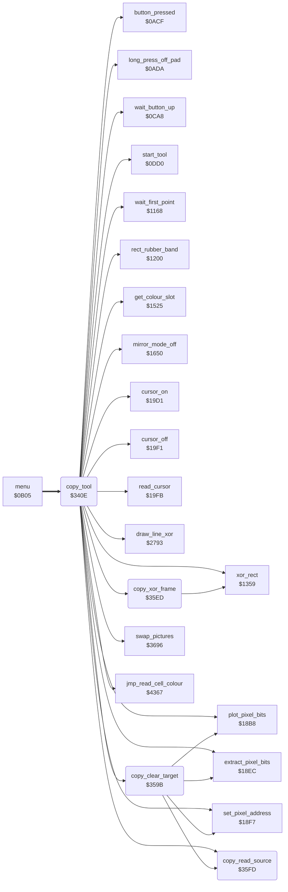

<!-- Generated by c64-docs from knowledge revision 20261025T214624.065-e5whe4 and .c64-re-tools/local/generated/src/source-map.json. Do not edit: change the knowledge, generate the source again, then run docs.ts generate. -->
# tools/copy.asm: Copy

Range `$340E-$35FF`. Source: [tools/copy.asm](../../../../src/tools/copy.asm). Index: [the reference](../../index.md).

## Routines

| Routine | Address | Reached from | Summary |
|---|---|---|---|
| [`copy_tool`](copy.md#copy_tool) | `$340E` | [`menu`](../menu/menu.md#menu) | Copy (command $0b, from the command table at $0d74). |
| [`copy_clear_target`](copy.md#copy_clear_target) | `$359B` | [`copy_tool`](copy.md#copy_tool) | For each pixel of the target rectangle whose source pixel is not bit pair 0, writes bit pair 0 to the target pixel. |
| [`copy_xor_frame`](copy.md#copy_xor_frame) | `$35ED` | [`copy_tool`](copy.md#copy_tool) | Draws the frame point_x0/point_y0 - point_x1/point_y1 with the XOR plot ($1359): a second call removes it. |
| [`copy_read_source`](copy.md#copy_read_source) | `$35FD` | [`copy_tool`](copy.md#copy_tool), [`copy_clear_target`](copy.md#copy_clear_target) | Jumps to read_source_pixel. |

## Call graph

A solid arrow is a call, a thick arrow a table entry. Rounded nodes are in this file.

## Details

### [`copy_tool`](../../../../src/tools/copy.asm#L6) `$340E`

*routine*

Copy (command $0b, from the command table at $0d74). The user marks a rectangle. Then a frame of the same size follows the cursor, and a press copies the rectangle there; this repeats. The source is the picture copy at $8000 (copy_source 0) or the swap picture at $e000 (copy_source 2). Source pixels with bit pair 0 are not copied. No touch and a long press ends the tool ($1495).

- **Entry of:** [`command_table`](../../tables.md#command_table)
- **Calls:** [`mirror_mode_off`](mirror_oops_tool.md#mirror_mode_off), [`wait_button_up`](../menu/menu.md#wait_button_up), [`start_tool`](tool_start.md#start_tool), [`wait_first_point`](line_tool.md#wait_first_point), [`draw_line_xor`](../graphics/bresenham_line.md#draw_line_xor), [`xor_rect`](box_frame_tool.md#xor_rect), [`rect_rubber_band`](box_frame_tool.md#rect_rubber_band), [`cursor_off`](../input/cursor.md#cursor_off), [`swap_pictures`](swap.md#swap_pictures), [`copy_xor_frame`](copy.md#copy_xor_frame), [`read_cursor`](../input/cursor.md#read_cursor), [`long_press_off_pad`](../input/buttons.md#long_press_off_pad) and 9 more
- **Jumps to:** [`tool_exit`](tool_exit.md#tool_exit)
- **Reads:** [`current_colour`](../../memory-map.md#current_colour), [`background_colour`](../../memory-map.md#background_colour), [`shape_x0`](../../memory-map.md#shape_x0), [`shape_y0`](../../memory-map.md#shape_y0), [`point_x0`](../../memory-map.md#point_x0), [`point_x1`](../../memory-map.md#point_x1), [`point_y0`](../../memory-map.md#point_y0), [`point_y1`](../../memory-map.md#point_y1), [`copy_mode`](../../memory-map.md#copy_mode), [`cursor_x`](../../memory-map.md#cursor_x), [`copy_width`](../../memory-map.md#copy_width), [`cursor_y`](../../memory-map.md#cursor_y) and 12 more
- **Writes:** [`zoom_pixel_x`](../../memory-map.md#zoom_pixel_x), [`saved_colour`](../../memory-map.md#saved_colour), [`current_colour`](../../memory-map.md#current_colour), [`point_x0`](../../memory-map.md#point_x0), [`point_x1`](../../memory-map.md#point_x1), [`point_y0`](../../memory-map.md#point_y0), [`point_y1`](../../memory-map.md#point_y1), [`copy_source_x0`](../../memory-map.md#copy_source_x0), [`copy_source_y0`](../../memory-map.md#copy_source_y0), [`copy_width`](../../memory-map.md#copy_width), [`copy_height`](../../memory-map.md#copy_height), [`cursor_y`](../../memory-map.md#cursor_y) and 6 more

| Label | Address | Comment |
|---|---|---|
| [`copy_start`](../../../../src/tools/copy.asm#L10) | `$3415` |  |
| [`copy_x_ordered`](../../../../src/tools/copy.asm#L39) | `$344F` | copy_source_x0: the left edge of the source. |
| [`copy_y_ordered`](../../../../src/tools/copy.asm#L51) | `$3462` |  |
| [`copy_show_frame`](../../../../src/tools/copy.asm#L68) | `$3485` |  |
| [`copy_wait`](../../../../src/tools/copy.asm#L71) | `$3488` | Waits for the target: a touch moves the frame, a press copies, no touch and a long press ends the tool. |
| [`copy_place`](../../../../src/tools/copy.asm#L81) | `$349F` |  |
| [`copy_move_frame`](../../../../src/tools/copy.asm#L85) | `$34A5` | The frame starts at the cursor point. Its end is the start plus copy_width and copy_height, at most $9f and $c7. |
| [`copy_clip_right`](../../../../src/tools/copy.asm#L95) | `$34B8` |  |
| [`copy_frame_y`](../../../../src/tools/copy.asm#L99) | `$34BC` |  |
| [`copy_clip_bottom`](../../../../src/tools/copy.asm#L109) | `$34CF` |  |
| [`copy_end`](../../../../src/tools/copy.asm#L115) | `$34D6` | End of Copy: removes the frame and sets current_colour again. After a copy from the swap picture, it swaps the pictures back and starts the copy again. |
| [`copy_exit`](../../../../src/tools/copy.asm#L125) | `$34EB` |  |
| [`copy_pixels`](../../../../src/tools/copy.asm#L128) | `$34EE` | Copies the rectangle: first copy_clear_target, then for each pixel of the target (point_x0-point_x1, point_y0-point_y1) the pixel of the source (copy_source_x, copy_source_y) with its colour. |
| [`copy_row`](../../../../src/tools/copy.asm#L134) | `$34FB` |  |
| [`copy_pixel`](../../../../src/tools/copy.asm#L139) | `$3505` |  |
| [`copy_colour_ptrs`](../../../../src/tools/copy.asm#L169) | `$3546` | Adds the base of the source colours: $d000/$d400 or $d800/$dc00. |
| [`copy_low_nybble`](../../../../src/tools/copy.asm#L187) | `$356B` |  |
| [`copy_plot`](../../../../src/tools/copy.asm#L189) | `$356D` |  |
| [`copy_next_pixel`](../../../../src/tools/copy.asm#L196) | `$357C` |  |
| [`copy_next_row`](../../../../src/tools/copy.asm#L203) | `$358A` |  |
| [`copy_done`](../../../../src/tools/copy.asm#L210) | `$3598` |  |

### [`copy_clear_target`](../../../../src/tools/copy.asm#L213) `$359B`

*routine*

For each pixel of the target rectangle whose source pixel is not bit pair 0, writes bit pair 0 to the target pixel.

- **Called from:** [`copy_tool`](copy.md#copy_tool)
- **Calls:** [`copy_read_source`](copy.md#copy_read_source), [`extract_pixel_bits`](../graphics/pixel.md#extract_pixel_bits), [`set_pixel_address`](../graphics/pixel.md#set_pixel_address), [`plot_pixel_bits`](../graphics/pixel.md#plot_pixel_bits)
- **Reads:** [`point_y0`](../../memory-map.md#point_y0), [`copy_source_y0`](../../memory-map.md#copy_source_y0), [`point_x0`](../../memory-map.md#point_x0), [`copy_source_x0`](../../memory-map.md#copy_source_x0), [`copy_source_x`](../../memory-map.md#copy_source_x), [`copy_source_y`](../../memory-map.md#copy_source_y), [`cursor_x`](../../memory-map.md#cursor_x), [`cursor_y`](../../memory-map.md#cursor_y), [`point_x1`](../../memory-map.md#point_x1), [`point_y1`](../../memory-map.md#point_y1)
- **Writes:** [`key_flush_count`](../../memory-map.md#key_flush_count), [`cursor_y`](../../memory-map.md#cursor_y), [`copy_source_y`](../../memory-map.md#copy_source_y), [`cursor_x`](../../memory-map.md#cursor_x), [`copy_source_x`](../../memory-map.md#copy_source_x)

| Label | Address | Comment |
|---|---|---|
| [`copy_clear_row`](../../../../src/tools/copy.asm#L220) | `$35AA` |  |
| [`copy_clear_pixel`](../../../../src/tools/copy.asm#L225) | `$35B4` |  |
| [`copy_clear_next_pixel`](../../../../src/tools/copy.asm#L238) | `$35D0` |  |
| [`copy_clear_next_row`](../../../../src/tools/copy.asm#L245) | `$35DE` |  |
| [`copy_clear_done`](../../../../src/tools/copy.asm#L252) | `$35EC` |  |

### [`copy_xor_frame`](../../../../src/tools/copy.asm#L255) `$35ED`

*routine*

Draws the frame point_x0/point_y0 - point_x1/point_y1 with the XOR plot ($1359): a second call removes it. Keeps cursor_x and cursor_y.

- **Called from:** [`copy_tool`](copy.md#copy_tool)
- **Calls:** [`xor_rect`](box_frame_tool.md#xor_rect)
- **Reads:** [`cursor_x`](../../memory-map.md#cursor_x), [`cursor_y`](../../memory-map.md#cursor_y)
- **Writes:** [`cursor_y`](../../memory-map.md#cursor_y), [`cursor_x`](../../memory-map.md#cursor_x)

### [`copy_read_source`](../../../../src/tools/copy.asm#L267) `$35FD`

*routine*

Jumps to read_source_pixel.

- **Called from:** [`copy_tool`](copy.md#copy_tool), [`copy_clear_target`](copy.md#copy_clear_target)
- **Jumps to:** [`read_source_pixel`](copy_3619.md#read_source_pixel)
