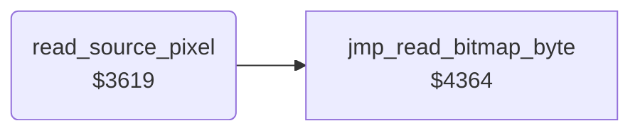

<!-- Generated by c64-docs from knowledge revision 20261025T214624.065-e5whe4 and .c64-re-tools/local/generated/src/source-map.json. Do not edit: change the knowledge, generate the source again, then run docs.ts generate. -->
# tools/copy_3619.asm

Range `$3619-$368D`. Source: [tools/copy_3619.asm](../../../../src/tools/copy_3619.asm). Index: [the reference](../../index.md).

## Routines

| Routine | Address | Reached from | Summary |
|---|---|---|---|
| [`read_source_pixel`](copy_3619.md#read_source_pixel) | `$3619` | [`copy_read_source`](copy.md#copy_read_source) | Reads the source byte of the pixel (X, Y) of the Copy source: the bitmap row address from the table at $1979, plus the base of copy_source_bitmap_offsets ($8000 or $e000), plus Y and 7, plus the cell column. |

## Call graph

A solid arrow is a call, a thick arrow a table entry. Rounded nodes are in this file.

## Details

### [`read_source_pixel`](../../../../src/tools/copy_3619.asm#L6) `$3619`

*routine*

Reads the source byte of the pixel (X, Y) of the Copy source: the bitmap row address from the table at $1979, plus the base of copy_source_bitmap_offsets ($8000 or $e000), plus Y and 7, plus the cell column. The read ($4364) switches I/O and ROM off. Output: A = source_byte, X = source_pair_index (4 - (X and 3)) for $18ec.

- **Jumped to from:** [`copy_read_source`](copy.md#copy_read_source)
- **Calls:** [`jmp_read_bitmap_byte`](../script/interpreter.md#jmp_read_bitmap_byte)
- **Reads:** [`copy_mode`](../../memory-map.md#copy_mode), [`bitmap_row_addr`](../graphics/pixel.md#bitmap_row_addr), [`bitmap_row_addr_hi`](../graphics/pixel.md#bitmap_row_addr_hi), [`source_y`](../../memory-map.md#source_y), [`temp_byte_2`](../../memory-map.md#temp_byte_2), [`source_row_ptr`](../../memory-map.md#source_row_ptr), [`source_byte_ptr`](../../memory-map.md#source_byte_ptr), [`source_x`](../../memory-map.md#source_x), [`temp_byte_3`](../../memory-map.md#temp_byte_3), [`source_byte`](../../memory-map.md#source_byte)
- **Writes:** [`source_x`](../../memory-map.md#source_x), [`source_y`](../../memory-map.md#source_y), [`source_row_addr`](../../memory-map.md#source_row_addr), [`source_row_ptr`](../../memory-map.md#source_row_ptr), [`temp_byte_2`](../../memory-map.md#temp_byte_2), [`source_byte_ptr`](../../memory-map.md#source_byte_ptr), [`temp_byte_3`](../../memory-map.md#temp_byte_3), [`source_pair_index`](../../memory-map.md#source_pair_index)

| Label | Address | Comment |
|---|---|---|
| [`source_pixel_add_column`](../../../../src/tools/copy_3619.asm#L39) | `$365B` |  |
| [`source_pixel_store`](../../../../src/tools/copy_3619.asm#L48) | `$366A` |  |
| [`source_pixel_pair`](../../../../src/tools/copy_3619.asm#L54) | `$3676` |  |
