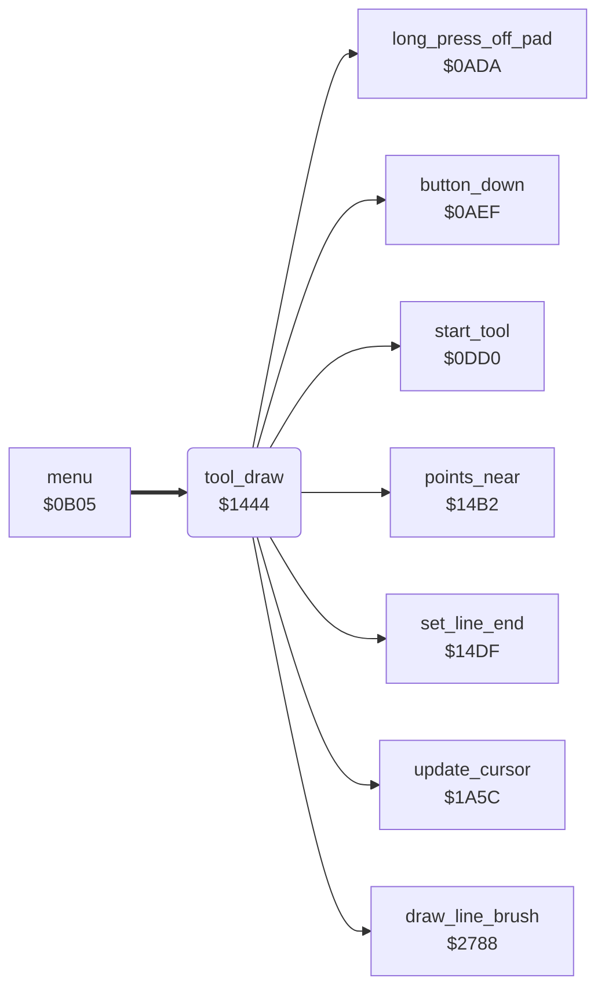

<!-- Generated by c64-docs from knowledge revision 20261025T214624.065-e5whe4 and .c64-re-tools/local/generated/src/source-map.json. Do not edit: change the knowledge, generate the source again, then run docs.ts generate. -->
# tools/draw_tool.asm: Draw tool

Range `$1444-$147C`. Source: [tools/draw_tool.asm](../../../../src/tools/draw_tool.asm). Index: [the reference](../../index.md).

## Routines

| Routine | Address | Reached from | Summary |
|---|---|---|---|
| [`tool_draw`](draw_tool.md#tool_draw) | `$1444` | [`menu`](../menu/menu.md#menu) | Draw command (code 1). |
| [`tool_draw_loop`](draw_tool.md#tool_draw_loop) | `$1455` | [`tool_draw`](draw_tool.md#tool_draw) | button_press_edge = button_held. |

## Call graph

A solid arrow is a call, a thick arrow a table entry. Rounded nodes are in this file.

## Details

### [`tool_draw`](../../../../src/tools/draw_tool.asm#L6) `$1444`

*routine*

Draw command (code 1). Shows the label DRAW and waits for the button to go up. While the button is up, the start of the line follows the cursor. While the button is down, draws a line with the brush from the last point to the cursor ($2788), and the cursor becomes the last point. A move of 25 pixels or more on one axis changes the last point and draws nothing. A long press off the pad goes to tool_exit.

- **Entry of:** [`command_table`](../../tables.md#command_table)
- **Calls:** [`start_tool`](tool_start.md#start_tool), [`update_cursor`](../input/cursor.md#update_cursor), [`long_press_off_pad`](../input/buttons.md#long_press_off_pad), [`button_down`](../input/buttons.md#button_down), [`set_line_end`](tool_exit.md#set_line_end), [`points_near`](tool_exit.md#points_near), [`draw_line_brush`](../graphics/bresenham_line.md#draw_line_brush)
- **Jumps to:** [`tool_exit`](tool_exit.md#tool_exit)
- **Reads:** [`button_held`](../../memory-map.md#button_held), [`cursor_x`](../../memory-map.md#cursor_x), [`shape_x1`](../../memory-map.md#shape_x1), [`shape_y1`](../../memory-map.md#shape_y1)
- **Writes:** [`shape_x0`](../../memory-map.md#shape_x0), [`shape_y0`](../../memory-map.md#shape_y0), [`button_press_edge`](../../memory-map.md#button_press_edge)

| Label | Address | Comment |
|---|---|---|
| [`tool_draw_wait_up`](../../../../src/tools/draw_tool.asm#L13) | `$1451` |  |
| [`tool_draw_wait_touch`](../../../../src/tools/draw_tool.asm#L20) | `$145B` |  |
| [`tool_draw_read`](../../../../src/tools/draw_tool.asm#L27) | `$1469` |  |

### [`tool_draw_loop`](../../../../src/tools/draw_tool.asm#L16) `$1455`

*label*

button_press_edge = button_held.

- **Jumped to from:** [`tool_draw`](draw_tool.md#tool_draw)
