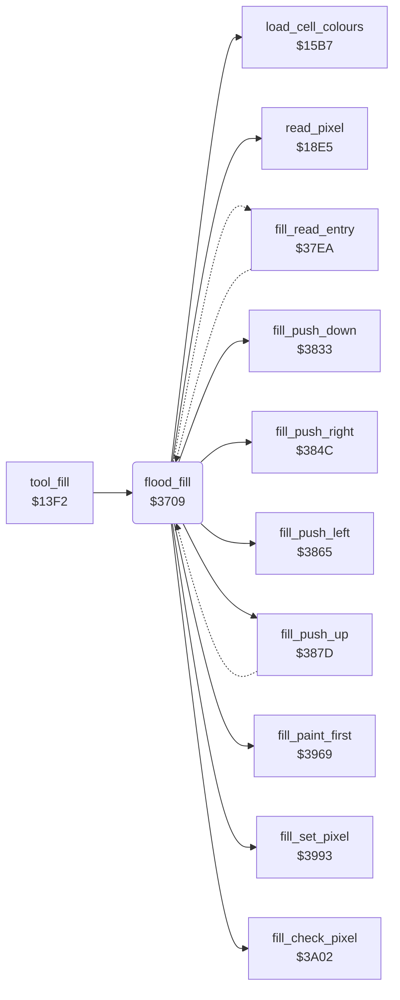

<!-- Generated by c64-docs from knowledge revision 20261024T063946.176-sfrhxb and .c64-re-tools/local/generated/src/source-map.json. Do not edit: change the knowledge, generate the source again, then run docs.ts generate. -->
# tools/fill.asm: Fill

Range `$3709-$37CF`. Source: [tools/fill.asm](../../../../src/tools/fill.asm). Index: [the reference](../../index.md).

## Call graph

A solid arrow is a call, a thick arrow a table entry, a dotted arrow a jump. Rounded nodes are in this file.

## Names

### [`flood_fill`](../../../../src/tools/fill.asm#L6) `$3709`

*routine*

Fill from the point (X, Y): changes all connected pixels of the colour of that point (target_colour) to current_colour, or to the dither colours. Uses a stack of 3-byte entries (direction, X, Y) from $c100. A press of the button stops the fill. Keeps brush_ptr, and sets line_fill_corners to 0 at the end.

- **Called from:** [`tool_fill`](fill_tool.md#tool_fill) [`$143E`](../../../../src/tools/fill_tool.asm#L47)
- **Calls:** [`read_pixel`](../graphics/pixel.md#read_pixel), [`load_cell_colours`](../graphics/colour_slots.md#load_cell_colours), [`fill_paint_first`](fill_3833.md#fill_paint_first), [`fill_push_down`](fill_3833.md#fill_push_down), [`fill_push_right`](fill_3833.md#fill_push_right), [`fill_push_left`](fill_3833.md#fill_push_left), [`fill_push_up`](fill_3833.md#fill_push_up), [`fill_check_pixel`](fill_3833.md#fill_check_pixel), [`fill_set_pixel`](fill_3833.md#fill_set_pixel)
- **Jumps to:** [`fill_went_down`](fill_37de.md#fill_went_down), [`fill_went_right`](fill_3806.md#fill_went_right), [`fill_went_left`](fill_3813.md#fill_went_left), [`fill_went_up`](fill_3823.md#fill_went_up)
- **Reads:** [`brush_ptr`](../../memory-map.md#brush_ptr), [`RNDX`](../../memory-map.md#RNDX), [`background_colour`](../../memory-map.md#background_colour), [`current_colour`](../../memory-map.md#current_colour), [`dither_colours`](../../memory-map.md#dither_colours), [`dither_colours_1`](../../memory-map.md#dither_colours_1), [`dither_colours_2`](../../memory-map.md#dither_colours_2), [`dither_colours_3`](../../memory-map.md#dither_colours_3), [`target_colour`](../../memory-map.md#target_colour), [`button_press_edge`](../../memory-map.md#button_press_edge), [`point_y1`](../../memory-map.md#point_y1), [`point_x1`](../../memory-map.md#point_x1)
- **Writes:** [`brush_ptr`](../../memory-map.md#brush_ptr), [`RNDX`](../../memory-map.md#RNDX), [`target_colour`](../../memory-map.md#target_colour), [`dither_colours_1`](../../memory-map.md#dither_colours_1), [`dither_colours`](../../memory-map.md#dither_colours), [`current_colour`](../../memory-map.md#current_colour), [`dither_colours_3`](../../memory-map.md#dither_colours_3), [`dither_colours_2`](../../memory-map.md#dither_colours_2), [`line_fill_corners`](../../memory-map.md#line_fill_corners), [`point_x1`](../../memory-map.md#point_x1), [`point_y1`](../../memory-map.md#point_y1), [`plot_vector`](../../memory-map.md#plot_vector), [`plot_vector+1`](../../memory-map.md#plot_vector), [`line_dx`](../../memory-map.md#line_dx), [`line_dy`](../../memory-map.md#line_dy), [`cursor_y`](../../memory-map.md#cursor_y), [`cursor_x`](../../memory-map.md#cursor_x)

### [`fill_done`](../../../../src/tools/fill.asm#L40) `$374D`

*label*

- **Jumped to from:** [`flood_fill`](fill.md#flood_fill) [`$371A`](../../../../src/tools/fill.asm#L17), [`flood_fill`](fill.md#flood_fill) [`$3796`](../../../../src/tools/fill.asm#L79), [`flood_fill`](fill.md#flood_fill) [`$379C`](../../../../src/tools/fill.asm#L82)

### [`fill_start`](../../../../src/tools/fill.asm#L50) `$375D`

*label*

- **Jumped to from:** [`flood_fill`](fill.md#flood_fill) [`$372B`](../../../../src/tools/fill.asm#L26), [`flood_fill`](fill.md#flood_fill) [`$374B`](../../../../src/tools/fill.asm#L39)

### [`fill_init`](../../../../src/tools/fill.asm#L58) `$376D`

*label*

Stack pointer = $c0fd: the stack is empty.

- **Jumped to from:** [`flood_fill`](fill.md#flood_fill) [`$3767`](../../../../src/tools/fill.asm#L55)

### [`fill_loop`](../../../../src/tools/fill.asm#L77) `$3794`

*label*

Takes the last entry from the stack. When the pixel still has target_colour, paints it and pushes the neighbours, but not the neighbour that the entry came from.
A press stops the fill.

- **Jumped to from:** [`flood_fill`](fill.md#flood_fill) [`$37BB`](../../../../src/tools/fill.asm#L99), [`fill_read_entry`](fill_37de.md#fill_read_entry) [`$3802`](../../../../src/tools/fill_37de.asm#L32), [`fill_read_entry`](fill_37de.md#fill_read_entry) [`$380F`](../../../../src/tools/fill_3806.asm#L10), [`fill_push_up`](fill_3833.md#fill_push_up) [`$38B8`](../../../../src/tools/fill_3833.asm#L95), [`fill_push_up`](fill_3833.md#fill_push_up) [`$38C7`](../../../../src/tools/fill_3833.asm#L102)

### [`fill_take_entry`](../../../../src/tools/fill.asm#L100) `$37BE`

*label*

- **Jumped to from:** [`flood_fill`](fill.md#flood_fill) [`$37B9`](../../../../src/tools/fill.asm#L97)
