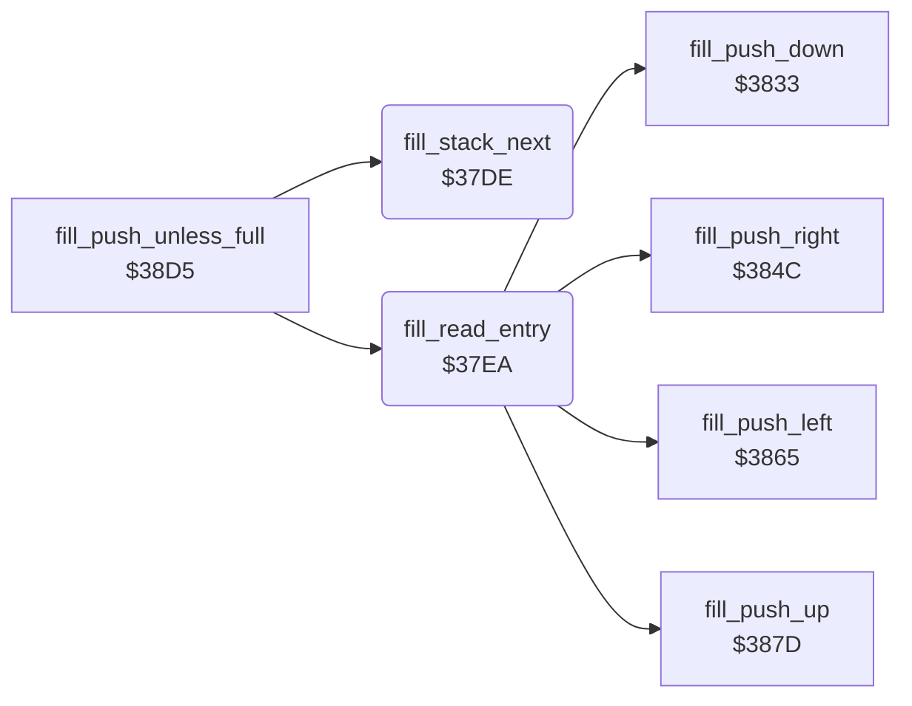

<!-- Generated by c64-docs from knowledge revision 20261025T214624.065-e5whe4 and .c64-re-tools/local/generated/src/source-map.json. Do not edit: change the knowledge, generate the source again, then run docs.ts generate. -->
# tools/fill_37de.asm

Range `$37DE-$3804`. Source: [tools/fill_37de.asm](../../../../src/tools/fill_37de.asm). Index: [the reference](../../index.md).

## Routines

| Routine | Address | Reached from | Summary |
|---|---|---|---|
| [`fill_stack_next`](fill_37de.md#fill_stack_next) | `$37DE` | [`fill_push_unless_full`](fill_3833.md#fill_push_unless_full) | Moves the stack pointer (point_x1/point_y1) 3 bytes up. |
| [`fill_read_entry`](fill_37de.md#fill_read_entry) | `$37EA` | [`fill_push_unless_full`](fill_3833.md#fill_push_unless_full) | Reads the entry at the stack pointer: cursor_y = byte 2, cursor_x = byte 1, A = byte 0 (the direction). |
| [`fill_went_down`](fill_37de.md#fill_went_down) | `$37F9` | [`flood_fill`](fill.md#flood_fill) | Entry from the pixel above: pushes down, right and left. |

## Call graph

A solid arrow is a call, a thick arrow a table entry. Rounded nodes are in this file.

## Details

### [`fill_stack_next`](../../../../src/tools/fill_37de.asm#L6) `$37DE`

*routine*

Moves the stack pointer (point_x1/point_y1) 3 bytes up.

- **Called from:** [`fill_push_unless_full`](fill_3833.md#fill_push_unless_full)
- **Reads:** [`point_x1`](../../memory-map.md#point_x1), [`point_y1`](../../memory-map.md#point_y1)
- **Writes:** [`point_x1`](../../memory-map.md#point_x1), [`point_y1`](../../memory-map.md#point_y1)

| Label | Address | Comment |
|---|---|---|
| [`fill_stack_next_done`](../../../../src/tools/fill_37de.asm#L14) | `$37E9` |  |

### [`fill_read_entry`](../../../../src/tools/fill_37de.asm#L17) `$37EA`

*routine*

Reads the entry at the stack pointer: cursor_y = byte 2, cursor_x = byte 1, A = byte 0 (the direction).

- **Called from:** [`fill_push_unless_full`](fill_3833.md#fill_push_unless_full)
- **Calls:** [`fill_push_down`](fill_3833.md#fill_push_down), [`fill_push_right`](fill_3833.md#fill_push_right), [`fill_push_left`](fill_3833.md#fill_push_left), [`fill_push_up`](fill_3833.md#fill_push_up)
- **Jumps to:** [`fill_loop`](fill.md#fill_loop), [`fill_push_left_up`](fill_3833.md#fill_push_left_up)
- **Reads:** [`point_x1`](../../memory-map.md#point_x1)
- **Writes:** [`cursor_y`](../../memory-map.md#cursor_y), [`cursor_x`](../../memory-map.md#cursor_x)

### [`fill_went_down`](../../../../src/tools/fill_37de.asm#L28) `$37F9`

*label*

Entry from the pixel above: pushes down, right and left.

- **Jumped to from:** [`flood_fill`](fill.md#flood_fill)
