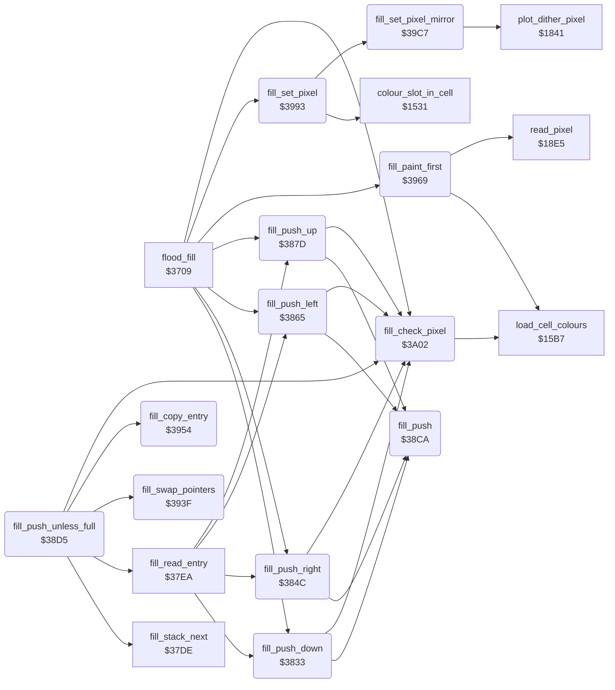

<!-- Generated by c64-docs from knowledge revision 20261025T214624.065-e5whe4 and .c64-re-tools/local/generated/src/source-map.json. Do not edit: change the knowledge, generate the source again, then run docs.ts generate. -->
# tools/fill_3833.asm

Range `$3833-$3A2A`. Source: [tools/fill_3833.asm](../../../../src/tools/fill_3833.asm). Index: [the reference](../../index.md).

## Routines

| Routine | Address | Reached from | Summary |
|---|---|---|---|
| [`fill_push_down`](fill_3833.md#fill_push_down) | `$3833` | [`flood_fill`](fill.md#flood_fill), [`fill_read_entry`](fill_37de.md#fill_read_entry) | When the pixel under (cursor_x, cursor_y) is in the picture (Y less than max_y) and has target_colour, pushes it with direction 0. |
| [`fill_push_right`](fill_3833.md#fill_push_right) | `$384C` | [`flood_fill`](fill.md#flood_fill), [`fill_read_entry`](fill_37de.md#fill_read_entry) | When the pixel to the right is in the picture (X less than max_x) and has target_colour, pushes it with direction $80. |
| [`fill_push_left`](fill_3833.md#fill_push_left) | `$3865` | [`flood_fill`](fill.md#flood_fill), [`fill_read_entry`](fill_37de.md#fill_read_entry) | When the pixel to the left is in the picture and has target_colour, pushes it with direction $20. |
| [`fill_push_up`](fill_3833.md#fill_push_up) | `$387D` | [`flood_fill`](fill.md#flood_fill), [`fill_read_entry`](fill_37de.md#fill_read_entry) | When the pixel above is in the picture and has target_colour, pushes it with direction $40. |
| [`fill_push_left_up`](fill_3833.md#fill_push_left_up) | `$3895` | [`fill_read_entry`](fill_37de.md#fill_read_entry) | Pushes the pixels to the left and above (as fill_push_left and fill_push_up), then goes back to fill_loop. |
| [`fill_push`](fill_3833.md#fill_push) | `$38CA` | [`fill_push_down`](fill_3833.md#fill_push_down), [`fill_push_right`](fill_3833.md#fill_push_right), [`fill_push_left`](fill_3833.md#fill_push_left), [`fill_push_up`](fill_3833.md#fill_push_up) | Pushes the entry (A = direction, cursor_x, cursor_y) on the fill stack. |
| [`fill_push_unless_full`](fill_3833.md#fill_push_unless_full) | `$38D5` |  | Pushes one fill entry (direction temp_word, cursor_x, cursor_y) at point_x1/point_y1 + 3, and moves the fill stack pointer. |
| [`fill_swap_pointers`](fill_3833.md#fill_swap_pointers) | `$393F` | [`fill_push_unless_full`](fill_3833.md#fill_push_unless_full) | Exchanges the stack pointer (point_x1/point_y1) with circle_dx/$45. |
| [`fill_copy_entry`](fill_3833.md#fill_copy_entry) | `$3954` | [`fill_push_unless_full`](fill_3833.md#fill_push_unless_full) | Copies the 3 bytes of the entry at the stack pointer to point_x0/point_y0, and moves point_x0/point_y0 3 bytes up. |
| [`fill_paint_first`](fill_3833.md#fill_paint_first) | `$3969` | [`flood_fill`](fill.md#flood_fill) | When the pixel (cursor_x, cursor_y) has target_colour, gets its dither colour (when line_fill_corners) and paints it with fill_set_pixel. |
| [`fill_set_pixel`](fill_3833.md#fill_set_pixel) | `$3993` | [`flood_fill`](fill.md#flood_fill) | Paints the pixel at pixel_ptr with current_colour: bit pair 0 for the background colour, else the bit pair that $1531 gives for the cell. |
| [`fill_set_pixel_mirror`](fill_3833.md#fill_set_pixel_mirror) | `$39C7` | [`fill_set_pixel`](fill_3833.md#fill_set_pixel) | Plots the pixel (X, Y) and its mirror images (159 - X, Y), (159 - X, 199 - Y) and (X, 199 - Y) with $1841. |
| [`fill_check_pixel`](fill_3833.md#fill_check_pixel) | `$3A02` | [`flood_fill`](fill.md#flood_fill), [`fill_push_down`](fill_3833.md#fill_push_down), [`fill_push_right`](fill_3833.md#fill_push_right), [`fill_push_left`](fill_3833.md#fill_push_left), [`fill_push_up`](fill_3833.md#fill_push_up), [`fill_push_unless_full`](fill_3833.md#fill_push_unless_full) | Reads the pixel (cursor_x, cursor_y) and gives its colour in A. |

## Call graph

A solid arrow is a call, a thick arrow a table entry. Rounded nodes are in this file.

The graph shows 30 of the 31 edges.

## Details

### [`fill_push_down`](../../../../src/tools/fill_3833.asm#L6) `$3833`

*routine*

When the pixel under (cursor_x, cursor_y) is in the picture (Y less than max_y) and has target_colour, pushes it with direction 0. Keeps cursor_y.

- **Called from:** [`flood_fill`](fill.md#flood_fill), [`fill_read_entry`](fill_37de.md#fill_read_entry)
- **Calls:** [`fill_check_pixel`](fill_3833.md#fill_check_pixel), [`fill_push`](fill_3833.md#fill_push)
- **Reads:** [`cursor_y`](../../memory-map.md#cursor_y), [`max_y`](../../memory-map.md#max_y)
- **Writes:** [`cursor_y`](../../memory-map.md#cursor_y)

| Label | Address | Comment |
|---|---|---|
| [`fill_push_down_undo`](../../../../src/tools/fill_3833.asm#L12) | `$383A` |  |
| [`fill_push_down_try`](../../../../src/tools/fill_3833.asm#L15) | `$383D` |  |

### [`fill_push_right`](../../../../src/tools/fill_3833.asm#L24) `$384C`

*routine*

When the pixel to the right is in the picture (X less than max_x) and has target_colour, pushes it with direction $80. Keeps cursor_x.

- **Called from:** [`flood_fill`](fill.md#flood_fill), [`fill_read_entry`](fill_37de.md#fill_read_entry)
- **Calls:** [`fill_check_pixel`](fill_3833.md#fill_check_pixel), [`fill_push`](fill_3833.md#fill_push)
- **Reads:** [`cursor_x`](../../memory-map.md#cursor_x), [`max_x`](../../memory-map.md#max_x)
- **Writes:** [`cursor_x`](../../memory-map.md#cursor_x)

| Label | Address | Comment |
|---|---|---|
| [`fill_push_right_undo`](../../../../src/tools/fill_3833.asm#L30) | `$3853` |  |
| [`fill_push_right_try`](../../../../src/tools/fill_3833.asm#L33) | `$3856` |  |

### [`fill_push_left`](../../../../src/tools/fill_3833.asm#L42) `$3865`

*routine*

When the pixel to the left is in the picture and has target_colour, pushes it with direction $20. Keeps cursor_x.

- **Called from:** [`flood_fill`](fill.md#flood_fill), [`fill_read_entry`](fill_37de.md#fill_read_entry)
- **Calls:** [`fill_check_pixel`](fill_3833.md#fill_check_pixel), [`fill_push`](fill_3833.md#fill_push)
- **Reads:** [`cursor_x`](../../memory-map.md#cursor_x)
- **Writes:** [`cursor_x`](../../memory-map.md#cursor_x)

| Label | Address | Comment |
|---|---|---|
| [`fill_push_left_undo`](../../../../src/tools/fill_3833.asm#L47) | `$386D` |  |
| [`fill_push_left_try`](../../../../src/tools/fill_3833.asm#L50) | `$3870` |  |

### [`fill_push_up`](../../../../src/tools/fill_3833.asm#L58) `$387D`

*routine*

When the pixel above is in the picture and has target_colour, pushes it with direction $40. Keeps cursor_y.

- **Called from:** [`flood_fill`](fill.md#flood_fill), [`fill_read_entry`](fill_37de.md#fill_read_entry)
- **Calls:** [`fill_check_pixel`](fill_3833.md#fill_check_pixel), [`fill_push`](fill_3833.md#fill_push)
- **Jumps to:** [`fill_loop`](fill.md#fill_loop)
- **Reads:** [`cursor_y`](../../memory-map.md#cursor_y), [`cursor_x`](../../memory-map.md#cursor_x)
- **Writes:** [`cursor_y`](../../memory-map.md#cursor_y), [`cursor_x`](../../memory-map.md#cursor_x)

| Label | Address | Comment |
|---|---|---|
| [`fill_push_up_undo`](../../../../src/tools/fill_3833.asm#L63) | `$3885` |  |
| [`fill_push_up_try`](../../../../src/tools/fill_3833.asm#L66) | `$3888` |  |
| [`fill_left_up_undo_x`](../../../../src/tools/fill_3833.asm#L79) | `$389D` |  |
| [`fill_left_up_try_x`](../../../../src/tools/fill_3833.asm#L82) | `$38A2` |  |
| [`fill_left_up_y`](../../../../src/tools/fill_3833.asm#L88) | `$38AE` |  |
| [`fill_left_up_undo_y`](../../../../src/tools/fill_3833.asm#L93) | `$38B6` |  |
| [`fill_left_up_try_y`](../../../../src/tools/fill_3833.asm#L96) | `$38BB` |  |

### [`fill_push_left_up`](../../../../src/tools/fill_3833.asm#L74) `$3895`

*label*

Pushes the pixels to the left and above (as fill_push_left and fill_push_up), then goes back to fill_loop.

- **Jumped to from:** [`fill_read_entry`](fill_37de.md#fill_read_entry)

### [`fill_push`](../../../../src/tools/fill_3833.asm#L104) `$38CA`

*routine*

Pushes the entry (A = direction, cursor_x, cursor_y) on the fill stack. With the stack pointer in page $ce, it first removes the entries of filled pixels (fill_compact_stack). From $cff0 on, it does not push.

- **Called from:** [`fill_push_down`](fill_3833.md#fill_push_down), [`fill_push_right`](fill_3833.md#fill_push_right), [`fill_push_left`](fill_3833.md#fill_push_left), [`fill_push_up`](fill_3833.md#fill_push_up)
- **Jumps to:** [`fill_push_unless_full`](fill_3833.md#fill_push_unless_full), [`fill_compact_stack`](fill_3833.md#fill_compact_stack)
- **Reads:** [`point_y1`](../../memory-map.md#point_y1)
- **Writes:** [`temp_word`](../../memory-map.md#temp_word)

### [`fill_push_unless_full`](../../../../src/tools/fill_3833.asm#L112) `$38D5`

*routine*

Pushes one fill entry (direction temp_word, cursor_x, cursor_y) at point_x1/point_y1 + 3, and moves the fill stack pointer. A = the high byte of the pointer. When the stack is full ($cff0 or higher), it pushes nothing.

- **Jumped to from:** [`fill_push`](fill_3833.md#fill_push)
- **Calls:** [`fill_swap_pointers`](fill_3833.md#fill_swap_pointers), [`fill_read_entry`](fill_37de.md#fill_read_entry), [`fill_check_pixel`](fill_3833.md#fill_check_pixel), [`fill_copy_entry`](fill_3833.md#fill_copy_entry), [`fill_stack_next`](fill_37de.md#fill_stack_next)
- **Reads:** [`point_x1`](../../memory-map.md#point_x1), [`temp_word`](../../memory-map.md#temp_word), [`cursor_x`](../../memory-map.md#cursor_x), [`cursor_y`](../../memory-map.md#cursor_y), [`point_y1`](../../memory-map.md#point_y1), [`current_colour`](../../memory-map.md#current_colour), [`line_y_negative`](../../memory-map.md#line_y_negative), [`line_x_negative`](../../memory-map.md#line_x_negative), [`point_x0`](../../memory-map.md#point_x0), [`point_y0`](../../memory-map.md#point_y0)
- **Writes:** [`point_x1`](../../memory-map.md#point_x1), [`point_y1`](../../memory-map.md#point_y1), [`line_y_negative`](../../memory-map.md#line_y_negative), [`point_y0`](../../memory-map.md#point_y0), [`line_x_negative`](../../memory-map.md#line_x_negative), [`point_x0`](../../memory-map.md#point_x0), [`cursor_y`](../../memory-map.md#cursor_y), [`cursor_x`](../../memory-map.md#cursor_x)

| Label | Address | Comment |
|---|---|---|
| [`fill_push_store`](../../../../src/tools/fill_3833.asm#L120) | `$38E0` |  |
| [`fill_push_done`](../../../../src/tools/fill_3833.asm#L136) | `$38FB` |  |
| [`fill_compact_stack`](../../../../src/tools/fill_3833.asm#L139) | `$38FC` | Pushes the entry, then copies each stack entry whose pixel does not have current_colour to the bottom of the stack ($c100 on). The stack pointer becomes the end of the kept entries. Keeps cursor_x and cursor_y. |
| [`fill_compact_loop`](../../../../src/tools/fill_3833.asm#L153) | `$3914` |  |
| [`fill_compact_next`](../../../../src/tools/fill_3833.asm#L159) | `$3921` |  |

### [`fill_swap_pointers`](../../../../src/tools/fill_3833.asm#L177) `$393F`

*routine*

Exchanges the stack pointer (point_x1/point_y1) with circle_dx/$45.

- **Called from:** [`fill_push_unless_full`](fill_3833.md#fill_push_unless_full)
- **Reads:** [`point_x1`](../../memory-map.md#point_x1), [`line_x_negative`](../../memory-map.md#line_x_negative), [`point_y1`](../../memory-map.md#point_y1), [`line_y_negative`](../../memory-map.md#line_y_negative)
- **Writes:** [`point_x1`](../../memory-map.md#point_x1), [`line_x_negative`](../../memory-map.md#line_x_negative), [`point_y1`](../../memory-map.md#point_y1), [`line_y_negative`](../../memory-map.md#line_y_negative)

### [`fill_copy_entry`](../../../../src/tools/fill_3833.asm#L192) `$3954`

*routine*

Copies the 3 bytes of the entry at the stack pointer to point_x0/point_y0, and moves point_x0/point_y0 3 bytes up.

- **Called from:** [`fill_push_unless_full`](fill_3833.md#fill_push_unless_full)
- **Reads:** [`point_x1`](../../memory-map.md#point_x1), [`point_x0`](../../memory-map.md#point_x0), [`point_y0`](../../memory-map.md#point_y0)
- **Writes:** [`point_x0`](../../memory-map.md#point_x0), [`point_y0`](../../memory-map.md#point_y0)

| Label | Address | Comment |
|---|---|---|
| [`fill_copy_entry_loop`](../../../../src/tools/fill_3833.asm#L194) | `$3956` |  |
| [`fill_copy_entry_done`](../../../../src/tools/fill_3833.asm#L205) | `$3968` |  |

### [`fill_paint_first`](../../../../src/tools/fill_3833.asm#L208) `$3969`

*routine*

When the pixel (cursor_x, cursor_y) has target_colour, gets its dither colour (when line_fill_corners) and paints it with fill_set_pixel. Z is clear when the pixel has an other colour.

- **Called from:** [`flood_fill`](fill.md#flood_fill)
- **Calls:** [`read_pixel`](../graphics/pixel.md#read_pixel), [`load_cell_colours`](../graphics/colour_slots.md#load_cell_colours)
- **Jumps to:** [`fill_pixel_done`](fill_3833.md#fill_pixel_done), [`fill_set_pixel`](fill_3833.md#fill_set_pixel)
- **Reads:** [`cursor_x`](../../memory-map.md#cursor_x), [`cursor_y`](../../memory-map.md#cursor_y), [`background_colour`](../../memory-map.md#background_colour), [`target_colour`](../../memory-map.md#target_colour), [`line_fill_corners`](../../memory-map.md#line_fill_corners), [`pixel_y`](../../memory-map.md#pixel_y), [`pixel_x`](../../memory-map.md#pixel_x), [`temp_word`](../../memory-map.md#temp_word), [`dither_colours`](../../memory-map.md#dither_colours)
- **Writes:** [`temp_word`](../../memory-map.md#temp_word), [`current_colour`](../../memory-map.md#current_colour)

### [`fill_set_pixel`](../../../../src/tools/fill_3833.asm#L232) `$3993`

*routine*

Paints the pixel at pixel_ptr with current_colour: bit pair 0 for the background colour, else the bit pair that $1531 gives for the cell. With Mirror on, paints the 4 mirrored pixels with fill_set_pixel_mirror. Z is set at the end.

- **Called from:** [`flood_fill`](fill.md#flood_fill)
- **Jumped to from:** [`fill_paint_first`](fill_3833.md#fill_paint_first)
- **Calls:** [`fill_set_pixel_mirror`](fill_3833.md#fill_set_pixel_mirror), [`colour_slot_in_cell`](../graphics/colour_slots.md#colour_slot_in_cell)
- **Reads:** [`mirror_mode`](../../memory-map.md#mirror_mode), [`current_colour`](../../memory-map.md#current_colour), [`background_colour`](../../memory-map.md#background_colour), [`pixel_pair_index`](../../memory-map.md#pixel_pair_index), [`pixel_ptr`](../../memory-map.md#pixel_ptr), [`pixel_mask`](../../memory-map.md#pixel_mask), [`temp_byte`](../../memory-map.md#temp_byte)
- **Writes:** [`temp_byte`](../../memory-map.md#temp_byte)

| Label | Address | Comment |
|---|---|---|
| [`fill_plain_pixel`](../../../../src/tools/fill_3833.asm#L238) | `$399E` |  |
| [`fill_colour_bits`](../../../../src/tools/fill_3833.asm#L245) | `$39A9` |  |
| [`fill_shift_bits`](../../../../src/tools/fill_3833.asm#L247) | `$39AC` |  |
| [`fill_shift_loop`](../../../../src/tools/fill_3833.asm#L251) | `$39B1` |  |
| [`fill_write_bits`](../../../../src/tools/fill_3833.asm#L256) | `$39B6` |  |
| [`fill_pixel_done`](../../../../src/tools/fill_3833.asm#L265) | `$39C6` |  |

### [`fill_set_pixel_mirror`](../../../../src/tools/fill_3833.asm#L268) `$39C7`

*routine*

Plots the pixel (X, Y) and its mirror images (159 - X, Y), (159 - X, 199 - Y) and (X, 199 - Y) with $1841. Keeps cursor_x and cursor_y.

- **Called from:** [`fill_set_pixel`](fill_3833.md#fill_set_pixel)
- **Calls:** [`plot_dither_pixel`](../graphics/brush_plot.md#plot_dither_pixel)
- **Reads:** [`cursor_y`](../../memory-map.md#cursor_y), [`cursor_x`](../../memory-map.md#cursor_x)
- **Writes:** [`cursor_x`](../../memory-map.md#cursor_x), [`cursor_y`](../../memory-map.md#cursor_y)

### [`fill_check_pixel`](../../../../src/tools/fill_3833.asm#L303) `$3A02`

*routine*

Reads the pixel (cursor_x, cursor_y) and gives its colour in A. When line_fill_corners, current_colour becomes the dither colour of that point. Z is set when the colour is target_colour.

- **Called from:** [`flood_fill`](fill.md#flood_fill), [`fill_push_down`](fill_3833.md#fill_push_down), [`fill_push_right`](fill_3833.md#fill_push_right), [`fill_push_left`](fill_3833.md#fill_push_left), [`fill_push_up`](fill_3833.md#fill_push_up), [`fill_push_unless_full`](fill_3833.md#fill_push_unless_full)
- **Calls:** [`read_pixel`](../graphics/pixel.md#read_pixel), [`load_cell_colours`](../graphics/colour_slots.md#load_cell_colours)
- **Reads:** [`cursor_x`](../../memory-map.md#cursor_x), [`cursor_y`](../../memory-map.md#cursor_y), [`line_fill_corners`](../../memory-map.md#line_fill_corners), [`pixel_y`](../../memory-map.md#pixel_y), [`pixel_x`](../../memory-map.md#pixel_x), [`temp_word`](../../memory-map.md#temp_word), [`dither_colours`](../../memory-map.md#dither_colours), [`background_colour`](../../memory-map.md#background_colour), [`target_colour`](../../memory-map.md#target_colour)
- **Writes:** [`temp_word`](../../memory-map.md#temp_word), [`current_colour`](../../memory-map.md#current_colour)

| Label | Address | Comment |
|---|---|---|
| [`fill_check_colour`](../../../../src/tools/fill_3833.asm#L320) | `$3A21` |  |
