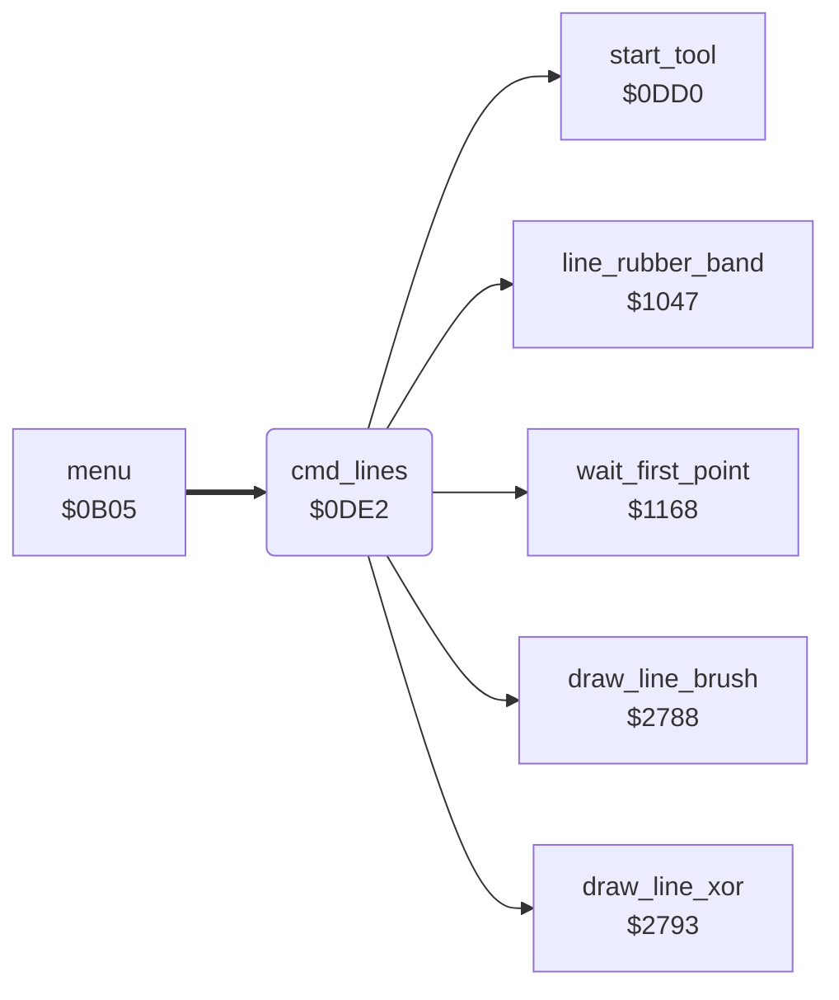

<!-- Generated by c64-docs from knowledge revision 20261024T063946.176-sfrhxb and .c64-re-tools/local/generated/src/source-map.json. Do not edit: change the knowledge, generate the source again, then run docs.ts generate. -->
# tools/lines.asm: Lines

Range `$0DE2-$0E16`. Source: [tools/lines.asm](../../../../src/tools/lines.asm). Index: [the reference](../../index.md).

## Call graph

A solid arrow is a call, a thick arrow a table entry, a dotted arrow a jump. Rounded nodes are in this file.

## Names

### [`cmd_lines`](../../../../src/tools/lines.asm#L6) `$0DE2`

*routine*

Command 3 (Lines): connected lines. The first point comes from $1168. Then for each next point ($1047): it removes the band line, draws the line in current_colour ($2788), and the end point becomes the start point. The band lines use background_colour and the plot routine of $2793 (a second draw at the same place removes the line).

- **Entry of:** [`command_table`](../../tables.md#command_table)
- **Calls:** [`start_tool`](tool_start.md#start_tool), [`wait_first_point`](line_tool.md#wait_first_point), [`line_rubber_band`](line_tool.md#line_rubber_band), [`draw_line_xor`](../graphics/bresenham_line.md#draw_line_xor), [`draw_line_brush`](../graphics/bresenham_line.md#draw_line_brush)
- **Reads:** [`current_colour`](../../memory-map.md#current_colour), [`background_colour`](../../memory-map.md#background_colour), [`saved_colour`](../../memory-map.md#saved_colour), [`shape_x1`](../../memory-map.md#shape_x1), [`shape_y1`](../../memory-map.md#shape_y1)
- **Writes:** [`saved_colour`](../../memory-map.md#saved_colour), [`current_colour`](../../memory-map.md#current_colour), [`shape_x0`](../../memory-map.md#shape_x0), [`shape_y0`](../../memory-map.md#shape_y0)

### [`lines_next`](../../../../src/tools/lines.asm#L15) `$0DF4`

*label*

- **Jumped to from:** [`cmd_lines`](lines.md#cmd_lines) [`$0E14`](../../../../src/tools/lines.asm#L30)
