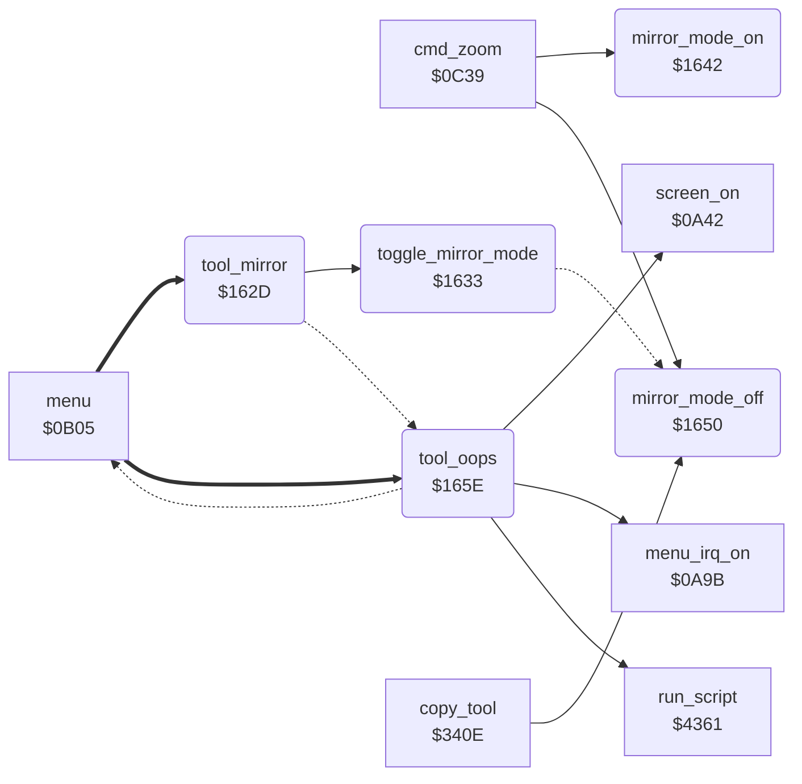

<!-- Generated by c64-docs from knowledge revision 20261024T063946.176-sfrhxb and .c64-re-tools/local/generated/src/source-map.json. Do not edit: change the knowledge, generate the source again, then run docs.ts generate. -->
# tools/mirror_oops_tool.asm: Mirror and Oops commands

Range `$162D-$166D`. Source: [tools/mirror_oops_tool.asm](../../../../src/tools/mirror_oops_tool.asm). Index: [the reference](../../index.md).

## Call graph

A solid arrow is a call, a thick arrow a table entry, a dotted arrow a jump. Rounded nodes are in this file.

## Names

### [`tool_mirror`](../../../../src/tools/mirror_oops_tool.asm#L6) `$162D`

*routine*

Mirror command (code $0d). Changes mirror mode on or off (toggle_mirror_mode), then goes back to the menu (return_to_menu).

- **Entry of:** [`command_table`](../../tables.md#command_table)
- **Calls:** [`toggle_mirror_mode`](mirror_oops_tool.md#toggle_mirror_mode)
- **Jumps to:** [`return_to_menu`](mirror_oops_tool.md#return_to_menu)

### [`toggle_mirror_mode`](../../../../src/tools/mirror_oops_tool.asm#L10) `$1633`

*routine*

Inverts bit 0 of mirror_mode and copies it to mirror_mode_saved. Then sets the drawing limits of the new mode (mirror_mode_on or mirror_mode_off).

- **Called from:** [`tool_mirror`](mirror_oops_tool.md#tool_mirror) [`$162D`](../../../../src/tools/mirror_oops_tool.asm#L7)
- **Jumps to:** [`mirror_mode_off`](mirror_oops_tool.md#mirror_mode_off)
- **Reads:** [`mirror_mode`](../../memory-map.md#mirror_mode)
- **Writes:** [`mirror_mode`](../../memory-map.md#mirror_mode), [`mirror_choice`](../../memory-map.md#mirror_choice)

### [`mirror_mode_on`](../../../../src/tools/mirror_oops_tool.asm#L18) `$1642`

*routine*

Sets mirror_mode to 1 and the drawing limits to the upper left quarter of the picture: max_x = 79, max_y = 99.

- **Called from:** [`cmd_zoom`](../menu/menu.md#cmd_zoom) [`$0C47`](../../../../src/menu/menu.asm#L174), [`$149D`](../../../../src/tools/tool_exit.asm#L10)
- **Writes:** [`mirror_mode`](../../memory-map.md#mirror_mode), [`max_x`](../../memory-map.md#max_x), [`max_y`](../../memory-map.md#max_y)

### [`mirror_mode_off`](../../../../src/tools/mirror_oops_tool.asm#L27) `$1650`

*routine*

Sets mirror_mode to 0 and the drawing limits to all of the picture: max_x = 159, max_y = 199. mirror_mode_saved does not change. Zoom and Copy call it.

- **Called from:** [`cmd_zoom`](../menu/menu.md#cmd_zoom) [`$0C39`](../../../../src/menu/menu.asm#L169), [`copy_tool`](copy.md#copy_tool) [`$340E`](../../../../src/tools/copy.asm#L7)
- **Jumped to from:** [`toggle_mirror_mode`](mirror_oops_tool.md#toggle_mirror_mode) [`$1640`](../../../../src/tools/mirror_oops_tool.asm#L16)
- **Writes:** [`mirror_mode`](../../memory-map.md#mirror_mode), [`max_y`](../../memory-map.md#max_y), [`max_x`](../../memory-map.md#max_x)

### [`tool_oops`](../../../../src/tools/mirror_oops_tool.asm#L36) `$165E`

*routine*

Oops command (code $10). Runs the script at $1eb5, then goes back to the menu (return_to_menu).

- **Entry of:** [`command_table`](../../tables.md#command_table)
- **Calls:** [`run_script`](../script/interpreter.md#run_script), [`menu_irq_on`](../irq/menu_irq.md#menu_irq_on), [`screen_on`](../init/screen.md#screen_on)
- **Jumps to:** [`menu_refresh`](../menu/menu.md#menu_refresh)

### [`return_to_menu`](../../../../src/tools/mirror_oops_tool.asm#L41) `$1665`

*label*

Starts the raster interrupt ($0a9b), sets the screen on ($0a42) and goes to the menu ($0b63).

- **Jumped to from:** [`tool_mirror`](mirror_oops_tool.md#tool_mirror) [`$1630`](../../../../src/tools/mirror_oops_tool.asm#L8)
