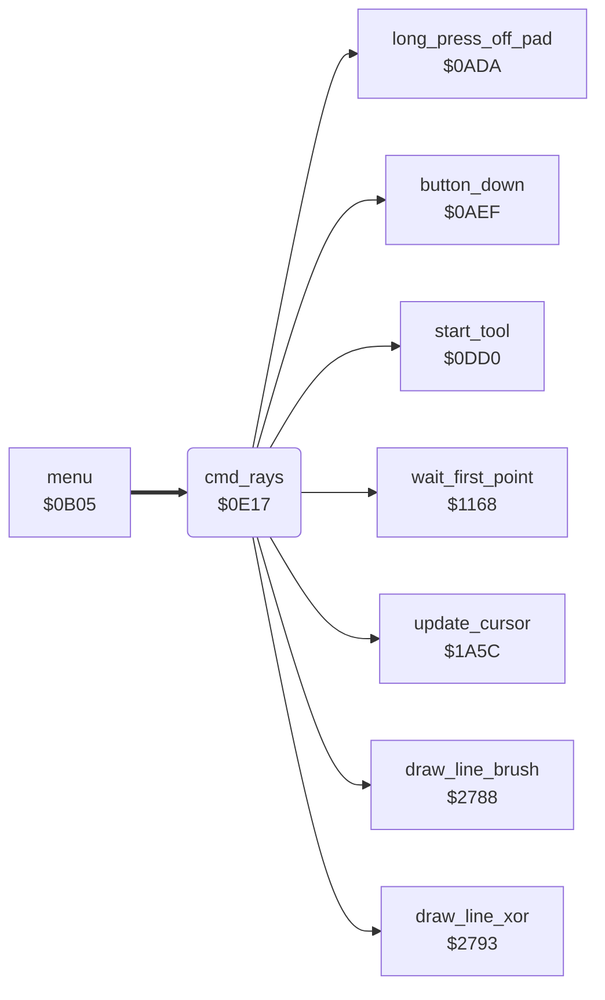

<!-- Generated by c64-docs from knowledge revision 20261025T214624.065-e5whe4 and .c64-re-tools/local/generated/src/source-map.json. Do not edit: change the knowledge, generate the source again, then run docs.ts generate. -->
# tools/rays.asm: Rays

Range `$0E17-$0EA1`. Source: [tools/rays.asm](../../../../src/tools/rays.asm). Index: [the reference](../../index.md).

## Routines

| Routine | Address | Reached from | Summary |
|---|---|---|---|
| [`cmd_rays`](rays.md#cmd_rays) | `$0E17` | [`menu`](../menu/menu.md#menu) | Command 6 (Rays): lines from one centre point. |

## Call graph

A solid arrow is a call, a thick arrow a table entry. Rounded nodes are in this file.

## Details

### [`cmd_rays`](../../../../src/tools/rays.asm#L6) `$0E17`

*routine*

Command 6 (Rays): lines from one centre point. The centre comes from $1168. While a button is down, it draws a line from the centre to the cursor ($2788) at each read. While the buttons are up, a band line follows the cursor ($2793). It sets brush_plot_flag to 1 and puts it back at the end. A long press with no touch goes back to the menu ($1495).

- **Entry of:** [`command_table`](../../tables.md#command_table)
- **Calls:** [`start_tool`](tool_start.md#start_tool), [`wait_first_point`](line_tool.md#wait_first_point), [`draw_line_xor`](../graphics/bresenham_line.md#draw_line_xor), [`update_cursor`](../input/cursor.md#update_cursor), [`long_press_off_pad`](../input/buttons.md#long_press_off_pad), [`button_down`](../input/buttons.md#button_down), [`draw_line_brush`](../graphics/bresenham_line.md#draw_line_brush)
- **Jumps to:** [`tool_exit`](tool_exit.md#tool_exit)
- **Reads:** [`line_fill_corners`](../../memory-map.md#line_fill_corners), [`current_colour`](../../memory-map.md#current_colour), [`background_colour`](../../memory-map.md#background_colour), [`saved_colour`](../../memory-map.md#saved_colour), [`button_held`](../../memory-map.md#button_held), [`cursor_x`](../../memory-map.md#cursor_x), [`cursor_y`](../../memory-map.md#cursor_y), [`shape_x1`](../../memory-map.md#shape_x1), [`shape_y1`](../../memory-map.md#shape_y1)
- **Writes:** [`line_fill_corners`](../../memory-map.md#line_fill_corners), [`saved_colour`](../../memory-map.md#saved_colour), [`current_colour`](../../memory-map.md#current_colour), [`button_press_edge`](../../memory-map.md#button_press_edge), [`shape_x1`](../../memory-map.md#shape_x1), [`shape_y1`](../../memory-map.md#shape_y1)

| Label | Address | Comment |
|---|---|---|
| [`rays_loop`](../../../../src/tools/rays.asm#L22) | `$0E37` |  |
| [`rays_check_exit`](../../../../src/tools/rays.asm#L26) | `$0E3D` |  |
| [`rays_read_point`](../../../../src/tools/rays.asm#L33) | `$0E4B` |  |
| [`rays_band_draw`](../../../../src/tools/rays.asm#L46) | `$0E67` |  |
| [`rays_band_loop`](../../../../src/tools/rays.asm#L48) | `$0E6A` |  |
| [`rays_band_test_move`](../../../../src/tools/rays.asm#L54) | `$0E76` |  |
| [`rays_band_move`](../../../../src/tools/rays.asm#L62) | `$0E85` |  |
| [`rays_band_button`](../../../../src/tools/rays.asm#L73) | `$0E97` |  |
