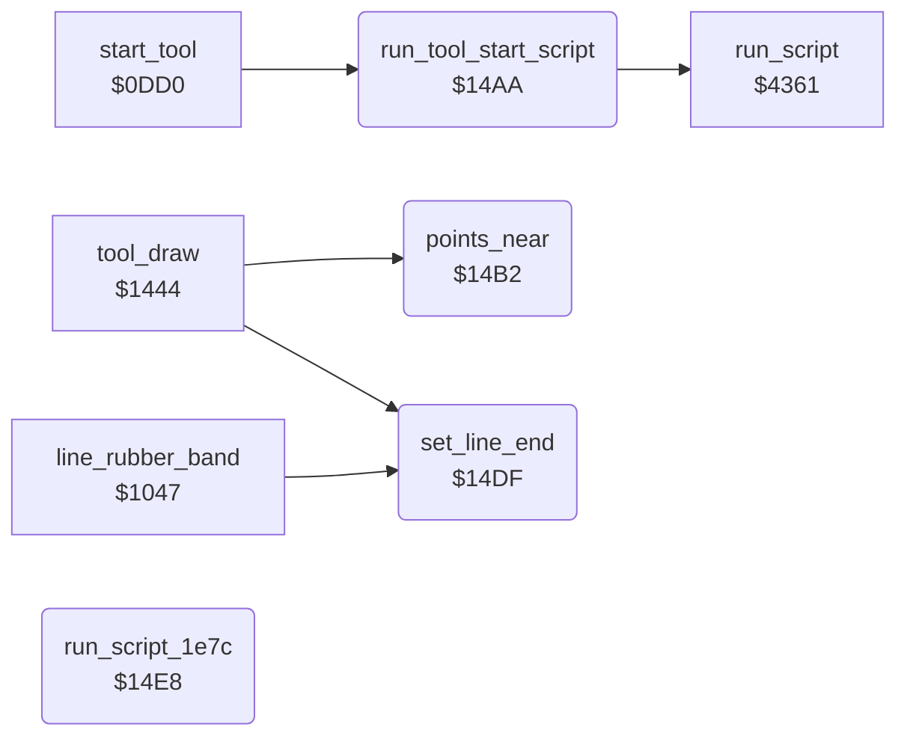

<!-- Generated by c64-docs from knowledge revision 20261024T063946.176-sfrhxb and .c64-re-tools/local/generated/src/source-map.json. Do not edit: change the knowledge, generate the source again, then run docs.ts generate. -->
# tools/tool_exit.asm: Tool exit and shared tool helpers

Range `$1495-$14EE`. Source: [tools/tool_exit.asm](../../../../src/tools/tool_exit.asm). Index: [the reference](../../index.md).

## Call graph

A solid arrow is a call, a thick arrow a table entry, a dotted arrow a jump. Rounded nodes are in this file.

## Names

### [`tool_exit`](../../../../src/tools/tool_exit.asm#L6) `$1495`

*label*

Leaves a drawing tool. The callers jump here and remove their return address first. When mirror_mode_saved is set, sets mirror mode again (mirror_mode_on). Runs the script at $1dd3, then goes to the menu ($0b4a).

- **Jumped to from:** [`cmd_rays`](rays.md#cmd_rays) [`$0E48`](../../../../src/tools/rays.asm#L32), [`shape_drag_size`](circle.md#shape_drag_size) [`$0F1D`](../../../../src/tools/circle.asm#L67), [`shape_drag_move`](circle.md#shape_drag_move) [`$0FAD`](../../../../src/tools/circle.asm#L147), [`line_rubber_band`](line_tool.md#line_rubber_band) [`$1058`](../../../../src/tools/line_tool.asm#L32), [`line_move`](line_tool.md#line_move) [`$10EC`](../../../../src/tools/line_tool.asm#L111), [`wait_first_point`](line_tool.md#wait_first_point) [`$1176`](../../../../src/tools/line_tool.asm#L194), [`rect_rubber_band`](box_frame_tool.md#rect_rubber_band) [`$1211`](../../../../src/tools/box_frame_tool.asm#L67), [`rect_move`](box_frame_tool.md#rect_move) [`$1292`](../../../../src/tools/box_frame_tool.asm#L138), [`tool_fill`](fill_tool.md#tool_fill) [`$1428`](../../../../src/tools/fill_tool.asm#L36), [`tool_draw`](draw_tool.md#tool_draw) [`$1461`](../../../../src/tools/draw_tool.asm#L23), [`tool_xcolor`](xcolor_tool.md#tool_xcolor) [`$168B`](../../../../src/tools/xcolor_tool.asm#L22), [`copy_tool`](copy.md#copy_tool) [`$34EB`](../../../../src/tools/copy.asm#L126), [`swap_tool`](swap.md#swap_tool) [`$36CF`](../../../../src/tools/swap.asm#L34)

### [`tool_exit_script`](../../../../src/tools/tool_exit.asm#L11) `$14A0`

*label*

- **Jumped to from:** [`$1498`](../../../../src/tools/tool_exit.asm#L8)

### [`run_tool_start_script`](../../../../src/tools/tool_exit.asm#L17) `$14AA`

*routine*

Runs the script at $1dfe. The script starts with op 9 to bitmap_mode_on. The tool start code at $0dd0 calls it.

- **Called from:** [`start_tool`](tool_start.md#start_tool) [`$0DD6`](../../../../src/tools/tool_start.asm#L9)
- **Calls:** [`run_script`](../script/interpreter.md#run_script)

### [`points_near`](../../../../src/tools/tool_exit.asm#L23) `$14B2`

*routine*

Compares the ends of the line (line_x0, line_y0) and (line_x1, line_y1). C = 0 when they differ by less than 25 on both axes, else C = 1.

- **Called from:** [`tool_draw`](draw_tool.md#tool_draw) [`$1482`](../../../../src/tools/draw_tool_147f.asm#L7)
- **Reads:** [`shape_x0`](../../memory-map.md#shape_x0), [`shape_x1`](../../memory-map.md#shape_x1), [`shape_y0`](../../memory-map.md#shape_y0), [`shape_y1`](../../memory-map.md#shape_y1)

### [`points_near_check_x`](../../../../src/tools/tool_exit.asm#L29) `$14BB`

*label*

25 pixels.

- **Jumped to from:** [`points_near`](tool_exit.md#points_near) [`$14C5`](../../../../src/tools/tool_exit.asm#L38)

### [`points_near_x_reverse`](../../../../src/tools/tool_exit.asm#L34) `$14C0`

*label*

- **Jumped to from:** [`points_near`](tool_exit.md#points_near) [`$14B6`](../../../../src/tools/tool_exit.asm#L26)

### [`points_near_y`](../../../../src/tools/tool_exit.asm#L39) `$14C8`

*label*

- **Jumped to from:** [`points_near`](tool_exit.md#points_near) [`$14BD`](../../../../src/tools/tool_exit.asm#L31)

### [`points_near_check_y`](../../../../src/tools/tool_exit.asm#L45) `$14D1`

*label*

- **Jumped to from:** [`points_near`](tool_exit.md#points_near) [`$14DC`](../../../../src/tools/tool_exit.asm#L56)

### [`points_near_yes`](../../../../src/tools/tool_exit.asm#L50) `$14D6`

*label*

- **Jumped to from:** [`points_near`](tool_exit.md#points_near) [`$14D3`](../../../../src/tools/tool_exit.asm#L47)

### [`points_near_y_reverse`](../../../../src/tools/tool_exit.asm#L52) `$14D7`

*label*

- **Jumped to from:** [`points_near`](tool_exit.md#points_near) [`$14CC`](../../../../src/tools/tool_exit.asm#L42)

### [`set_line_end`](../../../../src/tools/tool_exit.asm#L58) `$14DF`

*routine*

Sets the end of the line (line_x1, line_y1) to the cursor (cursor_x, cursor_y).

- **Called from:** [`line_rubber_band`](line_tool.md#line_rubber_band) [`$108A`](../../../../src/tools/line_tool.asm#L58), [`tool_draw`](draw_tool.md#tool_draw) [`$1477`](../../../../src/tools/draw_tool.asm#L34), [`tool_draw`](draw_tool.md#tool_draw) [`$147F`](../../../../src/tools/draw_tool_147f.asm#L6)
- **Reads:** [`cursor_x`](../../memory-map.md#cursor_x), [`cursor_y`](../../memory-map.md#cursor_y)
- **Writes:** [`shape_x1`](../../memory-map.md#shape_x1), [`shape_y1`](../../memory-map.md#shape_y1)

### [`run_script_1e7c`](../../../../src/tools/tool_exit.asm#L65) `$14E8`

*routine*

Runs the script at $1e7c. The code of the Erase command ($0c24) calls it.
