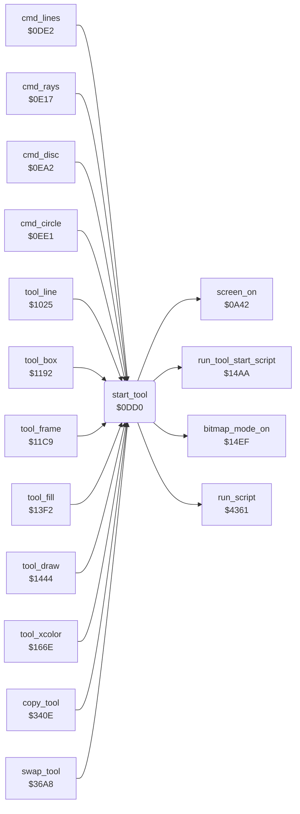

<!-- Generated by c64-docs from knowledge revision 20261024T063946.176-sfrhxb and .c64-re-tools/local/generated/src/source-map.json. Do not edit: change the knowledge, generate the source again, then run docs.ts generate. -->
# tools/tool_start.asm: Tool Start

Range `$0DD0-$0DE1`. Source: [tools/tool_start.asm](../../../../src/tools/tool_start.asm). Index: [the reference](../../index.md).

## Call graph

A solid arrow is a call, a thick arrow a table entry, a dotted arrow a jump. Rounded nodes are in this file.

## Names

### [`start_tool`](../../../../src/tools/tool_start.asm#L6) `$0DD0`

*routine*

Starts a tool: runs the script at A/Y (the tool label), screen on, the script at $1dfe ($14aa), background = background_colour, then the bitmap screen ($14ef).

- **Called from:** [`cmd_lines`](lines.md#cmd_lines) [`$0DE6`](../../../../src/tools/lines.asm#L9), [`cmd_rays`](rays.md#cmd_rays) [`$0E22`](../../../../src/tools/rays.asm#L13), [`cmd_disc`](circle.md#cmd_disc) [`$0EA6`](../../../../src/tools/circle.asm#L9), [`cmd_circle`](circle.md#cmd_circle) [`$0EE5`](../../../../src/tools/circle.asm#L41), [`tool_line`](line_tool.md#tool_line) [`$1029`](../../../../src/tools/line_tool.asm#L9), [`tool_box`](box_frame_tool.md#tool_box) [`$1196`](../../../../src/tools/box_frame_tool.asm#L9), [`tool_frame`](box_frame_tool.md#tool_frame) [`$11CD`](../../../../src/tools/box_frame_tool.asm#L35), [`tool_fill`](fill_tool.md#tool_fill) [`$13F6`](../../../../src/tools/fill_tool.asm#L9), [`tool_draw`](draw_tool.md#tool_draw) [`$1448`](../../../../src/tools/draw_tool.asm#L9), [`tool_xcolor`](xcolor_tool.md#tool_xcolor) [`$1672`](../../../../src/tools/xcolor_tool.asm#L9), [`copy_tool`](copy.md#copy_tool) [`$341C`](../../../../src/tools/copy.asm#L14), [`swap_tool`](swap.md#swap_tool) [`$36AC`](../../../../src/tools/swap.asm#L18)
- **Calls:** [`run_script`](../script/interpreter.md#run_script), [`screen_on`](../init/screen.md#screen_on), [`run_tool_start_script`](tool_exit.md#run_tool_start_script), [`bitmap_mode_on`](../graphics/display_mode.md#bitmap_mode_on)
- **Reads:** [`background_colour`](../../memory-map.md#background_colour)
- **Writes:** [`BGCOL0`](../../memory-map.md#BGCOL0)
