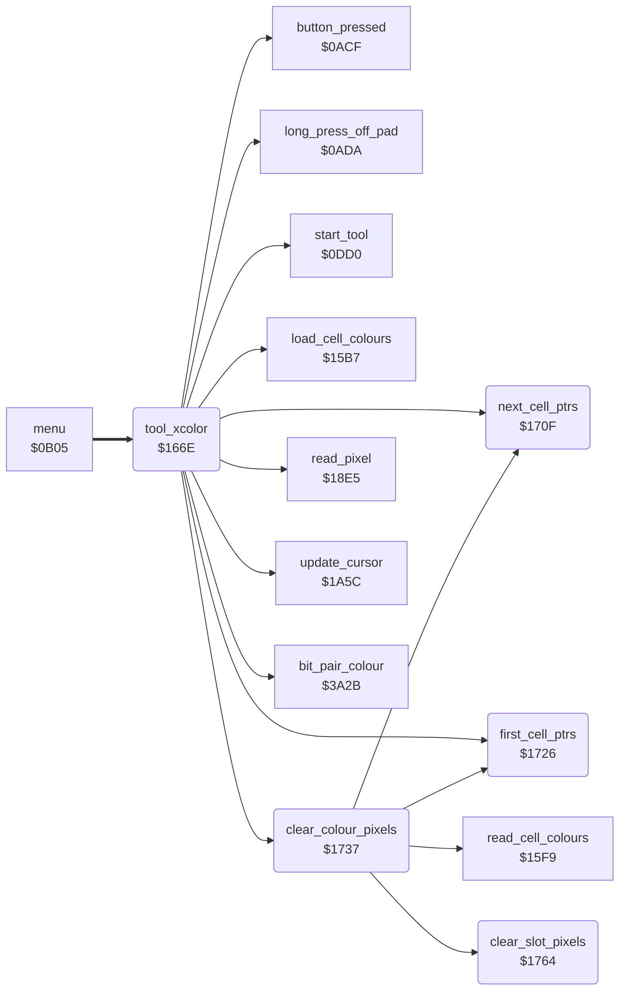

<!-- Generated by c64-docs from knowledge revision 20261024T063946.176-sfrhxb and .c64-re-tools/local/generated/src/source-map.json. Do not edit: change the knowledge, generate the source again, then run docs.ts generate. -->
# tools/xcolor_tool.asm: Xcolor tool

Range `$166E-$17AC`. Source: [tools/xcolor_tool.asm](../../../../src/tools/xcolor_tool.asm). Index: [the reference](../../index.md).

## Call graph

A solid arrow is a call, a thick arrow a table entry, a dotted arrow a jump. Rounded nodes are in this file.

## Names

### [`tool_xcolor`](../../../../src/tools/xcolor_tool.asm#L6) `$166E`

*routine*

Xcolor command (code $0a). Shows the label XCOLOR. On a button press, reads the colour of the pixel under the cursor into target_colour and replaces it with current_colour in all of the picture. When target_colour is the background colour, the background colour ($d021, background_colour) becomes current_colour, and clear_colour_pixels runs for the old and for the new colour. Else each screen nybble and colour RAM value that is target_colour becomes current_colour. When current_colour is the background colour, clear_colour_pixels runs in place of the replacement. A long press off the pad goes to tool_exit.

- **Entry of:** [`command_table`](../../tables.md#command_table)
- **Calls:** [`start_tool`](tool_start.md#start_tool), [`update_cursor`](../input/cursor.md#update_cursor), [`long_press_off_pad`](../input/buttons.md#long_press_off_pad), [`button_pressed`](../input/buttons.md#button_pressed), [`read_pixel`](../graphics/pixel.md#read_pixel), [`load_cell_colours`](../graphics/colour_slots.md#load_cell_colours), [`bit_pair_colour`](../graphics/bit_pair_colour.md#bit_pair_colour), [`clear_colour_pixels`](xcolor_tool.md#clear_colour_pixels), [`first_cell_ptrs`](xcolor_tool.md#first_cell_ptrs), [`next_cell_ptrs`](xcolor_tool.md#next_cell_ptrs)
- **Jumps to:** [`tool_exit`](tool_exit.md#tool_exit)
- **Reads:** [`cursor_x`](../../memory-map.md#cursor_x), [`cursor_y`](../../memory-map.md#cursor_y), [`point_x0`](../../memory-map.md#point_x0), [`point_y0`](../../memory-map.md#point_y0), [`background_colour`](../../memory-map.md#background_colour), [`current_colour`](../../memory-map.md#current_colour), [`cell_screen_ptr`](../../memory-map.md#cell_screen_ptr), [`target_colour`](../../memory-map.md#target_colour), [`temp_word`](../../memory-map.md#temp_word), [`cell_colour_ptr`](../../memory-map.md#cell_colour_ptr)
- **Writes:** [`point_x0`](../../memory-map.md#point_x0), [`point_y0`](../../memory-map.md#point_y0), [`cursor_x`](../../memory-map.md#cursor_x), [`cursor_y`](../../memory-map.md#cursor_y), [`target_colour`](../../memory-map.md#target_colour), [`BGCOL0`](../../memory-map.md#BGCOL0), [`background_colour`](../../memory-map.md#background_colour), [`temp_word`](../../memory-map.md#temp_word)

### [`tool_xcolor_loop`](../../../../src/tools/xcolor_tool.asm#L10) `$1675`

*label*

- **Jumped to from:** [`tool_xcolor`](xcolor_tool.md#tool_xcolor) [`$1691`](../../../../src/tools/xcolor_tool.asm#L25), [`tool_xcolor`](xcolor_tool.md#tool_xcolor) [`$16BD`](../../../../src/tools/xcolor_tool.asm#L45), [`tool_xcolor`](xcolor_tool.md#tool_xcolor) [`$16C9`](../../../../src/tools/xcolor_tool.asm#L52), [`tool_xcolor`](xcolor_tool.md#tool_xcolor) [`$170C`](../../../../src/tools/xcolor_tool.asm#L93)

### [`tool_xcolor_check_exit`](../../../../src/tools/xcolor_tool.asm#L19) `$1686`

*label*

- **Jumped to from:** [`tool_xcolor`](xcolor_tool.md#tool_xcolor) [`$167C`](../../../../src/tools/xcolor_tool.asm#L14)

### [`tool_xcolor_check_press`](../../../../src/tools/xcolor_tool.asm#L23) `$168E`

*label*

- **Jumped to from:** [`tool_xcolor`](xcolor_tool.md#tool_xcolor) [`$1689`](../../../../src/tools/xcolor_tool.asm#L21)

### [`tool_xcolor_other`](../../../../src/tools/xcolor_tool.asm#L46) `$16C0`

*label*

- **Jumped to from:** [`tool_xcolor`](xcolor_tool.md#tool_xcolor) [`$16AA`](../../../../src/tools/xcolor_tool.asm#L37)

### [`tool_xcolor_replace_all`](../../../../src/tools/xcolor_tool.asm#L53) `$16CC`

*label*

- **Jumped to from:** [`tool_xcolor`](xcolor_tool.md#tool_xcolor) [`$16C4`](../../../../src/tools/xcolor_tool.asm#L50)

### [`xcolor_replace_cell`](../../../../src/tools/xcolor_tool.asm#L56) `$16D1`

*label*

- **Jumped to from:** [`tool_xcolor`](xcolor_tool.md#tool_xcolor) [`$170A`](../../../../src/tools/xcolor_tool.asm#L92)

### [`xcolor_check_high`](../../../../src/tools/xcolor_tool.asm#L65) `$16E1`

*label*

- **Jumped to from:** [`tool_xcolor`](xcolor_tool.md#tool_xcolor) [`$16D7`](../../../../src/tools/xcolor_tool.asm#L60)

### [`xcolor_check_colour_ram`](../../../../src/tools/xcolor_tool.asm#L83) `$16FB`

*label*

- **Jumped to from:** [`tool_xcolor`](xcolor_tool.md#tool_xcolor) [`$16E9`](../../../../src/tools/xcolor_tool.asm#L72)

### [`xcolor_next_cell`](../../../../src/tools/xcolor_tool.asm#L90) `$1707`

*label*

- **Jumped to from:** [`tool_xcolor`](xcolor_tool.md#tool_xcolor) [`$1701`](../../../../src/tools/xcolor_tool.asm#L87)

### [`next_cell_ptrs`](../../../../src/tools/xcolor_tool.asm#L95) `$170F`

*routine*

Increments cell_screen_ptr and cell_colour_ptr. Z = 1 when cell_colour_ptr is $dbe8, after the last of the 1000 cells.

- **Called from:** [`tool_xcolor`](xcolor_tool.md#tool_xcolor) [`$1707`](../../../../src/tools/xcolor_tool.asm#L91), [`clear_colour_pixels`](xcolor_tool.md#clear_colour_pixels) [`$175E`](../../../../src/tools/xcolor_tool.asm#L147)
- **Reads:** [`cell_colour_ptr`](../../memory-map.md#cell_colour_ptr), [`cell_screen_ptr`](../../memory-map.md#cell_screen_ptr), [`cell_colour_ptr+1`](../../memory-map.md#cell_colour_ptr), [`cell_screen_ptr+1`](../../memory-map.md#cell_screen_ptr)
- **Writes:** [`cell_colour_ptr`](../../memory-map.md#cell_colour_ptr), [`cell_screen_ptr`](../../memory-map.md#cell_screen_ptr), [`cell_colour_ptr+1`](../../memory-map.md#cell_colour_ptr), [`cell_screen_ptr+1`](../../memory-map.md#cell_screen_ptr)

### [`next_cell_ptrs_check_end`](../../../../src/tools/xcolor_tool.asm#L101) `$1719`

*label*

- **Jumped to from:** [`next_cell_ptrs`](xcolor_tool.md#next_cell_ptrs) [`$1713`](../../../../src/tools/xcolor_tool.asm#L98)

### [`next_cell_ptrs_done`](../../../../src/tools/xcolor_tool.asm#L108) `$1725`

*label*

- **Jumped to from:** [`next_cell_ptrs`](xcolor_tool.md#next_cell_ptrs) [`$171F`](../../../../src/tools/xcolor_tool.asm#L105)

### [`first_cell_ptrs`](../../../../src/tools/xcolor_tool.asm#L111) `$1726`

*routine*

Sets cell_screen_ptr to $5c00 and cell_colour_ptr to $d800, the first cell.

- **Called from:** [`tool_xcolor`](xcolor_tool.md#tool_xcolor) [`$16CC`](../../../../src/tools/xcolor_tool.asm#L54), [`clear_colour_pixels`](xcolor_tool.md#clear_colour_pixels) [`$1737`](../../../../src/tools/xcolor_tool.asm#L123)
- **Writes:** [`cell_screen_ptr`](../../memory-map.md#cell_screen_ptr), [`cell_screen_ptr+1`](../../memory-map.md#cell_screen_ptr), [`cell_colour_ptr`](../../memory-map.md#cell_colour_ptr), [`cell_colour_ptr+1`](../../memory-map.md#cell_colour_ptr)

### [`clear_colour_pixels`](../../../../src/tools/xcolor_tool.asm#L122) `$1737`

*routine*

For each of the 1000 cells: each pixel value (1-3) whose cell colour is target_colour gets its pixels set to 0, the background (clear_slot_pixels).

- **Called from:** [`tool_xcolor`](xcolor_tool.md#tool_xcolor) [`$16B3`](../../../../src/tools/xcolor_tool.asm#L41), [`tool_xcolor`](xcolor_tool.md#tool_xcolor) [`$16BA`](../../../../src/tools/xcolor_tool.asm#L44), [`tool_xcolor`](xcolor_tool.md#tool_xcolor) [`$16C6`](../../../../src/tools/xcolor_tool.asm#L51)
- **Calls:** [`first_cell_ptrs`](xcolor_tool.md#first_cell_ptrs), [`read_cell_colours`](../graphics/colour_slots.md#read_cell_colours), [`clear_slot_pixels`](xcolor_tool.md#clear_slot_pixels), [`next_cell_ptrs`](xcolor_tool.md#next_cell_ptrs)
- **Reads:** [`cell_colour_1`](../../memory-map.md#cell_colour_1), [`target_colour`](../../memory-map.md#target_colour), [`cell_colour_2`](../../memory-map.md#cell_colour_2), [`cell_colour_3`](../../memory-map.md#cell_colour_3)

### [`clear_colour_cell`](../../../../src/tools/xcolor_tool.asm#L124) `$173A`

*label*

- **Jumped to from:** [`clear_colour_pixels`](xcolor_tool.md#clear_colour_pixels) [`$1761`](../../../../src/tools/xcolor_tool.asm#L148)

### [`clear_colour_check_2`](../../../../src/tools/xcolor_tool.asm#L132) `$1748`

*label*

- **Jumped to from:** [`clear_colour_pixels`](xcolor_tool.md#clear_colour_pixels) [`$1741`](../../../../src/tools/xcolor_tool.asm#L128)

### [`clear_colour_check_3`](../../../../src/tools/xcolor_tool.asm#L139) `$1753`

*label*

- **Jumped to from:** [`clear_colour_pixels`](xcolor_tool.md#clear_colour_pixels) [`$174C`](../../../../src/tools/xcolor_tool.asm#L135)

### [`clear_colour_next`](../../../../src/tools/xcolor_tool.asm#L146) `$175E`

*label*

- **Jumped to from:** [`clear_colour_pixels`](xcolor_tool.md#clear_colour_pixels) [`$1757`](../../../../src/tools/xcolor_tool.asm#L142)

### [`clear_slot_pixels`](../../../../src/tools/xcolor_tool.asm#L151) `$1764`

*routine*

A = pixel value (1-3). In the 8 bitmap bytes of the cell of cell_screen_ptr ($6000 + 8 * cell number), sets each pixel with this value to 0.

- **Called from:** [`clear_colour_pixels`](xcolor_tool.md#clear_colour_pixels) [`$1745`](../../../../src/tools/xcolor_tool.asm#L131), [`clear_colour_pixels`](xcolor_tool.md#clear_colour_pixels) [`$1750`](../../../../src/tools/xcolor_tool.asm#L138), [`clear_colour_pixels`](xcolor_tool.md#clear_colour_pixels) [`$175B`](../../../../src/tools/xcolor_tool.asm#L145)
- **Reads:** [`cell_screen_ptr+1`](../../memory-map.md#cell_screen_ptr), [`cell_screen_ptr`](../../memory-map.md#cell_screen_ptr), [`temp_word`](../../memory-map.md#temp_word), [`temp_word_hi`](../../memory-map.md#temp_word_hi), [`temp_byte`](../../memory-map.md#temp_byte)
- **Writes:** [`temp_byte`](../../memory-map.md#temp_byte), [`temp_word_hi`](../../memory-map.md#temp_word_hi), [`temp_word`](../../memory-map.md#temp_word)

### [`clear_slot_byte`](../../../../src/tools/xcolor_tool.asm#L176) `$178E`

*label*

- **Jumped to from:** [`clear_slot_pixels`](xcolor_tool.md#clear_slot_pixels) [`$17AA`](../../../../src/tools/xcolor_tool.asm#L197)

### [`clear_slot_pixel`](../../../../src/tools/xcolor_tool.asm#L179) `$1792`

*label*

- **Jumped to from:** [`clear_slot_pixels`](xcolor_tool.md#clear_slot_pixels) [`$17A5`](../../../../src/tools/xcolor_tool.asm#L194)

### [`clear_slot_keep`](../../../../src/tools/xcolor_tool.asm#L187) `$179D`

*label*

ASL and ADC #0 two times: rotates the byte left by 2 bits.

- **Jumped to from:** [`clear_slot_pixels`](xcolor_tool.md#clear_slot_pixels) [`$1797`](../../../../src/tools/xcolor_tool.asm#L183)
