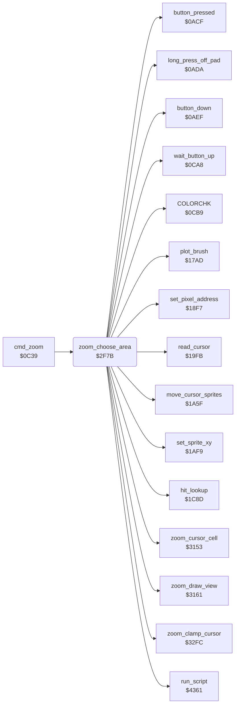

<!-- Generated by c64-docs from knowledge revision 20261025T214624.065-e5whe4 and .c64-re-tools/local/generated/src/source-map.json. Do not edit: change the knowledge, generate the source again, then run docs.ts generate. -->
# zoom/zoom_choose_area.asm: Zoom: Choose the Area

Range `$2F7B-$3152`. Source: [zoom/zoom_choose_area.asm](../../../../src/zoom/zoom_choose_area.asm). Index: [the reference](../../index.md).

## Routines

| Routine | Address | Reached from | Summary |
|---|---|---|---|
| [`zoom_choose_area`](zoom_choose_area.md#zoom_choose_area) | `$2F7B` | [`cmd_zoom`](../menu/menu.md#cmd_zoom) | Zoom: shows the picture with the zoom cursor (all 8 sprites) and waits for a press on the pad. |

## Call graph

A solid arrow is a call, a thick arrow a table entry. Rounded nodes are in this file.

## Details

### [`zoom_choose_area`](../../../../src/zoom/zoom_choose_area.asm#L6) `$2F7B`

*routine*

Zoom: shows the picture with the zoom cursor (all 8 sprites) and waits for a press on the pad. The press selects the top row of the zoom window (the cursor row - 3, at most 16) and the addresses of the window in the bitmap, the screen colours and the colour RAM. A long press off the pad returns. The code continues at $303f.

- **Called from:** [`cmd_zoom`](../menu/menu.md#cmd_zoom)
- **Calls:** [`run_script`](../script/interpreter.md#run_script), [`wait_button_up`](../menu/menu.md#wait_button_up), [`read_cursor`](../input/cursor.md#read_cursor), [`long_press_off_pad`](../input/buttons.md#long_press_off_pad), [`zoom_clamp_cursor`](zoom_clamp.md#zoom_clamp_cursor), [`move_cursor_sprites`](../input/cursor.md#move_cursor_sprites), [`button_pressed`](../input/buttons.md#button_pressed), [`zoom_cursor_cell`](zoom_view.md#zoom_cursor_cell), [`zoom_draw_view`](zoom_view.md#zoom_draw_view), [`hit_lookup`](../input/hit_test_1c85.md#hit_lookup), [`button_down`](../input/buttons.md#button_down), [`set_sprite_xy`](../input/cursor.md#set_sprite_xy) and 3 more
- **Reads:** [`background_colour`](../../memory-map.md#background_colour), [`cursor_x`](../../memory-map.md#cursor_x), [`zoom_row`](../../memory-map.md#zoom_row), [`bitmap_row_addr_hi`](../graphics/pixel.md#bitmap_row_addr_hi), [`bitmap_row_addr`](../graphics/pixel.md#bitmap_row_addr), [`temp_word`](../../memory-map.md#temp_word), [`temp_byte`](../../memory-map.md#temp_byte), [`cursor_y`](../../memory-map.md#cursor_y), [`hit_code`](../../memory-map.md#hit_code), [`zoom_top`](../../memory-map.md#zoom_top), [`zoom_left`](../../memory-map.md#zoom_left)
- **Writes:** [`cursor_offset_x`](../../memory-map.md#cursor_offset_x), [`cursor_offset_y`](../../memory-map.md#cursor_offset_y), [`BGCOL0`](../../memory-map.md#BGCOL0), [`SPENA`](../../memory-map.md#SPENA), [`cursor_sprite_mask`](../../memory-map.md#cursor_sprite_mask), [`script_condition`](../../memory-map.md#script_condition), [`zoom_row`](../../memory-map.md#zoom_row), [`script_return_stack`](../../memory-map.md#script_return_stack), [`script_arg_stack`](../../memory-map.md#script_arg_stack), [`temp_word`](../../memory-map.md#temp_word), [`temp_byte`](../../memory-map.md#temp_byte), [`cursor_y`](../../memory-map.md#cursor_y) and 7 more

| Label | Address | Comment |
|---|---|---|
| [`zoom_choose_loop`](../../../../src/zoom/zoom_choose_area.asm#L19) | `$2F96` |  |
| [`zoom_choose_exit`](../../../../src/zoom/zoom_choose_area.asm#L27) | `$2FAA` |  |
| [`zoom_test_press`](../../../../src/zoom/zoom_choose_area.asm#L30) | `$2FAB` |  |
| [`zoom_limit_row`](../../../../src/zoom/zoom_choose_area.asm#L49) | `$2FCC` |  |
| [`zoom_row_above_cursor`](../../../../src/zoom/zoom_choose_area.asm#L56) | `$2FD7` |  |
| [`zoom_set_window`](../../../../src/zoom/zoom_choose_area.asm#L61) | `$2FDC` | Puts the addresses of the window row on the argument stack ($4f47-$4f4c: colour RAM, screen, bitmap, high byte first) and the bitmap and screen offsets on the CPU stack. Moves the cursor Y into the window. |
| [`zoom_open_view`](../../../../src/zoom/zoom_choose_area.asm#L116) | `$303F` | Zoom: the place is chosen. zoom_left and zoom_top get the cursor point in the preview. The script zoom_view_script builds the zoom screen, zoom_draw_view draws the magnified view, and the hit table at $2728 becomes active. |
| [`zoom_loop`](../../../../src/zoom/zoom_choose_area.asm#L135) | `$3066` | Zoom main loop. No touch and a long press closes the zoom. |
| [`zoom_hit`](../../../../src/zoom/zoom_choose_area.asm#L140) | `$306E` | Hit test of the cursor on the zoom screen. Code 1: the magnified view, code 2: the preview, code 3: the rows under the preview, $40-$4f: the colour cells. |
| [`zoom_to_other_cell`](../../../../src/zoom/zoom_choose_area.asm#L156) | `$308B` |  |
| [`zoom_below_preview`](../../../../src/zoom/zoom_choose_area.asm#L159) | `$308E` | Code 3: the cursor is under the preview. cursor_y becomes $2f, the last row that the view can start at. Then as code 2. |
| [`zoom_move_view`](../../../../src/zoom/zoom_choose_area.asm#L163) | `$3092` | Code 2: while the button is down, the view starts at the cursor point in the preview (zoom_left, zoom_top), and zoom_draw_view draws it again. |
| [`zoom_paint`](../../../../src/zoom/zoom_choose_area.asm#L175) | `$30AC` | Code 1: sprite 6 frames the 4x4 block under the cursor. The cursor point becomes the picture point X = (cursor_x - 12) / 4 + zoom_left, Y = (cursor_y - 76) / 4 + zoom_top, and sprite 7 marks it in the preview. While the button is down, the brush plots that point and zoom_draw_view draws the view again. |
| [`zoom_paint_done`](../../../../src/zoom/zoom_choose_area.asm#L213) | `$30F3` |  |
| [`zoom_other_cell`](../../../../src/zoom/zoom_choose_area.asm#L216) | `$30F6` | Other cells: sprite 6 follows the cursor X. A press gives hit_code to COLORCHK, which selects the colour of the cell. |
| [`zoom_other_done`](../../../../src/zoom/zoom_choose_area.asm#L228) | `$310E` |  |
| [`zoom_close`](../../../../src/zoom/zoom_choose_area.asm#L231) | `$3111` | Closes the zoom. Pops the offsets that the choice pushed and gives the script zoom_close_script the addresses $a000 + offset, $c000 + offset and $c3e8 + offset of the zoomed rows. Then it clears the sprite expansion and runs the script at $1ee4, which copies the picture back from $a000 to $6000. |
