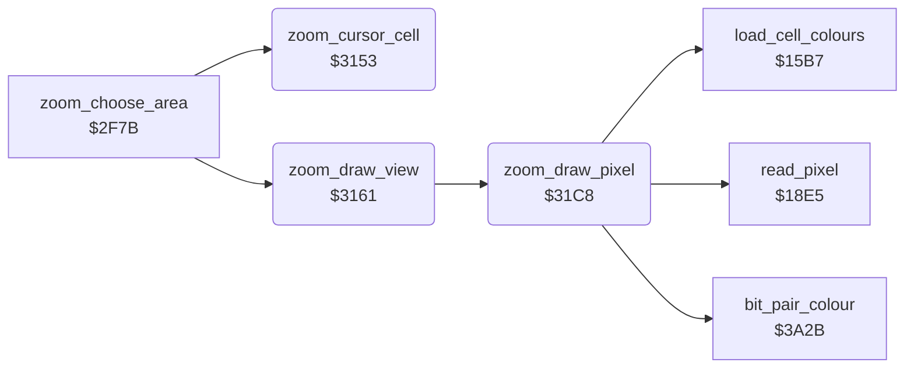

<!-- Generated by c64-docs from knowledge revision 20261024T063946.176-sfrhxb and .c64-re-tools/local/generated/src/source-map.json. Do not edit: change the knowledge, generate the source again, then run docs.ts generate. -->
# zoom/zoom_view.asm: Zoom: magnified view and its scripts

Range `$3153-$32E9`. Source: [zoom/zoom_view.asm](../../../../src/zoom/zoom_view.asm). Index: [the reference](../../index.md).

## Call graph

A solid arrow is a call, a thick arrow a table entry, a dotted arrow a jump. Rounded nodes are in this file.

## Data

| Range | Type | Name | Read by | Written by |
|---|---|---|---|---|
| [`$31FA`](../../../../src/zoom/zoom_view.asm#L110)-`$32E9` | bytes | [`zoom_open_script`](../../../../src/zoom/zoom_view.asm#L109) |  |  |

## Names

### [`zoom_cursor_cell`](../../../../src/zoom/zoom_view.asm#L6) `$3153`

*routine*

Gives the text cell of the cursor: zoom_row = cursor_y / 8, zoom_column = cursor_x / 4.

- **Called from:** [`zoom_choose_area`](zoom_choose_area.md#zoom_choose_area) [`$2FB6`](../../../../src/zoom/zoom_choose_area.asm#L36)
- **Reads:** [`cursor_y`](../../memory-map.md#cursor_y), [`cursor_x`](../../memory-map.md#cursor_x)
- **Writes:** [`zoom_row`](../../memory-map.md#zoom_row), [`zoom_column`](../../memory-map.md#zoom_column)

### [`zoom_draw_view`](../../../../src/zoom/zoom_view.asm#L18) `$3161`

*routine*

Draws the magnified view: 34 pixels by 25 lines of the preview from (zoom_left, zoom_top). Each pixel is a half cell of the view at $5d6b: the screen byte holds 2 colours, the upper half of the cell shows the high nybble and the lower half the low nybble. The first line goes into the low nybbles of the first view row, then each pair of lines goes into one view row. At the end current_colour gets the border colour again.

- **Called from:** [`zoom_choose_area`](zoom_choose_area.md#zoom_choose_area) [`$305B`](../../../../src/zoom/zoom_choose_area.asm#L129), [`zoom_choose_area`](zoom_choose_area.md#zoom_choose_area) [`$30A6`](../../../../src/zoom/zoom_choose_area.asm#L172), [`zoom_choose_area`](zoom_choose_area.md#zoom_choose_area) [`$30F0`](../../../../src/zoom/zoom_choose_area.asm#L212)
- **Calls:** [`zoom_draw_pixel`](zoom_view.md#zoom_draw_pixel)
- **Reads:** [`zoom_left`](../../memory-map.md#zoom_left), [`zoom_top`](../../memory-map.md#zoom_top), [`script_dest_ptr`](../../memory-map.md#script_dest_ptr), [`script_dest_ptr+1`](../../memory-map.md#script_dest_ptr), [`script_step_x`](../../memory-map.md#script_step_x), [`zoom_pixel_y`](../../memory-map.md#zoom_pixel_y), [`zoom_first_parity`](../../memory-map.md#zoom_first_parity), [`script_src_ptr`](../../memory-map.md#script_src_ptr), [`FAC1+4`](../../memory-map.md#FAC1), [`script_step_y`](../../memory-map.md#script_step_y), [`EXTCOL`](../../memory-map.md#EXTCOL)
- **Writes:** [`zoom_pixel_x`](../../memory-map.md#zoom_pixel_x), [`zoom_pixel_y`](../../memory-map.md#zoom_pixel_y), [`zoom_first_parity`](../../memory-map.md#zoom_first_parity), [`zoom_line_parity`](../../memory-map.md#zoom_line_parity), [`script_dest_ptr`](../../memory-map.md#script_dest_ptr), [`script_src_ptr`](../../memory-map.md#script_src_ptr), [`script_dest_ptr+1`](../../memory-map.md#script_dest_ptr), [`FAC1+4`](../../memory-map.md#FAC1), [`script_step_y`](../../memory-map.md#script_step_y), [`script_step_x`](../../memory-map.md#script_step_x), [`current_colour`](../../memory-map.md#current_colour)

### [`zoom_draw_line`](../../../../src/zoom/zoom_view.asm#L34) `$317F`

*label*

34 pixels in each line.

- **Jumped to from:** [`zoom_draw_view`](zoom_view.md#zoom_draw_view) [`$31BE`](../../../../src/zoom/zoom_view.asm#L71)

### [`zoom_draw_pixel_loop`](../../../../src/zoom/zoom_view.asm#L37) `$3183`

*label*

- **Jumped to from:** [`zoom_draw_view`](zoom_view.md#zoom_draw_view) [`$318E`](../../../../src/zoom/zoom_view.asm#L44)

### [`zoom_draw_next_pixel`](../../../../src/zoom/zoom_view.asm#L42) `$318C`

*label*

- **Jumped to from:** [`zoom_draw_view`](zoom_view.md#zoom_draw_view) [`$3188`](../../../../src/zoom/zoom_view.asm#L40)

### [`zoom_draw_next_row`](../../../../src/zoom/zoom_view.asm#L58) `$31AB`

*label*

Other parity: the next view row (34 + 6 = 40 bytes).

- **Jumped to from:** [`zoom_draw_view`](zoom_view.md#zoom_draw_view) [`$319E`](../../../../src/zoom/zoom_view.asm#L52)

### [`zoom_draw_line_done`](../../../../src/zoom/zoom_view.asm#L67) `$31B8`

*label*

- **Jumped to from:** [`zoom_draw_view`](zoom_view.md#zoom_draw_view) [`$31A8`](../../../../src/zoom/zoom_view.asm#L57), [`zoom_draw_view`](zoom_view.md#zoom_draw_view) [`$31B4`](../../../../src/zoom/zoom_view.asm#L64)

### [`zoom_draw_pixel`](../../../../src/zoom/zoom_view.asm#L77) `$31C8`

*routine*

Reads the pixel (zoom_pixel_x, zoom_pixel_y) of the picture, gets its colour with bit_pair_colour, and writes the colour into the high or the low nybble of the view cell at script_dest_ptr. Increments zoom_pixel_x.

- **Called from:** [`zoom_draw_view`](zoom_view.md#zoom_draw_view) [`$3183`](../../../../src/zoom/zoom_view.asm#L38)
- **Calls:** [`read_pixel`](../graphics/pixel.md#read_pixel), [`load_cell_colours`](../graphics/colour_slots.md#load_cell_colours), [`bit_pair_colour`](../graphics/bit_pair_colour.md#bit_pair_colour)
- **Reads:** [`zoom_pixel_x`](../../memory-map.md#zoom_pixel_x), [`zoom_pixel_y`](../../memory-map.md#zoom_pixel_y), [`zoom_line_parity`](../../memory-map.md#zoom_line_parity), [`zoom_first_parity`](../../memory-map.md#zoom_first_parity), [`script_dest_ptr`](../../memory-map.md#script_dest_ptr), [`temp_word`](../../memory-map.md#temp_word)
- **Writes:** [`zoom_pixel_x`](../../memory-map.md#zoom_pixel_x), [`temp_word`](../../memory-map.md#temp_word)

### [`zoom_store_nybble`](../../../../src/zoom/zoom_view.asm#L97) `$31E9`

*label*

- **Jumped to from:** [`zoom_draw_pixel`](zoom_view.md#zoom_draw_pixel) [`$31F7`](../../../../src/zoom/zoom_view.asm#L107)

### [`zoom_low_nybble`](../../../../src/zoom/zoom_view.asm#L103) `$31F2`

*label*

- **Jumped to from:** [`zoom_draw_pixel`](zoom_view.md#zoom_draw_pixel) [`$31DE`](../../../../src/zoom/zoom_view.asm#L89)

### [`zoom_open_script`](../../../../src/zoom/zoom_view.asm#L109) `$31FA-$322D`

*data*

Script of the zoom start ($2f7b): it clears 384 bytes of sprite data at $5800, writes $00 to $d026 and builds the sprite shapes of the zoom cursor at $5800-$597f (sub-scripts $32c4, $32cd).

### [`zoom_view_script`](../../../../src/zoom/zoom_view.asm#L118) `$322E-$32A8`

*data*

Script of the zoom screen. 6 arguments at $4f47-$4f4c: colour RAM, screen and bitmap address of the first preview row. Op $08 $1ed7 copies the bitmap to $a000. When script_flag is 0, it copies 9 rows of bitmap, screen and colour RAM from the arguments to the top of the screen (the preview). Then it fills rows 9-24 (bitmap $ff, screen and colour RAM $cc), puts the half-cell pattern of the view into the cells from $6b58 (sub-script $3268) and draws more parts of the screen (scripts $236d, $2e9f) and sprite shapes at $5983 and $59c3.

### [`zoom_close_script`](../../../../src/zoom/zoom_view.asm#L137) `$32A9-$32E9`

*data*

Script of the zoom end. 6 arguments at $4f47-$4f4c: the bitmap copy, screen colour and colour RAM targets. It copies the 9 preview rows of the bitmap ($6000), the screen ($5c00) and the colour RAM ($d800) to the targets.
