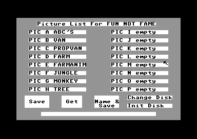
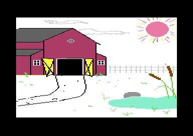
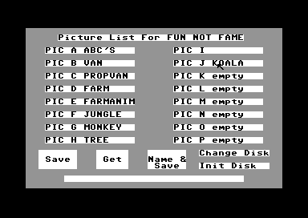
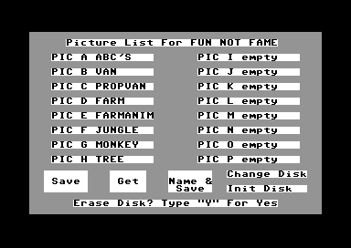

# Storage: the disk menu

The Storage screen is the disk menu of Koala Painter. It shows a list of the pictures on the disk in drive 8, in 16 slots. The player selects an action (Save, Get or Name & Save) and then a slot. Two more buttons read the directory again (Change Disk) and format the disk (Init Disk). The program needs this screen because the KoalaPad is its only input: a menu of cells replaces the commands of BASIC. The keyboard is necessary only for a picture name and a disk name.

**Conventions.**
- Addresses are C64 addresses. Names are the names of the knowledge.
- A *slot* is one of the 16 fields of the list: PIC A-H in the left column, PIC I-P in the right column. The slot number is 1-16, in the sequence A, B ... H, I ... P.
- The *first empty slot* is the slot after the last picture of the list (`storage_free_slot`).
- A *press* is a press of a KoalaPad button on a cell. A *long press off the pad* is a button that the player holds while the pen does not touch the pad.
- The *action* is the value of `storage_action`: 0 none, 1 Save, 2 Get, 3 Name & Save.
- **Observed** marks a fact that a run showed. **Code** marks a fact from the code only. **Conclusion** marks an interpretation.



The Storage screen after the directory read: the disk name in the title line, eight pictures and eight empty slots.

## How it works

~~~mermaid
flowchart TB
  A["Menu: the Storage cell (cmd_storage)"] --> B["Draw the screen, send I to the drive"]
  B --> C["Read the directory into the slots"]
  C --> D["Storage loop: wait for a press"]
  D -->|"Save, Get, Name & Save"| E["Select the action"]
  E --> D
  D -->|"a slot"| F["Save or load the picture"]
  F --> D
  D -->|"Change Disk"| B
  D -->|"Init Disk"| G["Questions, then N0 to the drive"]
  G --> B
  D -->|"long press off the pad"| A
~~~

The menu command $0F runs [`cmd_storage` `$0C30`](../src/menu/menu.asm#L163). It calls [`storage_screen` `$2A09`](../src/storage/storage_screen.asm#L6) and draws the menu again when Storage returns. Before the command, the menu copies the picture into the undo buffer, as for each command except Oops (**Code**). Thus Oops after a Get possibly restores the picture from before the Get (**Conclusion**, no run did it).

`storage_screen` does these steps:

1. It sets the hit table of the screen to `storage_hit_table`. The menu code then reads the Storage cells.
2. It runs the script [`storage_screen_script` `$23AC`](../src/script/storage_screen.asm#L6). The script fills the screen with character $81. It writes the title "Picture List For", the five buttons and "PIC x empty" in each slot.
3. It sends the command "I" (initialize) on channel 15 and reads the drive status. A status that is not 00 shows the message of the drive, and the list stays empty (**Code**).
4. It reads the directory and fills the slots (see the next section).
5. It clears the action and runs the Storage loop. The loop returns to the menu after a long press off the pad.

Change Disk jumps to the start of `storage_screen` again. It does not call it, so the stack does not grow (**Code**). Change Disk therefore also shows the directory of the disk that is in the drive now.

### The directory read

The program reads the directory with the KERNAL serial routines, not with LOAD. It sets the file name "$", sets the secondary address 0 (the byte $60) and opens the file with the KERNAL routine at `$F3D5`. Then it sends TALK and reads each byte with ACPTR (**Code**).

The read in [`storage_read_directory` `$2A29`](../src/storage/storage_screen.asm#L22) uses the quotes of the directory lines:

1. It skips to the first quote. The bytes up to the next quote are the disk name, at most 12 characters. They go to row 1, column 22 of the screen, after "Picture List For".
2. For each next line, it skips to the quote. It compares the first 5 bytes of the name with `pic_name_prefix`: $81 "PIC ".
3. When the 5 bytes agree, it copies them and the next 10 bytes into `dir_entry_buffer`. A script copies the 15 bytes into the next slot, and `storage_free_slot` increases by 1.
4. When a byte does not agree, it skips the line up to its zero byte.
5. A KERNAL status that is not 0 ends the read. The last line ("BLOCKS FREE.") has no quote, so the skip to the quote reads to the end of the file.

The loop has no limit of 16 (**Code**). A disk with 17 or more PIC files gives slot 17, and `set_slot_position` puts it on row 9 of the right column. That row has the Change Disk button (**Conclusion**, no run did it).

The list shows the pictures in the sequence of the directory, not in the sequence of the letters. The letter is a part of the file name, so a slot can show any letter (**Code**). The run after a save shows this (see [What the runs showed](#what-the-runs-showed)).

### The file names

A Koala Painter file name has 15 bytes. Each byte goes unchanged from the directory to the screen, and from the screen into the file name (**Code**):

| Bytes | Value | Meaning |
|---|---|---|
| 0 | `$81` | Mark of a Koala Painter picture. |
| 1-4 | `PIC ` | The fixed text. |
| 5 | `A`-`P` | The letter of the slot. |
| 6 | space | |
| 7-14 | 8 characters | The name of the picture, with spaces after it. |

$81 is the screen character that fills the Storage screen. Thus the mark at the start of each slot field looks like the background (**Conclusion**). In PETSCII, $81 is the control code of the colour orange, so a user cannot easily type it in BASIC (**Conclusion**).

The program does not change the letter of a slot. A save into the first empty slot uses the letter that the screen script wrote at that position. With another file sequence, this letter can be the letter of a file in the list (**Conclusion**, no run did it). The names then differ only in bytes 7-14.

### Save, Get and Name & Save

A press on Save, Get or Name & Save only sets the action and the label of the cursor ("save", "get" or "name"). The next press on a slot does the action. In [`storage_press` `$2B0E`](../src/storage/storage_screen.asm#L145), a press on an empty slot after the first empty slot selects the first empty slot (**Code**). Thus the list has no gaps.

- **Save.** [`storage_save_slot` `$2BCC`](../src/storage/storage_screen.asm#L244) shows "Saving Picture" and marks the slot. The first empty slot gets 9 spaces after its letter, so a plain Save gives a picture without a name (**Observed**). A slot with a picture gets the command "S0:" and the old name first: the drive scratches the old file (**Code**, no run did it).
- **Get.** [`storage_get_slot` `$2C06`](../src/storage/storage_screen.asm#L277) shows "Getting Picture" and loads the file of the slot. A press on an empty slot does nothing, and the action stays Get (**Code**).
- **Name & Save.** [`storage_name_save_slot` `$2C3D`](../src/storage/storage_screen.asm#L314) clears the name in the slot field and draws a caret under it. The player types the name in the slot field, then the program saves as Save does (**Observed**). `storage_named_slot` keeps the number of the slot, so Save does not clear the new name (**Code**).

After a transfer with the drive status 00, the program clears the mark and the message line. It also clears the action. Each transfer thus needs a new press on Save or Get (**Code**). The FARM picture after Get PIC D:



The FARM sample picture of the Mayday! disk, in the picture screen after the Get.

### The key entry

[`enter_text` `$2CDA`](../src/storage/storage_screen.asm#L407) reads the name for Name & Save (at most 8 characters) and the disk name for Init Disk (at most 12 characters). It uses `wait_key`, which sets `scan_keys_enable` so that the interrupt calls SCNKEY. `wait_key` waits for 10 empty GETIN results, then for a key, and then stops the scan (**Code**). The keyboard thus has no effect while `wait_key` does not run.

The entry takes the codes $20-$5A: the space, the digits, the punctuation and the unshifted letters. DEL removes the last character. RETURN ends the entry. RETURN with no characters cancels the entry, and the program reads the directory again (**Code**).



The list after Save as PIC I (no name) and Name & Save as PIC J with the name KOALA.

### Change Disk and Init Disk

Change Disk reads the directory again, as described in [How it works](#how-it-works). Init Disk in [`storage_init_disk` `$2B69`](../src/storage/storage_screen.asm#L193) formats the disk after two questions:

1. It shows `Erase Disk? Type "Y" For Yes` and waits for a key. Each key except `Y` reads the directory again and formats nothing.
2. It shows "Enter Disk Name:" and reads a name of 1-12 characters on the message line.
3. The script `build_format_command` writes "N0:", the 12 characters of the name, "," and the first 2 characters of the name into `disk_command`. The ID of the disk is thus the start of its name.
4. `format_disk` shows "Formatting Disk" and sends the 18 bytes of `disk_command` on channel 15.
5. When the drive status is 00, the program reads the directory of the new disk.



The first question of Init Disk.

### The drive status and the messages

[`drive_status` `$3ADF`](../src/storage/drive_status.asm#L6) reads the status of drive 8 on channel 15 with TALK and TKSA $6F. Before each read, `check_drive_status` writes "Error" and 23 spaces into `drive_message`. `drive_status` writes the number, a space for the first comma, and the text. It stops at the second comma, so the track and the sector are not in the message. The carry is clear only for the status 00 (**Code**).

A drive error thus gives a message such as "Error 62 FILE NOT FOUND" on the message line (**Conclusion**, no run showed an error). The KERNAL errors of a transfer have their own texts in [`storage_kernal_error` `$2AE8`](../src/storage/storage_screen.asm#L122):

| Source | Text |
|---|---|
| Drive status not 00 | "Error", the number and the text of the drive |
| No device answers | "Device Not Present" |
| KERNAL error 4 | "File not found" |
| Each other KERNAL error | "error" |
| No caller (unused) | "Disk Not Initialized" |

No code uses the script `disk_not_initialized` (**Code**).

## The picture file

The shared page [../../docs/koala_format.md](../../docs/koala_format.md) describes the Koala file. Storage needs only its ranges. While the menu shows, the program keeps the picture in two parts of RAM: the bitmap at `$6000-$7F3F` and the colours at `$C000-$C7D0` (`save_colours_script` copies them there). The file holds both parts after its load address (**Code**):

| File bytes | RAM | Content |
|---|---|---|
| 0-1 | | Load address `$6000` |
| 2-8001 | `$6000-$7F3F` | The bitmap, 8000 bytes |
| 8002-9001 | `$C000-$C3E7` | The screen colours, 1000 bytes |
| 9002-10001 | `$C3E8-$C7CF` | The colour RAM, 1000 bytes |
| 10002 | `$C7D0` | The background colour |

The file has 10003 bytes. `set_picture_file` sets the name to the 15 bytes of the slot field, the logical file 5 and device 8.

[`save_picture` `$3351`](../src/storage/picture_file.asm#L28) opens the file with the secondary address 1 (the byte $61 on the bus). It reads the drive status, then sends the load address and the two ranges with CIOUT. The KERNAL SAVE can send only one range, so the program sends the bytes itself (**Conclusion**). The STOP key ends the save.

[`load_picture` `$33A6`](../src/storage/picture_file.asm#L73) opens the file with the secondary address 0 (the byte $60 on the bus). It reads the two bytes of the load address and does not use them. Then it reads 8000 bytes to `$6000` and 2001 bytes to `$C000`. A timeout on the first byte gives the KERNAL error FILE NOT FOUND. A timeout on another byte makes it read the byte again (**Code**).

The range of the colours ends at `$C7D0`. `drive_message` starts at `$C7D1`, directly after the picture (**Code**). The details of each routine are in the reference: [storage_screen](reference/modules/storage/storage_screen.md), [picture_file](reference/modules/storage/picture_file.md) and [drive_status](reference/modules/storage/drive_status.md).

## The data

The hit table `storage_hit_table` starts with the count $15 (21 cells). Each cell has 5 bytes: Y max, Y min, X end, X min and the code. The codes of the slots PIC A-P are $81-$90. The codes $01-$05 are Save, Get, Name & Save, Change Disk and Init Disk. The slot number is the code AND $1F. The cell of PIC P starts at X $0C, as the left column does. The cell of PIC H comes first in the table, so it gets the presses on the left half of row 8 (**Code**).

| Buffer | Address | Bytes | Content |
|---|---|---|---|
| `dir_entry_buffer` | `$CC00` | 15 | The name of the directory line that the read compares |
| `disk_command` | `$4F6E` | 18 | "N0:" + 12 + "," + 2, or "S0:" + 15 |
| `drive_message` | `$C7D1` | 28 | "Error", a space and the drive status |
| `drive_status_text` | `$C7D7` | | The part of `drive_message` that the drive writes |

## The state machine of the Storage screen

The Storage loop in [`storage_loop` `$2B05`](../src/storage/storage_screen.asm#L139) waits for a press. `storage_press` makes each change. Each press first clears the marks and the message line.

~~~mermaid
stateDiagram-v2
  state "Read the directory" as Read
  state "Idle (action 0)" as Idle
  state "Save chosen (1)" as Save
  state "Get chosen (2)" as Get
  state "Name chosen (3)" as Name
  state "Name entry" as NameEntry
  state "Transfer" as Transfer
  state "Format question" as Erase
  state "Disk name entry" as DiskName
  state "Format" as Format
  [*] --> Read
  Read --> Idle: end of the directory
  Idle --> Save: Save
  Idle --> Get: Get
  Idle --> Name: Name and Save
  Save --> Transfer: a slot
  Get --> Transfer: a slot with a picture
  Name --> NameEntry: a slot
  NameEntry --> Transfer: RETURN, 1-8 characters
  NameEntry --> Read: RETURN, no characters
  Transfer --> Idle: status 00 or drive error
  Transfer --> Save: KERNAL error in a save
  Transfer --> Get: KERNAL error in a load
  Idle --> Erase: Init Disk
  Erase --> DiskName: Y
  Erase --> Read: other key
  DiskName --> Format: RETURN, 1-12 characters
  Format --> Read: status 00
  Idle --> Read: Change Disk
  Idle --> [*]: long press off the pad
~~~

The diagram shows Change Disk, Init Disk and the long press only from Idle. They work the same in the three action states. A press on a button changes the action from each action state. A KERNAL error keeps the action that the player selected, Save or Get.

| State | Condition | Next state | Code |
|---|---|---|---|
| Read the directory | Status 00, end of the directory | Idle `0` | `storage_directory_close` |
| Read the directory | Drive status not 00 | Idle `0`, message shown | `storage_show_error` |
| Each loop state | Press on Save, Get, Name & Save | Save `1`, Get `2`, Name `3` | `storage_choose_save`, `storage_choose_get`, `storage_choose_name_save` |
| Each loop state | Press on no cell | Idle `0` | `storage_idle` |
| Each loop state | Press on Change Disk | Read the directory | `storage_screen` |
| Each loop state | Press on Init Disk | Format question | `storage_init_disk` |
| Each loop state | Long press off the pad | Return to the menu | `storage_loop` |
| Idle `0` | Press on a slot | Idle `0` | `storage_slot_chosen` |
| Save `1` | Press on a slot | Transfer (save) | `storage_save_slot` |
| Get `2` | Press on a slot with a picture | Transfer (load) | `storage_get_slot` |
| Get `2` | Press on an empty slot | Get `2` | `storage_get_slot` |
| Name `3` | Press on a slot | Name entry | `storage_name_save_slot` |
| Name entry | RETURN after 1-8 characters | Transfer (save) | `storage_name_new_slot` |
| Name entry | RETURN with no characters | Read the directory | `storage_name_cancel` |
| Transfer | Drive status 00 | Idle `0` | `storage_clear_message` |
| Transfer | Drive status not 00 | Idle `0`, message shown | `storage_show_error` |
| Transfer | KERNAL error (carry set) | Same action, message shown | `storage_kernal_error` |
| Format question | Key `Y` | Disk name entry | `storage_init_disk` |
| Format question | Another key | Read the directory | `storage_init_disk_exit` |
| Disk name entry | RETURN after 1-12 characters | Format | `format_disk` |
| Disk name entry | RETURN with no characters | Read the directory | `storage_init_disk_exit` |
| Format | Drive status 00 | Read the directory | `storage_init_disk_exit` |
| Format | Drive status not 00 | Idle `0`, message shown | `storage_show_error` |

## What the runs showed

Two runs start from a snapshot of the main menu with a copy of the Mayday! disk in drive 8. The disk has eight pictures, PIC A-H. The runs give KoalaPad input with the joystick hook of the recordings, and they type keys for the names. The details are in [../tests/README.md](../tests/README.md).

The first run makes a round trip through the disk:

1. Get PIC D (FARM). The bitmap `$6000-$7F3F` and `$C000-$C7D0` then hold the bytes of the file on the disk (**Observed**).
2. Save the picture into the first empty slot. The new file is PIC I, without a name (**Observed**).
3. Get PIC A. The bitmap and the colours change (**Observed**).
4. Get PIC I. Memory holds the bytes of PIC D again (**Observed**). The test compares only the low 4 bits of the colour RAM bytes. The colour RAM keeps 4 bits, so the save writes other upper bits than the file of the disk has (**Observed**).
5. Name & Save with the name KOALA. The slot shows "PIC J KOALA" (**Observed**).
6. Change Disk. The list now has PIC I in slot 2, and PIC B-H move one slot down. PIC J KOALA stays in slot 10 (**Observed**).

Thus a save adds the slot at the end of the list, but the drive can put the file into an earlier directory entry. Here the drive used the second entry, which was free on the disk (**Conclusion**). The list shows the true sequence only after the next directory read.

The second run selects Init Disk, types `Y` and the disk name PAINT. The screen shows "Formatting Disk". After the format, the title line shows "Picture List For PAINT", and all 16 slots are empty (**Observed**).

## The worked example

The file name of PIC J from the first run, byte by byte (**Code**). The prefix comes from `pic_name_prefix`, the letter from the screen script, and the name from the key entry:

| Byte | 0 | 1 | 2 | 3 | 4 | 5 | 6 | 7 | 8 | 9 | 10 | 11 | 12-14 |
|---|---|---|---|---|---|---|---|---|---|---|---|---|---|
| Value | `$81` | `$50` | `$49` | `$43` | `$20` | `$4A` | `$20` | `$4B` | `$4F` | `$41` | `$4C` | `$41` | `$20` |
| Text | mark | P | I | C | space | J | space | K | O | A | L | A | spaces |

The disk command of the second run has 18 bytes. The disk name field has 12 characters, so PAINT gets 7 spaces (**Code**):

```
4E 30 3A  50 41 49 4E 54 20 20 20 20 20 20 20  2C  50 41
 N  0  :   P  A  I  N  T  (7 spaces)            ,   P  A
```

## Still open

- The scratch and save over a slot with a picture — a run that saves into PIC A and reads the directory again.
- The text of a drive error on the message line — a Get with no disk in the drive.
- The effect of 17 or more PIC files on one disk — a run with a disk that has 17 Koala files.
- A duplicate letter after a directory in another sequence — a save into the first empty slot after the run above, then Change Disk.
- Oops after a Get — a run that does Get, then Oops in the menu, and compares the picture.
