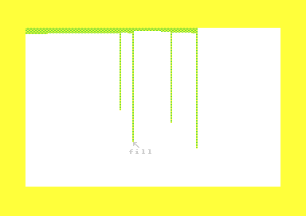
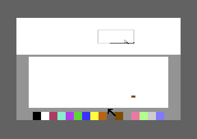

# The drawing tools

The menu of Koala Painter has 16 tools that change the picture. Each section of this page tells how the user operates one tool with the pad and the button. It also tells what the code does, which buffers the tool uses, and the facts that a user does not expect. The Storage tool loads and saves pictures. It has its own page: [storage.md](storage.md). The menu is on [menu.md](menu.md). The pixels, the colours and the brushes are on [pixels.md](pixels.md). The reference lists each routine and variable: [reference/index.md](reference/index.md).

**Conventions.**
- Addresses are C64 addresses. Names are the names of the knowledge.
- The *pad* is the KoalaPad. The *pen* touches the pad. A *press* is the moment when a pad button goes down. The two buttons have the same effect.
- A *long press* is a button that is down while the pen is off the pad for 16 reads. It changes between the menu and the picture.
- A *band* is a shape that a tool draws with XOR while the user moves the cursor. A second XOR draw at the same place restores the pixels.
- A *session* is the time from the start of a tool to the return to the menu.
- A *cell* is a 4x8 block of the multicolour bitmap. It has the background colour and 3 colour slots.
- **Observed** marks a fact that a run showed. **Code** marks a fact from the code only. **Conclusion** marks an interpretation.

## How a tool runs

All tools share one frame: the menu starts them, the undo buffer keeps the old picture, and one routine returns to the menu.

~~~mermaid
flowchart TB
  A["Press on a tool cell in the menu"] --> B["Long press: show the picture"]
  A --> C["Codes $0B-$11: run at once"]
  B --> D["Copy the picture to the undo buffer"]
  C --> D
  D --> E["Tool loop: band with XOR, shape with the brush"]
  E --> F["Long press: back to the menu (tool_exit)"]
~~~

1. **The menu selects the tool.** A press on the cells of codes 1-`$0A` (Draw to Xcolor) makes the cell flash. The picture shows only after a long press. The cells of the codes `$0B`-`$11` run their command at the press. Erase needs two presses (**Code**). The recordings of Copy, Swap and Zoom go to the picture without the long press (**Observed**).
2. **The command saves the picture.** [`run_command` `$0BBB`](../src/menu/menu.asm#L100) runs [`save_undo_script` `$1E93`](../src/script/picture_buffers.asm#L76) before each command. Oops does not run it. The command after an Erase also does not run it (**Code**).
3. **The tool shows the picture.** `start_tool` puts the label of the tool under the cursor and shows the bitmap. For the codes 1-6, the cursor also shows the selected brush (**Code**).
4. **The tool draws.** Most tools take the first point with [`wait_first_point` `$1168`](../src/tools/line_tool.asm#L186). A band follows the cursor until the next press. Then the tool draws the final shape in the selected colour (**Code**).
5. **A long press ends the session.** [`tool_exit` `$1495`](../src/tools/tool_exit.asm#L6) sets Mirror again when the user selected it. It saves the colours of the picture and draws the menu (**Code**).

The bands use the background colour and the XOR plot of `draw_line_xor`. XOR inverts both bits of each pixel, so a second draw restores the picture. The final shapes use `plot_brush`, which plots the selected brush and the dither pattern (**Code**).

A cell has only 3 colour slots. When a tool paints a fourth colour into a cell, [`get_colour_slot` `$1525`](../src/graphics/colour_slots.asm#L6) gives the new colour to the slot with the fewest pixels. All pixels of that slot then change colour. This is true for each tool that paints (**Code**). The details are on [pixels.md](pixels.md).

| Buffer | Range | Content | Tools |
|---|---|---|---|
| Undo | `$8000-$9F3F`, `$D000-$D7E8` | The picture at the start of the last command: bitmap, screen colours, colour RAM, background | all, Oops reads it, Copy reads it |
| Second picture | `$E000-$FF3F`, `$D800-$DFE8` | The picture behind the visible picture | Swap, Copy after Swap |
| Zoom save | `$A000-$BF3F` | The bitmap while the zoom screen shows | Zoom |
| Fill stack | `$C100-$CFEF` | 3 bytes for each pixel that waits: direction, X, Y | Fill |

The undo buffer and the second picture keep their colours in the RAM under the I/O area (**Code**).

### The two-point tools

Line, Frame, Box, Circle and Disc use the same three steps. The first press sets a point. The second press sets the size. Then the shape follows the cursor with the same size, and the third press draws it. After the third press, the tool waits for a new first point (**Code**).

~~~mermaid
stateDiagram-v2
  state "Wait for the first point" as First
  state "Band: set the size" as Size
  state "Band: move the shape" as Move
  state "Draw with the brush" as Draw
  [*] --> First
  First --> Size: press
  Size --> Move: press
  Move --> Draw: press
  Draw --> First
  First --> [*]: long press
  Size --> [*]: long press
  Move --> [*]: long press
~~~

| State | Condition | Next state | Code |
|---|---|---|---|
| Wait for the first point | press with the pen on the pad | Band: set the size | `wait_first_point` |
| Band: set the size | press | Band: move the shape | `line_rubber_band`, `rect_rubber_band`, `shape_drag_size` |
| Band: move the shape | press | Draw with the brush | `line_move`, `rect_move`, `shape_drag_move` |
| any band state | long press | the menu | `tool_exit` |

In the move step, the other point keeps its distance from the cursor. When that point reaches the edge of the picture, it stops there, and the shape changes its size (**Code**). No run reached the code that stops the point at the edge.

## Draw

Draw paints a free line with the brush. While the button is up, the start of the line follows the cursor. While the button is down, each read of the pad draws a line from the last point to the cursor (**Code**).

[`tool_draw` `$1444`](../src/tools/draw_tool.asm#L6) uses `draw_line_brush`, so a fast movement gives a line and not a row of dots. It uses no band. Its only buffer is the undo buffer (**Code**).

- **A jump of the pen draws nothing.** [`points_near` `$14B2`](../src/tools/tool_exit.asm#L23) compares the two points. When they differ by 25 pixels or more on one axis, the tool moves the last point and draws no line (**Code**). This stops a line across the picture when the pen jumps (**Conclusion**).
- **The exit needs a new press.** Draw checks for the long press only while the button is up. The user must release the button with the pen off the pad, then press again (**Code**).

## Line

Line draws one straight line. The first press sets the start, the second press sets the end, and the third press draws the line where the band is (**Code**). The recordings do a drag and three taps (**Observed**).

[`tool_line` `$1025`](../src/tools/line_tool.asm#L6) follows the two-point steps. In the move step, the whole line moves with the cursor and keeps its length and its direction. The final line uses the selected brush. The buffer is the undo buffer (**Code**).

- **The line moves after the second press.** A user can expect the second press to draw the line. It only fixes the length. The third press draws it (**Code**).

## Lines

Lines draws connected lines. The first press sets the start. Each next press draws a line to the cursor, and the end of that line becomes the next start (**Code**).

[`cmd_lines` `$0DE2`](../src/tools/lines.asm#L6) uses `line_rubber_band` for the band, but it has no move step. It clears the band, draws the line with the brush, and starts a new band at the end point. The buffer is the undo buffer (**Code**).

- **Only a long press ends the chain.** A double press does not end it. The long press clears the last band and keeps the lines (**Code**).

## Rays

Rays draws lines from one centre. The first press sets the centre. While the button is up, a band line follows the cursor. While the button is down, the tool draws a line from the centre to the cursor at each read (**Code**).

[`cmd_rays` `$0E17`](../src/tools/rays.asm#L6) uses `draw_line_xor` for the band and `draw_line_brush` for the rays. The buffer is the undo buffer (**Code**).

- **Rays draws thicker lines.** The tool sets `line_fill_corners` to 1 for its session. Then each diagonal step of a line also plots the corner point. At the end, the tool restores the old value (**Code**).
- **One press with a movement gives a fan.** The tool draws a new ray at each read while the button is down, so a drag paints many rays (**Code**).

## Frame

Frame draws the outline of a rectangle. The first press sets a corner, the second press sets the opposite corner, and the third press draws the frame where the band is (**Code**).

[`tool_frame` `$11C9`](../src/tools/box_frame_tool.asm#L32) follows the two-point steps with `xor_rect` for the band. At the end, `brush_rect` draws the four sides with the selected brush. The buffer is the undo buffer (**Code**).

- **One corner of the band is missing.** `draw_rect` starts the second and the third side one pixel after their corner. The fourth side ends on the first corner. Thus the XOR band inverts that pixel two times, and it does not change (**Code**).

## Box

Box draws a filled rectangle. The user operates it as Frame: two corners, a move, and a third press (**Code**).

[`tool_box` `$1192`](../src/tools/box_frame_tool.asm#L6) uses the same band as Frame. At the end, [`fill_box` `$130E`](../src/tools/box_frame_tool.asm#L213) draws one horizontal line for each row of the rectangle. The buffer is the undo buffer (**Code**).

- **Box does not use the selected brush.** `fill_box` uses brush 0, one point, and restores the brush at the end. The cursor of Box does not show the brush (**Code**).
- **A dithered colour works.** Each point goes through the dither plot, so a box can have a 2x2 pattern of two colours (**Code**).

## Circle

Circle draws the outline of a circle. The user does three presses, as for Line: a point, the size, and the place (**Code**).

[`cmd_circle` `$0EE1`](../src/tools/circle.asm#L38) follows the two-point steps with `circle_xor` for the band. At the end, `circle_brush` draws the outline with the selected brush. The routine walks a quarter of the circle with the midpoint method and plots 4 points at each step. It multiplies the X offsets by 3/4. The buffer is the undo buffer (**Code**).

- **The cursor is the centre, not the first point.** [`circle_radius` `$3B41`](../src/graphics/circle.asm#L6) exchanges the two points before each draw. Thus the circle has its centre at the cursor, and the first point sets the size (**Code**). No run measured the centre.
- **The size is not a true distance.** The radius is the X distance plus the Y distance of the two points, at most `max_y`. A diagonal movement thus gives a larger circle than a straight movement of the same length (**Code**).

## Disc

Disc draws a filled circle. The user operates it as Circle (**Code**).

[`cmd_disc` `$0EA2`](../src/tools/circle.asm#L6) uses the same band and the same size as Circle. At the end, `disc_brush` draws two horizontal lines at each step of the circle, one in the upper half and one in the lower half. The buffer is the undo buffer (**Code**).

- **Disc does not use the selected brush.** It uses brush 0 for the lines and restores the brush at the end. The cursor of Disc does not show the brush (**Code**).
- **The disc can go past the edge.** The routine clips each line at the edge of the picture and skips the rows outside it (**Code**).

## Fill

Fill paints an area. The user moves the cursor to a pixel and presses. All connected pixels of the colour of that pixel get the selected colour, or the dither pattern (**Code**).

[`tool_fill` `$13F2`](../src/tools/fill_tool.asm#L6) calls [`flood_fill` `$3709`](../src/tools/fill.asm#L6). The fill paints one pixel at a time. It keeps the pixels that wait on a stack at `$C100-$CFEF`, with 3 bytes for each pixel: the direction, X and Y. For each pixel that it takes from the stack, it pushes the neighbours, but not the neighbour that it came from. The buffers are the undo buffer and the fill stack (**Code**).

- **A press stops the fill.** `fill_loop` reads the press of the interrupt before each pixel. A large area thus stays half painted when the user presses again too early (**Code**).
- **The stack has a limit.** With the stack pointer in page `$CE`, the fill discards the entries of painted pixels. From `$CFF0`, it pushes no more pixels, so a part of the area can stay unpainted (**Code**). No run reached this code.
- **The stack uses the colour copy.** While the menu shows, `$C000-$C7D0` holds the colours of the picture. During a tool the colours are at `$5C00` and `$D800`, and `tool_exit` saves them again. Thus the fill can use this RAM (**Conclusion**).
- **Fill changes the line style of the brush.** At its end, the fill sets `line_fill_corners` to 0. Until the next brush choice, the lines of the brushes that set it have no corner points (**Code**).
- **Mirror moves the start point.** In Mirror mode, Fill halves the cursor coordinates. The other tools fold them into the upper left quarter. No run reached this code (**Code**).
- **A fill in the same colour changes the pattern.** When the start pixel has the selected colour already, the fill exchanges the colours of the dither pattern. With a plain colour, it does nothing (**Code**).

## Xcolor

Xcolor changes one colour in all of the picture. The user moves the cursor to a pixel and presses. Each cell slot with the colour of that pixel gets the selected colour (**Code**).

[`tool_xcolor` `$166E`](../src/tools/xcolor_tool.asm#L6) reads the colour of the pixel. It then makes one of three changes. The buffer is the undo buffer (**Code**).

1. The pixel has the background colour. The background becomes the selected colour. Then [`clear_colour_pixels` `$1737`](../src/tools/xcolor_tool.asm#L122) sets to 0 the pixels of the old colour and of the new colour in each cell (**Code**). A run reached this case (**Observed**).
2. The selected colour is the background colour. The pixels of the old colour become background pixels (**Code**).
3. Other colours. The tool changes each screen nybble and colour RAM value of the old colour in the 1000 cells (**Code**). No run reached cases 2 and 3.

- **Xcolor is not a fill.** It changes the colour in all cells, also in areas that do not touch the cursor (**Code**).
- **A dithered colour gives one colour.** Xcolor writes only `current_colour`, the first colour of the pattern (**Code**).

## Mirror

Mirror is a switch. A press on its cell sets Mirror mode on or off and returns to the menu at once. While Mirror is on, its cell flashes (**Code**).

[`tool_mirror` `$162D`](../src/tools/mirror_oops_tool.asm#L6) calls `toggle_mirror_mode`. Mirror on sets the limits of the tools to the upper left quarter: X 0-79 and Y 0-99. [`read_cursor` `$19FB`](../src/input/cursor.asm#L58) folds the cursor into that quarter. Then each plot also plots the points (159 - X, Y), (159 - X, 199 - Y) and (X, 199 - Y). Mirror uses no buffer (**Code**). The mirror recording shows each mark four times (**Observed**).

- **The sprite does not fold.** The cursor sprite stays where the pen is, but the tool paints at the folded point and its 3 mirror points (**Code**).
- **Mirror also saves the undo buffer.** `run_command` saves the picture before Mirror. Thus an Oops after Mirror does not undo the shapes of the tool before Mirror (**Code**).
- **Copy and Zoom stop Mirror.** They set Mirror off for their session. The return to the menu sets it on again (**Code**).

## Copy

Copy copies a rectangle of the picture. The first press sets a corner and the second press sets the opposite corner. Then a frame of the same size follows the cursor. Each press copies the rectangle into the frame. A long press ends the tool (**Code**).

[`copy_tool` `$340E`](../src/tools/copy.asm#L6) uses `rect_rubber_band` for the rectangle and `copy_xor_frame` for the frame. [`copy_pixels` `$34EE`](../src/tools/copy.asm#L128) copies the pixels one at a time. The buffers are the undo buffer, the source of the copy, and the second picture after a Swap (**Code**).

- **Copy reads the old picture.** The source is the undo buffer at `$8000`, the picture at the start of the session. A copy of an area that got a copy in the same session gives the old content (**Code**).
- **The background is clear.** Source pixels with the bit pair 0 do not change the target (**Code**). The copy recording copied only such pixels: no run reached the code that copies a coloured pixel.
- **The colours can change.** Each copied pixel takes its colour through `get_colour_slot`. A fourth colour in a target cell changes the pixels of a slot (**Code**).
- **Copy after Swap copies between the pictures.** When the last command was Swap, the source is the second picture at `$E000`. The user marks the rectangle on the visible picture. Then the tool shows the second picture, and each press copies the rectangle into it. A long press swaps the pictures again and starts a new Copy (**Code**). No run reached this code.
- **The frame stops at the edge.** The frame ends at X `$9F` and Y `$C7`, and the copy then has a smaller size (**Code**).

## Swap

Swap shows the second picture in place of the picture. Each press exchanges the two pictures. A long press ends the tool (**Code**).

[`swap_tool` `$36A8`](../src/tools/swap.asm#L15) calls `swap_pictures`, which runs [`swap_script` `$36D2`](../src/tools/swap.asm#L36). The script exchanges the bitmap with `$E000`, the screen colours with `$D800`, the colour RAM with `$DC00` and the background with `$DFE8`. The buffers are the second picture and the undo buffer (**Code**).

- **The second picture starts empty.** At the start, the program copies the empty bitmap to `$E000` and puts a white background at `$DFE8` (**Code**).
- **The touch test has an error.** The code compares the A register with `$FF` in place of the cursor X. Thus a press can swap the pictures while the pen is off the pad, before the 16 reads of a long press (**Code**).
- **Oops after Swap can lose a picture.** The undo buffer holds the visible picture of the start of the session. After an odd number of swaps, Oops puts it back, and the second picture has the same content (**Conclusion**).

## Zoom

Zoom shows a part of the picture magnified, for work on single pixels. The first press selects the rows of the picture. Then the screen shows the rows at the top, a magnified view in the middle and colour cells at the bottom (**Code**).

[`cmd_zoom` `$0C39`](../src/menu/menu.asm#L168) calls [`zoom_choose_area` `$2F7B`](../src/zoom/zoom_choose_area.asm#L6). The press takes 9 text rows of the picture, from 3 rows above the cursor. The magnified view shows 34 pixels by 25 lines of these rows (**Code**).

1. A touch in the magnified view with the button down plots the selected brush at that picture point. Then the tool draws the view again (**Code**).
2. A touch in the rows at the top with the button down moves the magnified area (**Code**).
3. A press on a colour cell selects that colour (**Code**). No run reached cases 2 and 3.
4. A long press closes the zoom. [`zoom_close` `$3111`](../src/zoom/zoom_choose_area.asm#L231) writes the 9 rows back into the saved picture and shows it (**Code**).

The zoom screen uses the bitmap of the picture. Thus the program saves the bitmap at `$A000` while the zoom shows, and the colours at `$C000`. The buffers are the zoom save and the undo buffer (**Code**).

- **Only the 9 rows keep the changes.** The close copies only the rows of the top of the zoom screen back into the picture (**Code**).
- **Zoom paints with the brush.** The magnified view paints the selected brush, not one pixel (**Code**).

## Oops

Oops cancels the changes of the last command. A press on its cell restores the picture and returns to the menu at once (**Code**).

[`tool_oops` `$165E`](../src/tools/mirror_oops_tool.asm#L36) runs [`restore_undo_script` `$1EB5`](../src/script/picture_buffers.asm#L83). The script copies `$8000` to the bitmap, and the colours from `$D000`, `$D400` and `$D7E8` to their copies at `$C000`. The buffer is the undo buffer (**Code**).

- **Oops cancels a full session.** The program saves the picture only at the start of a command. Thus Oops cancels all shapes of the last session, not only the last shape (**Code**).
- **A second Oops does nothing.** Oops does not save the picture, so the undo buffer does not change. Oops is not a redo (**Code**).
- **Oops also cancels a Get.** Storage is a command, so Oops after a Get restores the picture before the Get (**Code**).

## Erase

Erase clears the picture. The first press on its cell only makes the cell flash. The second press clears the picture and returns to the menu (**Code**).

[`cmd_erase` `$0C24`](../src/menu/menu.asm#L157) runs [`new_picture_script` `$1E7C`](../src/script/picture_buffers.asm#L63). The script fills the bitmap with 0 and the screen colours and the colour RAM with fixed values. The buffer is the undo buffer (**Code**).

- **The first press is a safety step.** [`setflash_no_cell` `$0D4D`](../src/menu/flash.asm#L83) sets `erase_mode` at the first press, and runs Erase only when `erase_mode` is 1 already. A press on a tool cell clears it (**Code**).
- **Erase keeps the background colour.** The script does not change the background (**Code**).
- **The picture before Erase stays in the undo buffer.** The command after Erase does not save the picture. Thus Oops after a new drawing on the empty picture still restores the picture before Erase (**Code**).

## The tools

| Tool | Code | Routine | Buffers |
|---|---|---|---|
| Draw | `$01` | `tool_draw` | undo |
| Line | `$02` | `tool_line` | undo |
| Lines | `$03` | `cmd_lines` | undo |
| Frame | `$04` | `tool_frame` | undo |
| Circle | `$05` | `cmd_circle` | undo |
| Rays | `$06` | `cmd_rays` | undo |
| Box | `$07` | `tool_box` | undo |
| Disc | `$08` | `cmd_disc` | undo |
| Fill | `$09` | `tool_fill` | undo, fill stack `$C100` |
| Xcolor | `$0A` | `tool_xcolor` | undo |
| Copy | `$0B` | `copy_tool` | undo (source), Swap picture `$E000` after Swap |
| Zoom | `$0C` | `cmd_zoom` | undo, Zoom save `$A000` |
| Mirror | `$0D` | `tool_mirror` | undo |
| Swap | `$0E` | `swap_tool` | undo, Swap picture `$E000` |
| Oops | `$10` | `tool_oops` | undo (read only) |
| Erase | `$11` | `cmd_erase` | undo |
